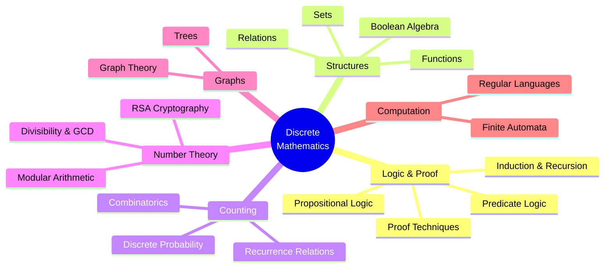
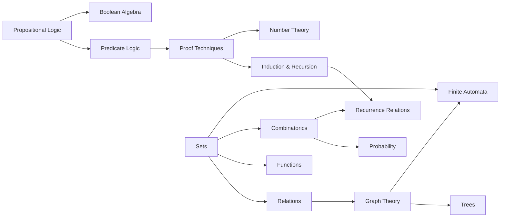
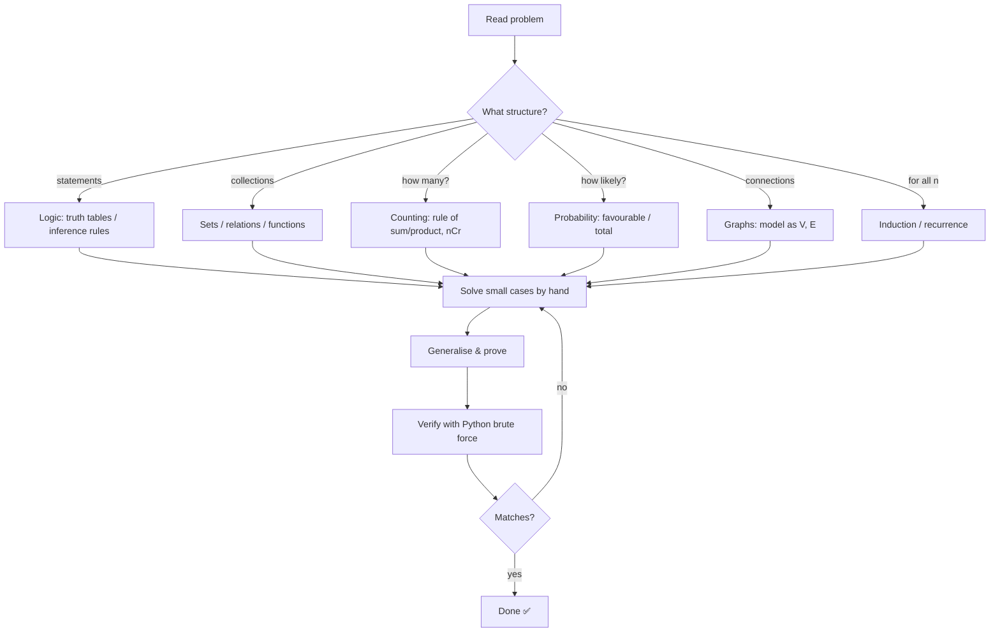

# 🧭 Discrete Mathematics — Map of Content

> [!abstract] What is discrete mathematics?
> The mathematics of **countable, separate** structures — integers, graphs, logical statements, finite sets — as opposed to continuous ones (real numbers, calculus). It is the mathematical foundation of **computer science**: algorithms, data structures, databases, cryptography, networking, compilers and AI all rest on it.

## 🗺️ Mind Map of the Whole Subject

## 📚 Notes (suggested study order)

| #   | Note                                       | Core idea                                  | CS application                    |
| --- | ------------------------------------------ | ------------------------------------------ | --------------------------------- |
| 1   | [[01 - Propositional Logic]]               | True/false statements & connectives        | `if` conditions, circuits, SAT    |
| 2   | [[02 - Predicate Logic and Quantifiers]]   | ∀, ∃, predicates over domains              | SQL, specifications, `all()/any()`|
| 3   | [[03 - Proof Techniques]]                  | Direct, contrapositive, contradiction      | Algorithm correctness             |
| 4   | [[04 - Sets]]                              | Collections, ∪ ∩ −, power sets             | Python `set`, databases           |
| 5   | [[05 - Relations]]                         | Reflexive, symmetric, transitive, closures | Relational DBs, dependency graphs |
| 6   | [[06 - Functions]]                         | Injective, surjective, bijective           | Hashing, encodings                |
| 7   | [[07 - Mathematical Induction and Recursion]] | Prove for all n; define recursively     | Recursive algorithms, loops       |
| 8   | [[08 - Counting and Combinatorics]]        | Permutations, combinations, pigeonhole     | Complexity, password strength     |
| 9   | [[09 - Discrete Probability]]              | Sample spaces, Bayes, expectation          | ML, randomized algorithms         |
| 10  | [[10 - Number Theory and Cryptography]]    | GCD, mod, primes, RSA                      | Security, hashing, checksums      |
| 11  | [[11 - Recurrence Relations]]              | Sequences defined by earlier terms         | Running time of divide & conquer  |
| 12  | [[12 - Graph Theory]]                      | Vertices, edges, paths, coloring           | Maps, networks, social graphs     |
| 13  | [[13 - Trees]]                             | Acyclic connected graphs, traversals, MST  | File systems, BSTs, Huffman       |
| 14  | [[14 - Boolean Algebra]]                   | Laws, normal forms, K-maps                 | Digital logic, query optimisation |
| 15  | [[15 - Finite Automata and Regular Languages]] | DFA, NFA, regex                        | Lexers, regex engines, protocols  |

## 🔗 How the Topics Depend on Each Other

## 🧠 Standard Workflow for Solving Any Discrete Math Problem

## 🛠️ How to Use This Vault

- Each note has the same sections: **Concepts → Examples → Mind Map → Workflow → Real-Life Examples → Python → Test Cases → Practice → Summary**.
- Mermaid diagrams render natively in Obsidian (Reading view or Live Preview).
- The Python blocks in each note run together as one module. Test functions use plain `assert`s; run them all with `python scripts/verify_notes.py`.
- Use the tag pane: `#discrete-math` plus a topic tag on each note.

## 📖 Recommended References

- Kenneth Rosen — *Discrete Mathematics and Its Applications*
- Susanna Epp — *Discrete Mathematics with Applications*
- MIT 6.042J — *Mathematics for Computer Science* (Lehman, Leighton, Meyer)
