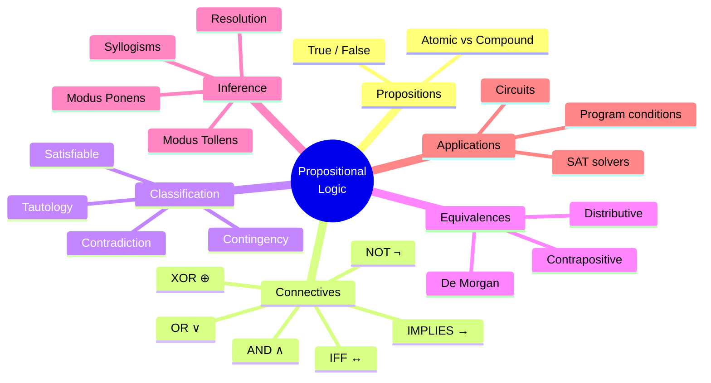
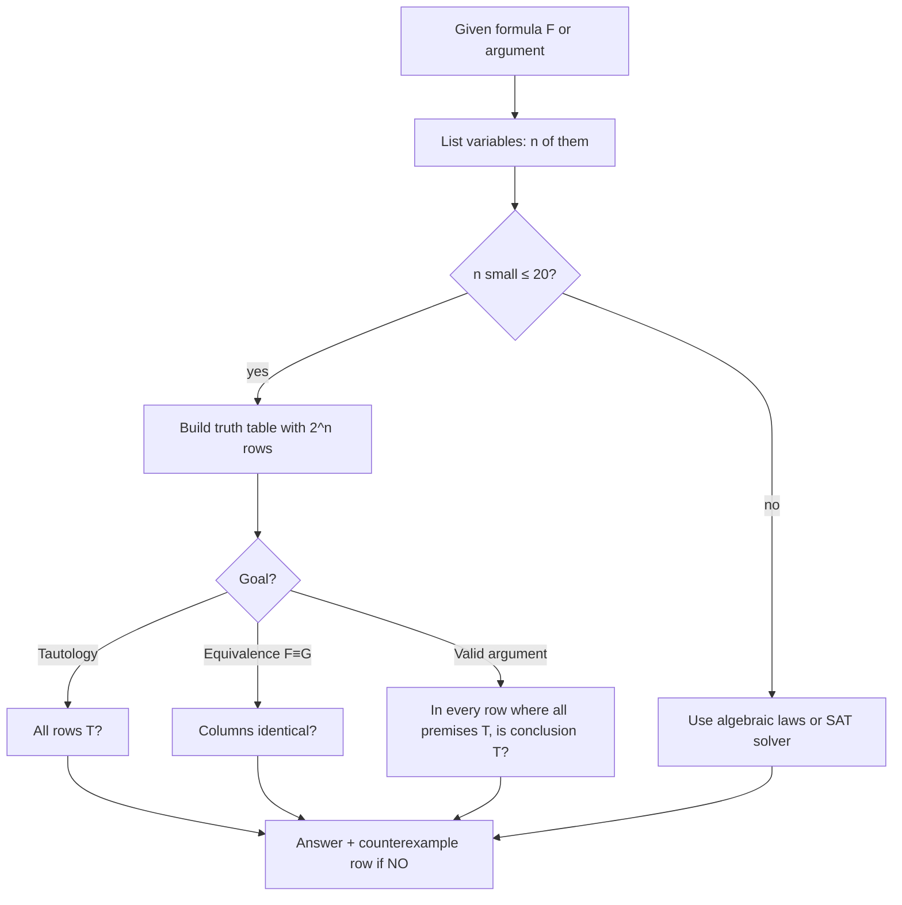

# 01 — Propositional Logic

← [[00 - Discrete Mathematics MOC|MOC]] | Next → [[02 - Predicate Logic and Quantifiers]]

## 1. Core Concepts

> [!definition] Proposition
> A **proposition** is a declarative statement that is either **true (T)** or **false (F)**, but not both.

| Statement                 | Proposition? | Why                         |
| ------------------------- | ------------ | --------------------------- |
| "7 is prime."             | ✅ (T)       | Has a definite truth value  |
| "2 + 2 = 5"               | ✅ (F)       | False, but still a statement|
| "Close the door."         | ❌           | Command                     |
| "x + 1 = 3"               | ❌           | Depends on x (see [[02 - Predicate Logic and Quantifiers\|predicates]]) |

### Logical Connectives

| Symbol | Name             | Read as          | Python        | True when…                     |
| ------ | ---------------- | ---------------- | ------------- | ------------------------------ |
| ¬p     | Negation         | not p            | `not p`       | p is false                     |
| p ∧ q  | Conjunction      | p and q          | `p and q`     | both true                      |
| p ∨ q  | Disjunction      | p or q           | `p or q`      | at least one true              |
| p ⊕ q  | Exclusive or     | p xor q          | `p != q`      | exactly one true               |
| p → q  | Implication      | if p then q      | `(not p) or q`| except when p=T, q=F           |
| p ↔ q  | Biconditional    | p iff q          | `p == q`      | same truth value               |

### Truth Table

| p | q | ¬p | p∧q | p∨q | p⊕q | p→q | p↔q |
|---|---|----|-----|-----|-----|-----|-----|
| T | T | F  | T   | T   | F   | T   | T   |
| T | F | F  | F   | T   | T   | **F** | F |
| F | T | T  | F   | T   | T   | T   | F   |
| F | F | T  | F   | F   | F   | T   | T   |

> [!tip] Implication intuition
> "If it rains, I take an umbrella." I only **lied** if it rained and I did **not** take the umbrella. If it did not rain, the promise was not broken → **vacuously true**.

### Variants of an Implication p → q

| Name           | Form    | Equivalent to original? |
| -------------- | ------- | ----------------------- |
| Converse       | q → p   | ❌                      |
| Inverse        | ¬p → ¬q | ❌ (≡ converse)         |
| Contrapositive | ¬q → ¬p | ✅                      |

### Classification

- **Tautology** — always true (e.g. `p ∨ ¬p`)
- **Contradiction** — always false (e.g. `p ∧ ¬p`)
- **Contingency** — sometimes true, sometimes false
- **Logically equivalent** (p ≡ q) — `p ↔ q` is a tautology
- **Satisfiable** — at least one assignment makes it true

### Key Equivalence Laws

| Law            | Form                                                  |
| -------------- | ----------------------------------------------------- |
| Identity       | p ∧ T ≡ p,  p ∨ F ≡ p                                 |
| Domination     | p ∨ T ≡ T,  p ∧ F ≡ F                                 |
| Idempotent     | p ∨ p ≡ p,  p ∧ p ≡ p                                 |
| Double negation| ¬(¬p) ≡ p                                             |
| Commutative    | p ∨ q ≡ q ∨ p                                         |
| Associative    | (p ∨ q) ∨ r ≡ p ∨ (q ∨ r)                             |
| Distributive   | p ∧ (q ∨ r) ≡ (p ∧ q) ∨ (p ∧ r)                       |
| **De Morgan**  | ¬(p ∧ q) ≡ ¬p ∨ ¬q,  ¬(p ∨ q) ≡ ¬p ∧ ¬q               |
| Absorption     | p ∨ (p ∧ q) ≡ p                                       |
| Implication    | p → q ≡ ¬p ∨ q                                        |
| Contrapositive | p → q ≡ ¬q → ¬p                                       |

### Rules of Inference

| Rule                   | Premises             | Conclusion |
| ---------------------- | -------------------- | ---------- |
| Modus Ponens           | p, p → q             | q          |
| Modus Tollens          | ¬q, p → q            | ¬p         |
| Hypothetical Syllogism | p → q, q → r         | p → r      |
| Disjunctive Syllogism  | p ∨ q, ¬p            | q          |
| Addition               | p                    | p ∨ q      |
| Simplification         | p ∧ q                | p          |
| Resolution             | p ∨ q, ¬p ∨ r        | q ∨ r      |

## 2. Worked Examples

> [!example] Example 1 — Prove De Morgan with a truth table
> | p | q | ¬(p∧q) | ¬p∨¬q |
> |---|---|--------|-------|
> | T | T | F | F |
> | T | F | T | T |
> | F | T | T | T |
> | F | F | T | T |
> The columns match → equivalent. ∎

> [!example] Example 2 — Simplify ¬(p → q) ∨ (p ∧ q)
> 1. ¬(¬p ∨ q) ∨ (p ∧ q) — implication law
> 2. (p ∧ ¬q) ∨ (p ∧ q) — De Morgan + double negation
> 3. p ∧ (¬q ∨ q) — distributive
> 4. p ∧ T — negation law
> 5. **p** — identity

> [!example] Example 3 — Valid argument?
> "If the server is down, the site fails. The site did not fail. ∴ The server is not down."
> p → q, ¬q ⊢ ¬p — **Modus Tollens**, valid ✅

> [!example] Example 4 — A common fallacy
> "If it's a cat, it has fur. It has fur. ∴ It's a cat." → p → q, q ⊢ p — **affirming the consequent**, invalid ❌ (a dog has fur).

## 3. Mind Map



## 4. Workflow — Checking Equivalence / Validity



## 5. Real-Life Examples

| Situation                                   | Logic                                                            |
| ------------------------------------------- | ---------------------------------------------------------------- |
| Login allowed                               | `valid_user ∧ (correct_password ∨ valid_token) ∧ ¬locked`        |
| Car alarm sounds                            | `armed ∧ (door_open ∨ window_broken)`                            |
| Search "laptop AND (dell OR hp) NOT used"   | Boolean search engines                                           |
| Legal contract "if you pay, we deliver"     | Implication — only broken when paid but not delivered            |
| Debugging `if not (a and b)`                | De Morgan → `if not a or not b`                                  |
| Electrical circuits                         | Switches in series = AND, in parallel = OR                       |

## 6. Programming Use Case (Python)

### 6.1 Truth-table generator & tautology checker

```python
from itertools import product
from typing import Callable, Dict, List

def implies(p: bool, q: bool) -> bool:
    return (not p) or q

def iff(p: bool, q: bool) -> bool:
    return p == q

def truth_table(variables: List[str], formula: Callable[..., bool]) -> List[Dict[str, bool]]:
    """Return one dict per row: variable values + 'result'."""
    rows = []
    for values in product([True, False], repeat=len(variables)):
        env = dict(zip(variables, values))
        env["result"] = formula(**{v: env[v] for v in variables})
        rows.append(env)
    return rows

def print_truth_table(variables, formula, label="F"):
    header = " | ".join(variables + [label])
    print(header)
    print("-" * len(header))
    for row in truth_table(variables, formula):
        cells = ["T" if row[v] else "F" for v in variables]
        cells.append("T" if row["result"] else "F")
        print(" | ".join(c.center(len(h)) for c, h in zip(cells, variables + [label])))

def is_tautology(variables, formula) -> bool:
    return all(r["result"] for r in truth_table(variables, formula))

def is_contradiction(variables, formula) -> bool:
    return not any(r["result"] for r in truth_table(variables, formula))

def is_satisfiable(variables, formula) -> bool:
    return any(r["result"] for r in truth_table(variables, formula))

def equivalent(variables, f, g) -> bool:
    return is_tautology(variables, lambda **kw: f(**kw) == g(**kw))

def valid_argument(variables, premises, conclusion) -> bool:
    """Valid iff conclusion is true in every row where all premises are true."""
    for values in product([True, False], repeat=len(variables)):
        env = dict(zip(variables, values))
        if all(p(**env) for p in premises) and not conclusion(**env):
            return False  # counterexample found
    return True

if __name__ == "__main__":
    print_truth_table(["p", "q"], lambda p, q: implies(p, q), "p→q")
```

### 6.2 Real use: simplifying a business rule

```python
def can_checkout_original(logged_in, cart_empty, banned):
    return not (not logged_in or cart_empty or banned)

def can_checkout_simplified(logged_in, cart_empty, banned):
    # De Morgan: ¬(¬a ∨ b ∨ c) ≡ a ∧ ¬b ∧ ¬c
    return logged_in and not cart_empty and not banned
```

### 6.3 Mini SAT solver (brute force)

```python
def brute_force_sat(variables, clauses):
    """clauses: list of lists of literals like 'p' or '~p' (CNF). Returns a model or None."""
    for values in product([True, False], repeat=len(variables)):
        env = dict(zip(variables, values))
        def lit(l):
            return not env[l[1:]] if l.startswith("~") else env[l]
        if all(any(lit(l) for l in clause) for clause in clauses):
            return env
    return None
```

## 7. Test Cases

```python
def test_connectives():
    assert implies(True, False) is False
    assert implies(False, False) is True
    assert iff(True, True) and iff(False, False)
    assert not iff(True, False)

def test_tautology_and_contradiction():
    assert is_tautology(["p"], lambda p: p or not p)               # excluded middle
    assert is_contradiction(["p"], lambda p: p and not p)
    assert not is_tautology(["p", "q"], lambda p, q: p or q)       # contingency
    assert is_satisfiable(["p", "q"], lambda p, q: p and q)

def test_de_morgan():
    assert equivalent(["p", "q"], lambda p, q: not (p and q), lambda p, q: (not p) or (not q))
    assert equivalent(["p", "q"], lambda p, q: not (p or q), lambda p, q: (not p) and (not q))

def test_contrapositive_vs_converse():
    imp = lambda p, q: implies(p, q)
    assert equivalent(["p", "q"], imp, lambda p, q: implies(not q, not p))
    assert not equivalent(["p", "q"], imp, lambda p, q: implies(q, p))

def test_inference_rules():
    V = ["p", "q"]
    assert valid_argument(V, [lambda p, q: p, lambda p, q: implies(p, q)], lambda p, q: q)          # modus ponens
    assert valid_argument(V, [lambda p, q: not q, lambda p, q: implies(p, q)], lambda p, q: not p)  # modus tollens
    assert not valid_argument(V, [lambda p, q: q, lambda p, q: implies(p, q)], lambda p, q: p)      # fallacy

def test_simplification_example():
    assert equivalent(["p", "q"], lambda p, q: (not implies(p, q)) or (p and q), lambda p, q: p)

def test_business_rule_simplification():
    assert equivalent(["logged_in", "cart_empty", "banned"], can_checkout_original, can_checkout_simplified)

def test_sat():
    assert brute_force_sat(["p", "q"], [["p", "q"], ["~p"]]) == {"p": False, "q": True}
    assert brute_force_sat(["p"], [["p"], ["~p"]]) is None

def test_truth_table_size():
    assert len(truth_table(["a", "b", "c"], lambda a, b, c: a)) == 8
```

## 8. Practice Problems

1. Show that `(p → q) ∧ (p → r) ≡ p → (q ∧ r)`.
2. Is `(p ∧ (p → q)) → q` a tautology? *(Yes — this is modus ponens.)*
3. Write the contrapositive of "If a number is divisible by 4, it is even."
4. Translate: "You can ride the roller coaster only if you are over 1.2 m, unless you are with an adult."
5. Use Python to find all assignments satisfying `(p ⊕ q) ∧ (q → r) ∧ ¬r`.

> [!success]- Answers
> 1. Truth table / `equivalent(...)` returns `True`.
> 2. Yes.
> 3. "If a number is not even, it is not divisible by 4."
> 4. `ride → (tall ∨ with_adult)`.
> 5. p=T, q=F, r=F.

## 9. Summary

> [!summary]
> - Propositions are statements with a single truth value.
> - Six connectives: ¬ ∧ ∨ ⊕ → ↔; **p → q ≡ ¬p ∨ q**.
> - Use **truth tables** (2ⁿ rows) or **laws** to prove equivalence.
> - Valid arguments use rules of inference; beware *affirming the consequent* and *denying the antecedent*.
> - Applications: program conditions, digital circuits ([[14 - Boolean Algebra]]), SAT solving, AI reasoning.
