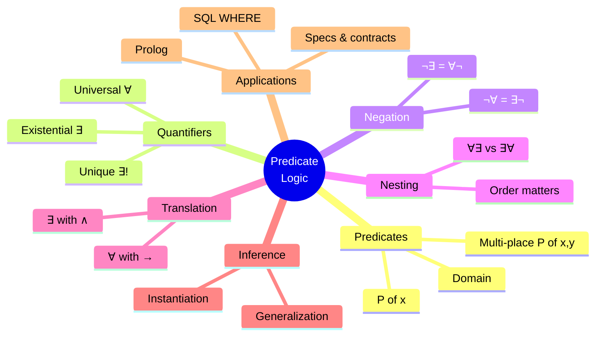
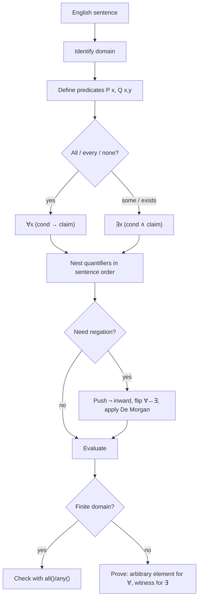

# 02 — Predicate Logic and Quantifiers

← [[01 - Propositional Logic]] | [[00 - Discrete Mathematics MOC|MOC]] | Next → [[03 - Proof Techniques]]

## 1. Core Concepts

> [!definition] Predicate
> A **predicate** P(x) is a statement containing variables that becomes a proposition when the variables are given values from a **domain** (universe of discourse).
> Example: P(x): "x > 3". P(5) is true, P(1) is false.

### Quantifiers

| Quantifier     | Symbol | Meaning                           | True when…                       | False when…                       | Python   |
| -------------- | ------ | --------------------------------- | -------------------------------- | --------------------------------- | -------- |
| Universal      | ∀x P(x)| "for all x, P(x)"                 | P(x) true for **every** x        | there's **one counterexample**    | `all()`  |
| Existential    | ∃x P(x)| "there exists x such that P(x)"   | P(x) true for **at least one** x | P(x) false for every x            | `any()`  |
| Uniqueness     | ∃!x P(x)| "there is exactly one x"         | exactly one x works              | zero or ≥ 2 work                  | `sum(...) == 1` |

> [!warning] Empty domain
> Over an empty domain, ∀x P(x) is **true** (vacuous) and ∃x P(x) is **false**. Python agrees: `all([]) == True`, `any([]) == False`.

### Negating Quantifiers (De Morgan for quantifiers)

| Statement   | Negation      | English                                       |
| ----------- | ------------- | --------------------------------------------- |
| ∀x P(x)     | ∃x ¬P(x)      | "Not everyone passed" = "someone failed"      |
| ∃x P(x)     | ∀x ¬P(x)      | "No one cheated" = "everyone did not cheat"   |
| ∀x ∃y P(x,y)| ∃x ∀y ¬P(x,y) | Push ¬ inward, flipping each quantifier       |

### Nested Quantifiers — order matters!

Let L(x, y): "x loves y" over people.

| Formula      | Meaning                                    |
| ------------ | ------------------------------------------ |
| ∀x ∃y L(x,y) | Everybody loves somebody (maybe different) |
| ∃y ∀x L(x,y) | There is someone whom everybody loves      |
| ∀x ∀y L(x,y) | Everybody loves everybody                  |
| ∃x ∃y L(x,y) | Somebody loves somebody                    |

∃y ∀x ⟹ ∀x ∃y, but **not** the reverse.

### Translating English

| English                              | Logic                          |
| ------------------------------------ | ------------------------------ |
| "All students are smart"             | ∀x (S(x) → M(x))               |
| "Some students are smart"            | ∃x (S(x) ∧ M(x))               |
| "No student is lazy"                 | ∀x (S(x) → ¬L(x))              |
| "Not all students are lazy"          | ∃x (S(x) ∧ ¬L(x))              |

> [!tip] Rule of thumb
> **∀ goes with →**, **∃ goes with ∧**. Writing ∃x (S(x) → M(x)) is a classic mistake: it is true whenever any non-student exists.

### Bound and Free Variables
- In ∀x P(x, y), **x is bound**, **y is free**. A formula is a proposition only when all variables are bound (or assigned).

### Inference Rules for Quantifiers

| Rule                         | From          | Infer                     |
| ---------------------------- | ------------- | ------------------------- |
| Universal instantiation      | ∀x P(x)       | P(c) for any c            |
| Universal generalization     | P(c) for arbitrary c | ∀x P(x)            |
| Existential instantiation    | ∃x P(x)       | P(c) for some (new) c     |
| Existential generalization   | P(c)          | ∃x P(x)                   |

## 2. Worked Examples

> [!example] Example 1 — Evaluate over domain {1, 2, 3, 4}
> - ∀x (x² ≥ x) → **T**
> - ∃x (x² = 9) → **T** (x = 3)
> - ∀x (x is even) → **F** (counterexample x = 1)
> - ∃!x (x + 1 = 3) → **T** (only x = 2)

> [!example] Example 2 — Negate "Every server has a backup that is online"
> ∀s ∃b (Backup(b, s) ∧ Online(b))
> ¬ → ∃s ∀b ¬(Backup(b, s) ∧ Online(b)) ≡ ∃s ∀b (Backup(b, s) → ¬Online(b))
> "There is a server all of whose backups are offline."

> [!example] Example 3 — Famous syllogism
> ∀x (Human(x) → Mortal(x)), Human(Socrates) ⊢ Mortal(Socrates)
> Universal instantiation + modus ponens. ✅

> [!example] Example 4 — Limit definition (calculus) is nested quantifiers
> ∀ε>0 ∃δ>0 ∀x (|x − a| < δ → |f(x) − L| < ε)

## 3. Mind Map



## 4. Workflow — Translating & Evaluating Quantified Statements



## 5. Real-Life Examples

| Domain       | Statement                                      | Logic form                                    |
| ------------ | ---------------------------------------------- | --------------------------------------------- |
| Databases    | "Find customers who ordered every product"     | ∀p ∃o (Order(o, c, p)) — relational division  |
| Security     | "Every admin action is logged"                 | ∀a (Admin(a) → Logged(a))                     |
| Testing      | "There is an input that crashes the program"   | ∃x Crash(x) — a single failing test suffices  |
| Scheduling   | "Every class has a room at every slot"         | ∀c ∀t ∃r Assigned(c, r, t)                    |
| Law          | "No person shall be deprived of liberty…"      | ∀x (Person(x) → ¬Deprived(x))                 |
| Unit tests   | `assert all(is_valid(u) for u in users)`       | ∀ over a finite domain                         |

## 6. Programming Use Case (Python)

```python
from typing import Callable, Iterable, TypeVar

T = TypeVar("T")

def forall(domain: Iterable[T], pred: Callable[[T], bool]) -> bool:
    return all(pred(x) for x in domain)

def exists(domain: Iterable[T], pred: Callable[[T], bool]) -> bool:
    return any(pred(x) for x in domain)

def exists_unique(domain: Iterable[T], pred: Callable[[T], bool]) -> bool:
    return sum(1 for x in domain if pred(x)) == 1

def counterexample(domain, pred):
    """Return the first x with not pred(x), or None if ∀x P(x) holds."""
    return next((x for x in domain if not pred(x)), None)

def witness(domain, pred):
    """Return the first x with pred(x), or None if no witness exists."""
    return next((x for x in domain if pred(x)), None)

# Nested quantifiers
def forall_exists(dx, dy, pred) -> bool:
    return all(any(pred(x, y) for y in dy) for x in dx)

def exists_forall(dx, dy, pred) -> bool:
    return any(all(pred(x, y) for x in dx) for y in dy)
```

### Real use: "relational division" in plain Python (SQL-style query)

```python
orders = {
    ("alice", "pen"), ("alice", "book"), ("alice", "lamp"),
    ("bob", "pen"), ("bob", "lamp"),
    ("cara", "book"),
}
products = {"pen", "book", "lamp"}
customers = {c for c, _ in orders}

def customers_who_bought_everything():
    # { c | ∀p ∈ products : (c, p) ∈ orders }
    return {c for c in customers if forall(products, lambda p: (c, p) in orders)}

def customers_who_bought_something_expensive(expensive={"lamp"}):
    # { c | ∃p ∈ expensive : (c, p) ∈ orders }
    return {c for c in customers if exists(expensive, lambda p: (c, p) in orders)}
```

## 7. Test Cases

```python
D = [1, 2, 3, 4]

def test_basic_quantifiers():
    assert forall(D, lambda x: x * x >= x)
    assert exists(D, lambda x: x * x == 9)
    assert not forall(D, lambda x: x % 2 == 0)
    assert exists_unique(D, lambda x: x + 1 == 3)
    assert not exists_unique(D, lambda x: x > 2)

def test_empty_domain():
    assert forall([], lambda x: False) is True   # vacuous truth
    assert exists([], lambda x: True) is False

def test_negation_law():
    P = lambda x: x > 2
    assert (not forall(D, P)) == exists(D, lambda x: not P(x))
    assert (not exists(D, P)) == forall(D, lambda x: not P(x))

def test_witness_and_counterexample():
    assert counterexample(D, lambda x: x < 4) == 4
    assert witness(D, lambda x: x % 3 == 0) == 3
    assert counterexample(D, lambda x: x > 0) is None

def test_quantifier_order_matters():
    # P(x, y): x + y == 5
    P = lambda x, y: x + y == 5
    assert forall_exists(D, D, P) is True    # every x has a partner
    assert exists_forall(D, D, P) is False   # no single y works for all x

def test_exists_forall_implies_forall_exists():
    P = lambda x, y: y == 4 or x == y
    if exists_forall(D, D, P):
        assert forall_exists(D, D, P)

def test_relational_division():
    assert customers_who_bought_everything() == {"alice"}
    assert customers_who_bought_something_expensive() == {"alice", "bob"}

def test_translation_pitfall():
    people = ["s1", "s2", "t1"]
    student = {"s1": True, "s2": True, "t1": False}
    smart = {"s1": False, "s2": False, "t1": True}
    correct = exists(people, lambda x: student[x] and smart[x])          # ∃ with ∧
    wrong = exists(people, lambda x: (not student[x]) or smart[x])        # ∃ with →
    assert correct is False and wrong is True   # the → version is misleadingly true
```

## 8. Practice Problems

1. Negate: ∀x ∃y (x + y = 0). Is the original true over ℤ? Over ℕ?
2. Translate: "Every programmer knows at least one language that some other programmer doesn't know."
3. Over domain {1..10}, check with Python: ∃x ∀y (x ≤ y).
4. Why is ∃x (P(x) → Q(x)) almost always true?

> [!success]- Answers
> 1. ∃x ∀y (x + y ≠ 0). True over ℤ (y = −x); false over ℕ (x = 1 has no partner).
> 2. ∀p ∃l ∃q (q ≠ p ∧ Knows(p, l) ∧ ¬Knows(q, l)).
> 3. True, x = 1.
> 4. It is satisfied by any x where P(x) is false.

## 9. Summary

> [!summary]
> - Predicates + domain + quantifiers = first-order logic.
> - ∀ ↔ `all()`, ∃ ↔ `any()`. ¬∀ = ∃¬, ¬∃ = ∀¬.
> - **Order of nested quantifiers matters.**
> - ∀ pairs with →, ∃ pairs with ∧.
> - Used in SQL, formal specifications, test assertions and [[03 - Proof Techniques|proofs]].
