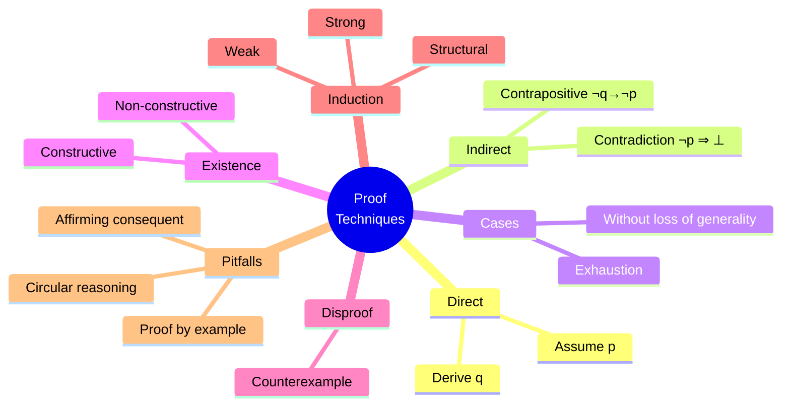
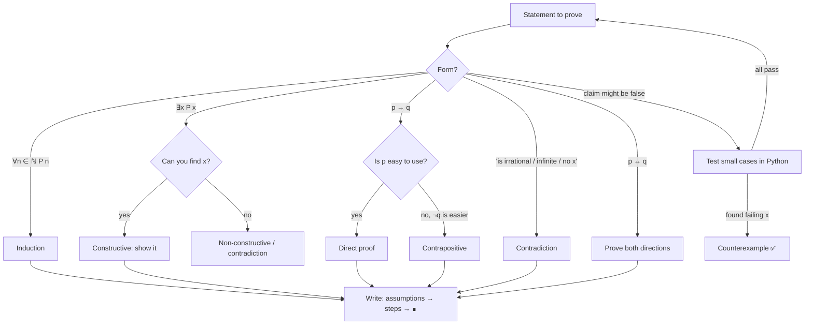

# 03 — Proof Techniques

← [[02 - Predicate Logic and Quantifiers]] | [[00 - Discrete Mathematics MOC|MOC]] | Next → [[04 - Sets]]

## 1. Core Concepts

> [!definition] Proof
> A **proof** is a finite sequence of logically valid steps that shows a statement (a **theorem**) follows from axioms, definitions and previously proven results.

| Term        | Meaning                                                   |
| ----------- | --------------------------------------------------------- |
| Axiom       | Statement accepted without proof                          |
| Theorem     | Important proven statement                                |
| Lemma       | Helper theorem used to prove a bigger one                 |
| Corollary   | Follows easily from a theorem                             |
| Conjecture  | Believed true, not yet proven (e.g. Goldbach)             |

### Proof Methods at a Glance

| Method              | To prove       | Strategy                                                                 |
| ------------------- | -------------- | ------------------------------------------------------------------------ |
| **Direct**          | p → q          | Assume p, derive q step by step                                          |
| **Contrapositive**  | p → q          | Assume ¬q, derive ¬p                                                     |
| **Contradiction**   | p              | Assume ¬p, derive a contradiction (r ∧ ¬r)                               |
| **Cases (exhaustion)** | p          | Split into exhaustive cases, prove each                                  |
| **Biconditional**   | p ↔ q          | Prove p → q **and** q → p                                                |
| **Existence (constructive)** | ∃x P(x) | Exhibit a concrete x                                                  |
| **Existence (non-constructive)** | ∃x P(x) | Show one must exist without finding it                          |
| **Counterexample**  | ¬∀x P(x)       | Find one x with ¬P(x)                                                    |
| **Induction**       | ∀n P(n)        | Base case + inductive step → see [[07 - Mathematical Induction and Recursion]] |

### Useful Definitions
- n is **even** ⟺ ∃k ∈ ℤ, n = 2k. n is **odd** ⟺ ∃k ∈ ℤ, n = 2k + 1.
- r is **rational** ⟺ r = a/b, a, b ∈ ℤ, b ≠ 0 (can take gcd(a, b) = 1).
- a **divides** b (a | b) ⟺ ∃k, b = ak.

## 2. Worked Examples

> [!example] Direct proof — "If n is odd, then n² is odd."
> Let n = 2k + 1. Then n² = 4k² + 4k + 1 = 2(2k² + 2k) + 1, which is odd. ∎

> [!example] Contrapositive — "If n² is even, then n is even."
> Contrapositive: if n is odd then n² is odd — proven above. ∎
> *(A direct proof is awkward here; contrapositive is the natural choice.)*

> [!example] Contradiction — "√2 is irrational."
> Suppose √2 = a/b in lowest terms. Then 2b² = a², so a² is even ⇒ a is even, a = 2c.
> Then 2b² = 4c² ⇒ b² = 2c² ⇒ b is even. Both a, b even contradicts lowest terms. ∎

> [!example] Contradiction — "There are infinitely many primes." (Euclid)
> Suppose the primes are p₁,…,pₙ. Let N = p₁p₂…pₙ + 1. N leaves remainder 1 when divided by each pᵢ, so N's prime factors are not on the list. Contradiction. ∎

> [!example] Cases — "n² + n is even for every integer n."
> Case n even: n = 2k ⇒ n² + n = 2(2k² + k). Case n odd: n = 2k+1 ⇒ n² + n = (2k+1)(2k+2) = 2(2k+1)(k+1). ∎

> [!example] Non-constructive existence — "There exist irrationals a, b with aᵇ rational."
> Let x = √2^√2. If x is rational, take a = b = √2. Otherwise take a = x, b = √2: aᵇ = √2² = 2. Either way such a, b exist. ∎

> [!example] Counterexample — "Every n² + n + 41 is prime."
> n = 40: 40² + 40 + 41 = 1681 = 41². False. ∎

## 3. Mind Map



## 4. Workflow — Choosing a Proof Strategy



## 5. Real-Life Examples

| Area                     | How proofs are used                                                         |
| ------------------------ | --------------------------------------------------------------------------- |
| Algorithm correctness    | Loop invariants proven by induction (e.g. binary search, Dijkstra)          |
| Cryptography             | RSA correctness proven via Fermat/Euler theorems                            |
| Compilers & type systems | "Well-typed programs don't go wrong" — proven by structural induction       |
| Hardware verification    | Intel uses formal proofs after the 1994 Pentium FDIV bug                    |
| Smart contracts / aviation| Formal verification tools (Coq, Lean, TLA+) prove absence of bugs          |
| Everyday debugging       | Contradiction: "assume the bug is in module A… then X would log; it didn't" |
| Testing                  | A failing test is a **counterexample** to "the code is correct"             |

## 6. Programming Use Case (Python)

Python cannot replace proofs, but it is excellent for **exploring**, **finding counterexamples**, and **checking invariants**.

```python
from math import isqrt
from fractions import Fraction

def is_prime(n: int) -> bool:
    if n < 2:
        return False
    if n % 2 == 0:
        return n == 2
    return all(n % d for d in range(3, isqrt(n) + 1, 2))

def find_counterexample(pred, domain):
    """Search for x in domain where pred(x) is False."""
    for x in domain:
        if not pred(x):
            return x
    return None

# Euler's polynomial n^2 + n + 41
def euler_poly_prime(n):
    return is_prime(n * n + n + 41)

# Direct-proof claim: odd^2 is odd
def odd_square_is_odd(n):
    return (n % 2 == 0) or ((n * n) % 2 == 1)

# Euclid's construction
def euclid_new_prime_factor(primes):
    """Return a prime factor of prod(primes)+1, which is never in `primes`."""
    N = 1
    for p in primes:
        N *= p
    N += 1
    d = 2
    while d * d <= N:
        if N % d == 0:
            return d
        d += 1
    return N

# Search for a rational p/q with (p/q)^2 == 2 — finds nothing (supports √2 irrational)
def rational_sqrt2_search(max_den=200):
    for q in range(1, max_den + 1):
        p = isqrt(2 * q * q)
        if Fraction(p, q) ** 2 == 2:
            return Fraction(p, q)
    return None
```

### Loop invariant check (algorithm correctness by induction)

```python
def sum_list(xs):
    total = 0
    for i, x in enumerate(xs):
        # Invariant: total == sum(xs[:i]) before processing xs[i]
        assert total == sum(xs[:i])
        total += x
    assert total == sum(xs)   # invariant + termination ⇒ correctness
    return total
```

## 7. Test Cases

```python
def test_counterexample_euler_polynomial():
    assert find_counterexample(euler_poly_prime, range(0, 100)) == 40

def test_direct_proof_holds_for_many_values():
    assert find_counterexample(odd_square_is_odd, range(-1000, 1000)) is None

def test_cases_proof_n2_plus_n_even():
    assert all((n * n + n) % 2 == 0 for n in range(-500, 500))

def test_euclid_construction():
    for primes in ([2], [2, 3], [2, 3, 5], [2, 3, 5, 7, 11, 13]):
        p = euclid_new_prime_factor(primes)
        assert is_prime(p) and p not in primes
    assert euclid_new_prime_factor([2, 3, 5, 7, 11, 13]) == 59  # 30031 = 59 × 509

def test_sqrt2_has_no_small_rational():
    assert rational_sqrt2_search() is None

def test_loop_invariant():
    assert sum_list([3, 1, 4, 1, 5]) == 14
    assert sum_list([]) == 0

def test_is_prime():
    assert [n for n in range(20) if is_prime(n)] == [2, 3, 5, 7, 11, 13, 17, 19]
```

## 8. Practice Problems

1. Prove directly: the sum of two even integers is even.
2. Prove by contrapositive: if 3n + 2 is odd, then n is odd.
3. Prove by contradiction: there is no largest even integer.
4. Disprove: "For all positive integers n, 2ⁿ + 1 is prime." (Find the smallest counterexample in Python.)
5. Prove: an integer is even iff its square is even.

> [!success]- Hints
> 1. 2a + 2b = 2(a + b).
> 2. If n even, n = 2k ⇒ 3n + 2 = 2(3k + 1), even.
> 3. If N is the largest, N + 2 is larger and even.
> 4. n = 3 → 9 = 3 × 3.
> 5. Combine the direct proof and the contrapositive.

## 9. Summary

> [!summary]
> - Pick the method that matches the statement's **form**.
> - Contrapositive is equivalent to the original; the converse is **not**.
> - Contradiction is good for "irrational", "infinite", "no such x".
> - One counterexample disproves a ∀ statement; examples never prove it.
> - Python = laboratory for conjectures; proof = certainty.
