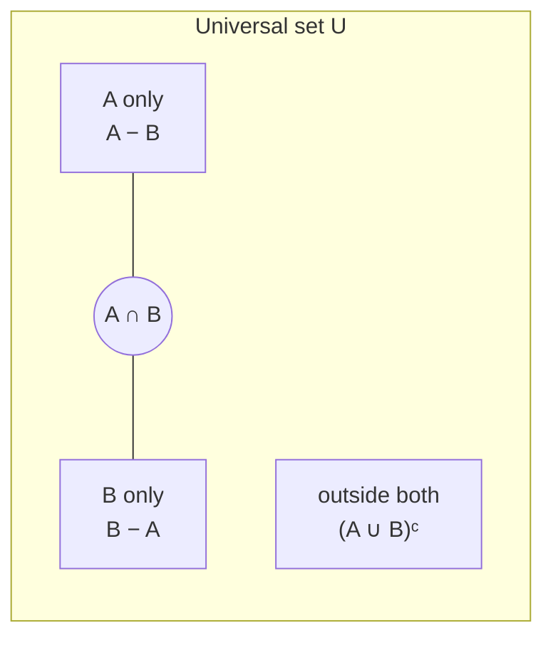
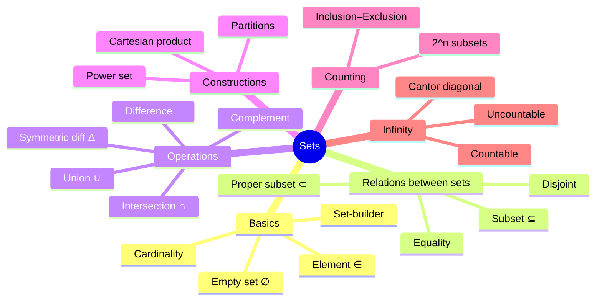
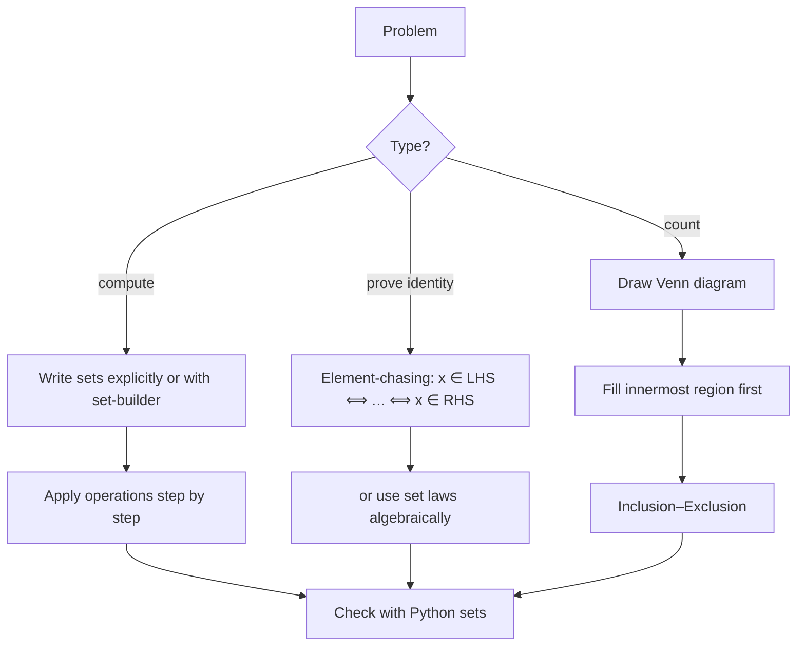

# 04 — Sets

← [[03 - Proof Techniques]] | [[00 - Discrete Mathematics MOC|MOC]] | Next → [[05 - Relations]]

## 1. Core Concepts

> [!definition] Set
> A **set** is an unordered collection of **distinct** objects called elements. `{1, 2, 2, 3} = {3, 1, 2}`.

### Notation

| Notation           | Meaning                                  | Example                              |
| ------------------ | ---------------------------------------- | ------------------------------------ |
| a ∈ A              | a is an element of A                     | 2 ∈ {1, 2, 3}                        |
| a ∉ A              | a is not an element of A                 | 5 ∉ {1, 2, 3}                        |
| ∅ or {}            | Empty set                                | \|∅\| = 0                            |
| {x \| P(x)}        | Set-builder notation                     | {x ∈ ℤ \| x² < 10} = {−3,…,3}        |
| \|A\|              | Cardinality (size)                       | \|{a, b}\| = 2                       |
| A ⊆ B              | Subset: every element of A is in B       | {1} ⊆ {1, 2}                         |
| A ⊂ B              | Proper subset (A ⊆ B and A ≠ B)          | {1} ⊂ {1, 2}                         |
| 𝒫(A)               | Power set (all subsets)                  | 𝒫({a,b}) = {∅,{a},{b},{a,b}}         |
| A × B              | Cartesian product (ordered pairs)        | {1,2}×{x} = {(1,x),(2,x)}            |
| U                  | Universal set                            |                                      |

Standard number sets: ℕ ⊂ ℤ ⊂ ℚ ⊂ ℝ ⊂ ℂ.

### Set Operations

| Operation            | Symbol | Definition                    | Python      |
| -------------------- | ------ | ----------------------------- | ----------- |
| Union                | A ∪ B  | x ∈ A **or** x ∈ B            | `A \| B`    |
| Intersection         | A ∩ B  | x ∈ A **and** x ∈ B           | `A & B`     |
| Difference           | A − B  | x ∈ A and x ∉ B               | `A - B`     |
| Symmetric difference | A Δ B  | in exactly one of A, B        | `A ^ B`     |
| Complement           | Aᶜ, Ā  | U − A                         | `U - A`     |
| Subset               | A ⊆ B  |                               | `A <= B`    |
| Disjoint             | A ∩ B = ∅ |                            | `A.isdisjoint(B)` |

### Venn Diagram (two sets)



### Set Identities (mirror the [[01 - Propositional Logic|logic laws]])

| Law          | Identity                                    |
| ------------ | ------------------------------------------- |
| Identity     | A ∪ ∅ = A, A ∩ U = A                        |
| Domination   | A ∪ U = U, A ∩ ∅ = ∅                        |
| Complement   | A ∪ Aᶜ = U, A ∩ Aᶜ = ∅                      |
| De Morgan    | (A ∪ B)ᶜ = Aᶜ ∩ Bᶜ,  (A ∩ B)ᶜ = Aᶜ ∪ Bᶜ     |
| Distributive | A ∩ (B ∪ C) = (A ∩ B) ∪ (A ∩ C)             |
| Absorption   | A ∪ (A ∩ B) = A                             |

### Key Cardinality Facts
- |𝒫(A)| = 2^|A|
- |A × B| = |A| · |B|
- **Inclusion–Exclusion:** |A ∪ B| = |A| + |B| − |A ∩ B|
- |A ∪ B ∪ C| = |A| + |B| + |C| − |A∩B| − |A∩C| − |B∩C| + |A∩B∩C|

### Infinite Sets
- **Countable**: can be listed (bijection with ℕ): ℤ, ℚ.
- **Uncountable**: ℝ — proven by **Cantor's diagonal argument**.
- Cantor's theorem: |A| < |𝒫(A)| for every set A.

## 2. Worked Examples

> [!example] Example 1 — Operations
> A = {1, 2, 3, 4}, B = {3, 4, 5}, U = {1,…,7}
> - A ∪ B = {1, 2, 3, 4, 5}
> - A ∩ B = {3, 4}
> - A − B = {1, 2}, B − A = {5}
> - A Δ B = {1, 2, 5}
> - Aᶜ = {5, 6, 7}

> [!example] Example 2 — Inclusion–exclusion
> In a class of 40: 25 study Python, 18 study Java, 8 study both. How many study neither?
> |P ∪ J| = 25 + 18 − 8 = 35 ⇒ neither = 40 − 35 = **5**.

> [!example] Example 3 — Prove A ∩ (B ∪ C) = (A ∩ B) ∪ (A ∩ C)
> x ∈ LHS ⟺ x ∈ A ∧ (x ∈ B ∨ x ∈ C) ⟺ (x ∈ A ∧ x ∈ B) ∨ (x ∈ A ∧ x ∈ C) ⟺ x ∈ RHS. ∎
> *(Element-chasing: reduces set laws to logic laws.)*

> [!example] Example 4 — Power set
> 𝒫({a, b, c}) has 2³ = 8 elements: ∅, {a}, {b}, {c}, {a,b}, {a,c}, {b,c}, {a,b,c}.

## 3. Mind Map



## 4. Workflow — Solving a Set Problem



## 5. Real-Life Examples

| Situation                                  | Set operation                                |
| ------------------------------------------ | -------------------------------------------- |
| Friends you have in common on social media | A ∩ B                                        |
| "People you may know"                      | (friends of friends) − (your friends) − {you}|
| Remove duplicate emails from a list        | Convert list → set                           |
| SQL `UNION`, `INTERSECT`, `EXCEPT`         | ∪, ∩, −                                      |
| Permissions: role A or role B              | perms(A) ∪ perms(B)                          |
| Spam filter: words in email ∩ blocklist    | Non-empty ⇒ flag                             |
| Survey analysis (who uses both apps)       | Inclusion–exclusion                          |
| Git: files changed in branch A but not B   | A − B                                        |

## 6. Programming Use Case (Python)

```python
from itertools import chain, combinations, product

def power_set(s):
    """All subsets of s, as frozensets."""
    items = list(s)
    return {frozenset(c) for c in chain.from_iterable(combinations(items, r) for r in range(len(items) + 1))}

def power_set_bitmask(s):
    """Same, using the binary representation 0..2^n-1 (each bit = include element)."""
    items = list(s)
    n = len(items)
    return {frozenset(items[i] for i in range(n) if mask >> i & 1) for mask in range(1 << n)}

def cartesian(A, B):
    return set(product(A, B))

def complement(A, U):
    return U - A

def union_size_inclusion_exclusion(*sets):
    """|A1 ∪ ... ∪ An| via inclusion–exclusion (to compare with len(set.union(...)))."""
    total = 0
    n = len(sets)
    for r in range(1, n + 1):
        for combo in combinations(sets, r):
            inter = set.intersection(*map(set, combo))
            total += (-1) ** (r + 1) * len(inter)
    return total

def is_partition(parts, S):
    """Parts are non-empty, pairwise disjoint and cover S."""
    parts = [set(p) for p in parts]
    if any(not p for p in parts):
        return False
    if set().union(*parts) != set(S):
        return False
    return sum(len(p) for p in parts) == len(set(S))
```

### Real use: friend recommendation

```python
friends = {
    "ana":  {"ben", "cy"},
    "ben":  {"ana", "dee", "eli"},
    "cy":   {"ana", "dee"},
    "dee":  {"ben", "cy"},
    "eli":  {"ben"},
}

def recommend(user):
    """Friends-of-friends minus existing friends minus self, ranked by mutual friends."""
    fof = set().union(*(friends[f] for f in friends[user]))
    candidates = fof - friends[user] - {user}
    return sorted(candidates, key=lambda c: (-len(friends[user] & friends[c]), c))
```

## 7. Test Cases

```python
A, B, U = {1, 2, 3, 4}, {3, 4, 5}, set(range(1, 8))

def test_operations():
    assert A | B == {1, 2, 3, 4, 5}
    assert A & B == {3, 4}
    assert A - B == {1, 2}
    assert A ^ B == {1, 2, 5}
    assert complement(A, U) == {5, 6, 7}

def test_de_morgan_sets():
    assert complement(A | B, U) == complement(A, U) & complement(B, U)
    assert complement(A & B, U) == complement(A, U) | complement(B, U)

def test_power_set():
    ps = power_set({"a", "b", "c"})
    assert len(ps) == 8
    assert frozenset() in ps and frozenset({"a", "b", "c"}) in ps
    assert ps == power_set_bitmask({"a", "b", "c"})

def test_cartesian_size():
    assert len(cartesian({1, 2, 3}, {"x", "y"})) == 6

def test_inclusion_exclusion():
    X, Y, Z = set(range(0, 30, 2)), set(range(0, 30, 3)), set(range(0, 30, 5))
    assert union_size_inclusion_exclusion(X, Y, Z) == len(X | Y | Z)

def test_class_survey():
    total, python, java, both = 40, 25, 18, 8
    assert total - (python + java - both) == 5

def test_partition():
    assert is_partition([{1, 2}, {3}, {4, 5}], {1, 2, 3, 4, 5})
    assert not is_partition([{1, 2}, {2, 3}], {1, 2, 3})
    assert not is_partition([{1}, set(), {2}], {1, 2})

def test_recommend():
    assert recommend("ana") == ["dee", "eli"]   # dee has 2 mutual friends, eli has 1
    assert recommend("eli") == ["ana", "dee"]
```

## 8. Practice Problems

1. Prove (A − B) ∪ (B − A) = (A ∪ B) − (A ∩ B).
2. How many integers in 1..1000 are divisible by 3, 5 or 7?
3. List 𝒫(𝒫(∅)).
4. Is {∅} = ∅? Explain.

> [!success]- Answers
> 1. Element-chasing; both are the symmetric difference.
> 2. 333 + 200 + 142 − 66 − 47 − 28 + 9 = **543**.
> 3. 𝒫(∅) = {∅}; 𝒫({∅}) = {∅, {∅}}.
> 4. No: {∅} has one element, ∅ has none.

## 9. Summary

> [!summary]
> - Sets are unordered with no duplicates; Python's `set` and `frozenset` model them directly.
> - Set laws mirror logic laws (∪ ↔ ∨, ∩ ↔ ∧, complement ↔ ¬).
> - |𝒫(A)| = 2ⁿ, |A × B| = |A||B|, inclusion–exclusion for unions.
> - Foundation for [[05 - Relations]], [[06 - Functions]], and [[08 - Counting and Combinatorics]].
