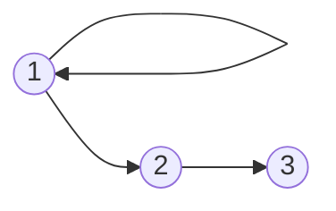
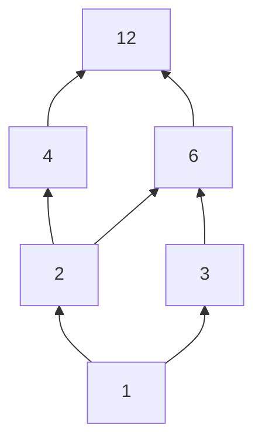
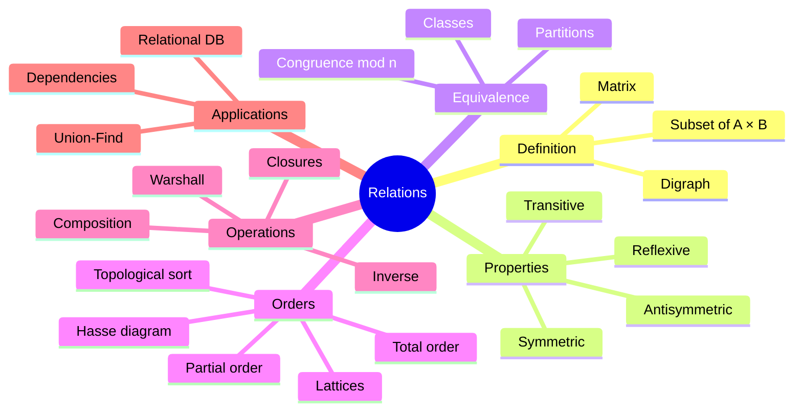
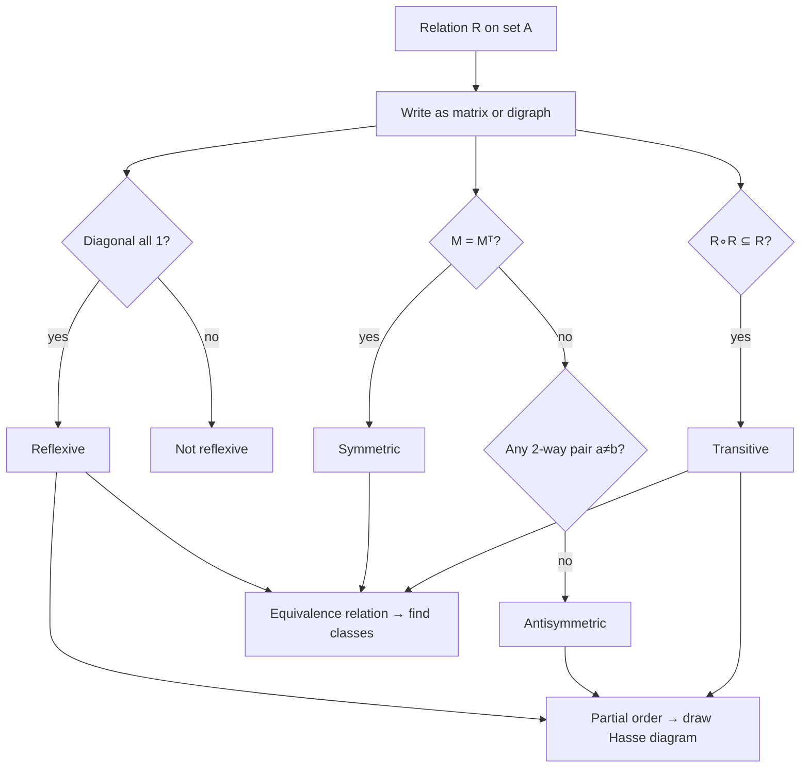

# 05 — Relations

← [[04 - Sets]] | [[00 - Discrete Mathematics MOC|MOC]] | Next → [[06 - Functions]]

## 1. Core Concepts

> [!definition] Binary relation
> A **binary relation** R from A to B is a subset R ⊆ A × B. We write a R b when (a, b) ∈ R. A relation **on** A is a subset of A × A.

### Representations

| Representation  | Example for R = {(1,1), (1,2), (2,3)} on {1,2,3} |
| --------------- | ------------------------------------------------ |
| Set of pairs    | {(1,1), (1,2), (2,3)}                            |
| Boolean matrix  | rows = from, cols = to (below)                   |
| Directed graph  | arrows 1→1, 1→2, 2→3                             |

```
     1 2 3
  1 [1 1 0]
  2 [0 0 1]
  3 [0 0 0]
```



### Properties of a Relation R on A

| Property        | Definition                                       | Matrix / graph test                        |
| --------------- | ------------------------------------------------ | ------------------------------------------ |
| Reflexive       | ∀a: (a, a) ∈ R                                   | All 1s on the diagonal / loop on each node |
| Irreflexive     | ∀a: (a, a) ∉ R                                   | All 0s on the diagonal                     |
| Symmetric       | (a, b) ∈ R → (b, a) ∈ R                          | M = Mᵀ / every arrow has a reverse         |
| Antisymmetric   | (a, b) ∈ R ∧ (b, a) ∈ R → a = b                  | No 2-way arrows between distinct nodes     |
| Asymmetric      | (a, b) ∈ R → (b, a) ∉ R                          | Antisymmetric + irreflexive                |
| Transitive      | (a, b), (b, c) ∈ R → (a, c) ∈ R                  | Every 2-step path has a shortcut           |

### Important Kinds of Relations

| Kind                     | Properties                                      | Example                        |
| ------------------------ | ----------------------------------------------- | ------------------------------ |
| **Equivalence relation** | Reflexive + Symmetric + Transitive              | "same remainder mod 3", "same birthday" |
| **Partial order** (poset)| Reflexive + Antisymmetric + Transitive          | ≤ on ℤ, ⊆ on sets, "divides" on ℕ⁺ |
| **Total order**          | Partial order where every pair is comparable    | ≤ on ℝ, alphabetical order     |
| **Strict order**         | Irreflexive + Transitive                        | < on ℤ                         |

> [!important] Equivalence classes ⟷ partitions
> An equivalence relation on A splits A into disjoint **equivalence classes** [a] = {x | x R a}. Conversely, every partition of A defines an equivalence relation. Example: congruence mod 3 splits ℤ into [0], [1], [2].

### Operations on Relations
- **Inverse**: R⁻¹ = {(b, a) | (a, b) ∈ R}
- **Composition**: S ∘ R = {(a, c) | ∃b: (a, b) ∈ R ∧ (b, c) ∈ S}. Matrix: Boolean product.
- **Closures** (smallest relation containing R with the property):
  - Reflexive closure: R ∪ {(a, a)}
  - Symmetric closure: R ∪ R⁻¹
  - Transitive closure R⁺: all pairs connected by a path — **Warshall's algorithm**, O(n³)

### Hasse Diagram (poset of divisors of 12 under "divides")



Hasse diagrams omit loops and implied (transitive) edges; "up" means "greater".

Key poset terms: **maximal/minimal**, **greatest/least**, **upper/lower bound**, **lattice** (every pair has a LUB and GLB), **topological sort** (a total order compatible with the partial order).

## 2. Worked Examples

> [!example] Example 1 — Classify relations on {1, 2, 3}
> | R | Refl | Sym | Antisym | Trans |
> |---|---|---|---|---|
> | {(1,1),(2,2),(3,3)} | ✅ | ✅ | ✅ | ✅ |
> | {(1,2),(2,1)} | ❌ | ✅ | ❌ | ❌ (needs (1,1)) |
> | {(1,2),(2,3),(1,3)} | ❌ | ❌ | ✅ | ✅ |
> | ≤ | ✅ | ❌ | ✅ | ✅ |

> [!example] Example 2 — Congruence mod 3 is an equivalence relation
> a ~ b ⟺ 3 | (a − b).
> Reflexive: 3 | 0. Symmetric: 3 | (a−b) ⇒ 3 | (b−a). Transitive: 3 | (a−b), 3 | (b−c) ⇒ 3 | (a−c). ∎
> Classes on {0..8}: {0,3,6}, {1,4,7}, {2,5,8}.

> [!example] Example 3 — Transitive closure
> R = {(1,2), (2,3), (3,4)} ⇒ R⁺ = R ∪ {(1,3), (2,4), (1,4)}.

> [!example] Example 4 — Topological sort of course prerequisites
> Intro → DataStructures → Algorithms; Intro → Discrete → Algorithms.
> One valid order: Intro, Discrete, DataStructures, Algorithms.

## 3. Mind Map



## 4. Workflow — Classifying a Relation



## 5. Real-Life Examples

| Relation                                  | Type                            | Use                                       |
| ----------------------------------------- | ------------------------------- | ----------------------------------------- |
| Rows in a database table                  | n-ary relation                  | SQL is "relational algebra"               |
| "is prerequisite of" (courses)            | Strict partial order            | Curriculum planning, topological sort     |
| Package dependencies (pip, npm)           | Partial order / DAG             | Install order, cycle detection            |
| "same connected component" in a network   | Equivalence                     | Union-Find, clustering                    |
| "is ancestor of"                          | Transitive closure of "parent"  | Family trees, org charts                  |
| "can reach" in a road map                 | Transitive closure              | Reachability queries                      |
| Version ordering, `git` commit ancestry   | Partial order                   | Merge bases                               |
| Same hash bucket                          | Equivalence                     | Hash tables                               |

## 6. Programming Use Case (Python)

```python
from itertools import product
from collections import defaultdict, deque

def is_reflexive(R, A):
    return all((a, a) in R for a in A)

def is_symmetric(R):
    return all((b, a) in R for (a, b) in R)

def is_antisymmetric(R):
    return all(a == b or (b, a) not in R for (a, b) in R)

def is_transitive(R):
    return all((a, d) in R for (a, b) in R for (c, d) in R if b == c)

def is_equivalence(R, A):
    return is_reflexive(R, A) and is_symmetric(R) and is_transitive(R)

def is_partial_order(R, A):
    return is_reflexive(R, A) and is_antisymmetric(R) and is_transitive(R)

def compose(S, R):
    """S ∘ R: first R, then S."""
    return {(a, d) for (a, b) in R for (c, d) in S if b == c}

def inverse(R):
    return {(b, a) for (a, b) in R}

def transitive_closure_warshall(R, A):
    A = list(A)
    idx = {a: i for i, a in enumerate(A)}
    n = len(A)
    M = [[False] * n for _ in range(n)]
    for a, b in R:
        M[idx[a]][idx[b]] = True
    for k in range(n):
        for i in range(n):
            if M[i][k]:
                for j in range(n):
                    if M[k][j]:
                        M[i][j] = True
    return {(A[i], A[j]) for i in range(n) for j in range(n) if M[i][j]}

def equivalence_classes(R, A):
    classes = []
    seen = set()
    for a in A:
        if a not in seen:
            cls = frozenset(b for b in A if (a, b) in R)
            classes.append(cls)
            seen |= cls
    return classes

def topological_sort(nodes, edges):
    """Kahn's algorithm. edges: (before, after). Raises ValueError on a cycle."""
    indeg = {n: 0 for n in nodes}
    adj = defaultdict(list)
    for u, v in edges:
        adj[u].append(v)
        indeg[v] += 1
    queue = deque(sorted(n for n in nodes if indeg[n] == 0))
    order = []
    while queue:
        u = queue.popleft()
        order.append(u)
        for v in sorted(adj[u]):
            indeg[v] -= 1
            if indeg[v] == 0:
                queue.append(v)
    if len(order) != len(nodes):
        raise ValueError("cycle detected — not a partial order")
    return order
```

### Real use: Union-Find for "same group" queries

```python
class UnionFind:
    """Maintains an equivalence relation incrementally."""
    def __init__(self, items):
        self.parent = {x: x for x in items}
        self.rank = {x: 0 for x in items}

    def find(self, x):
        while self.parent[x] != x:
            self.parent[x] = self.parent[self.parent[x]]  # path halving
            x = self.parent[x]
        return x

    def union(self, a, b):
        ra, rb = self.find(a), self.find(b)
        if ra == rb:
            return False
        if self.rank[ra] < self.rank[rb]:
            ra, rb = rb, ra
        self.parent[rb] = ra
        self.rank[ra] += self.rank[ra] == self.rank[rb]
        return True

    def same(self, a, b):
        return self.find(a) == self.find(b)
```

## 7. Test Cases

```python
A3 = {1, 2, 3}

def test_properties_table():
    identity = {(a, a) for a in A3}
    assert is_equivalence(identity, A3) and is_partial_order(identity, A3)
    R2 = {(1, 2), (2, 1)}
    assert is_symmetric(R2) and not is_transitive(R2) and not is_reflexive(R2, A3)
    R3 = {(1, 2), (2, 3), (1, 3)}
    assert is_transitive(R3) and is_antisymmetric(R3) and not is_symmetric(R3)
    leq = {(a, b) for a, b in product(A3, A3) if a <= b}
    assert is_partial_order(leq, A3) and not is_symmetric(leq)

def test_congruence_mod_3():
    A = set(range(9))
    R = {(a, b) for a, b in product(A, A) if (a - b) % 3 == 0}
    assert is_equivalence(R, A)
    classes = {tuple(sorted(c)) for c in equivalence_classes(R, A)}
    assert classes == {(0, 3, 6), (1, 4, 7), (2, 5, 8)}

def test_divides_is_partial_order():
    A = {1, 2, 3, 4, 6, 12}
    R = {(a, b) for a, b in product(A, A) if b % a == 0}
    assert is_partial_order(R, A)

def test_transitive_closure():
    R = {(1, 2), (2, 3), (3, 4)}
    assert transitive_closure_warshall(R, {1, 2, 3, 4}) == R | {(1, 3), (2, 4), (1, 4)}

def test_compose_and_inverse():
    R = {(1, "a"), (2, "b")}
    S = {("a", "X"), ("b", "Y")}
    assert compose(S, R) == {(1, "X"), (2, "Y")}
    assert inverse(R) == {("a", 1), ("b", 2)}

def test_topological_sort():
    nodes = {"Intro", "Discrete", "DS", "Algo"}
    edges = [("Intro", "DS"), ("Intro", "Discrete"), ("DS", "Algo"), ("Discrete", "Algo")]
    order = topological_sort(nodes, edges)
    pos = {c: i for i, c in enumerate(order)}
    assert all(pos[u] < pos[v] for u, v in edges)

def test_topological_sort_cycle():
    try:
        topological_sort({"a", "b"}, [("a", "b"), ("b", "a")])
        assert False, "expected ValueError"
    except ValueError:
        pass

def test_union_find():
    uf = UnionFind(range(6))
    uf.union(0, 1); uf.union(1, 2); uf.union(4, 5)
    assert uf.same(0, 2) and uf.same(4, 5)
    assert not uf.same(2, 4)
    assert uf.union(0, 2) is False   # already related
```

## 8. Practice Problems

1. How many relations are there on a set with n elements? How many are reflexive?
2. Is "x is a sibling of y" an equivalence relation? (Careful with reflexivity.)
3. Draw the Hasse diagram for 𝒫({a, b, c}) under ⊆.
4. Find the transitive closure of {(a,b), (b,c), (c,a)}.

> [!success]- Answers
> 1. 2^(n²); reflexive: 2^(n² − n).
> 2. Not reflexive (you're not your own sibling) — unless you define it as "same parents".
> 3. A cube: ∅ at bottom, singletons, pairs, {a,b,c} at top.
> 4. All 9 pairs on {a, b, c}.

## 9. Summary

> [!summary]
> - Relation = set of ordered pairs; view it as a matrix or a digraph.
> - **Equivalence** (R, S, T) ⟷ partitions into classes.
> - **Partial order** (R, AS, T) ⟷ Hasse diagram, topological sort.
> - Closures and composition power reachability, databases, and dependency resolution.
> - A **function** is a special relation → [[06 - Functions]]. Digraphs lead to [[12 - Graph Theory]].
