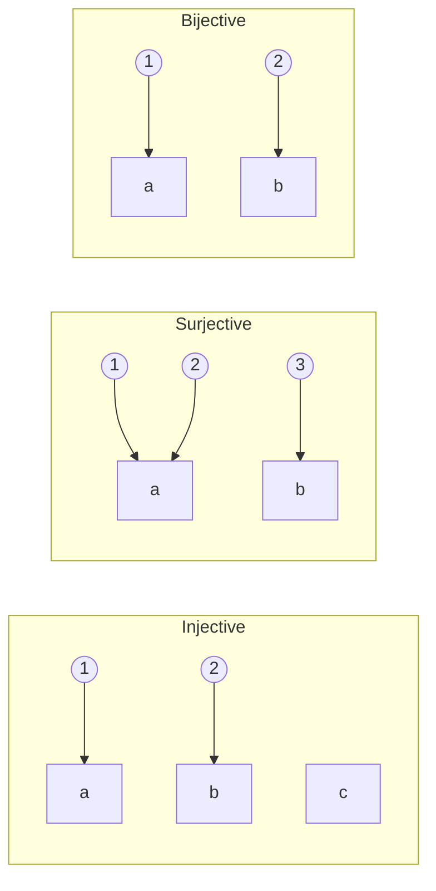
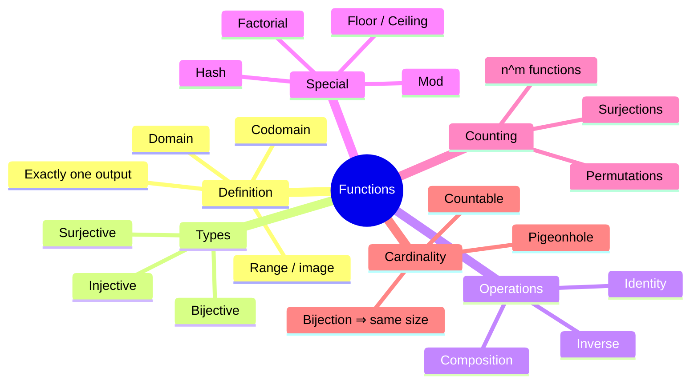
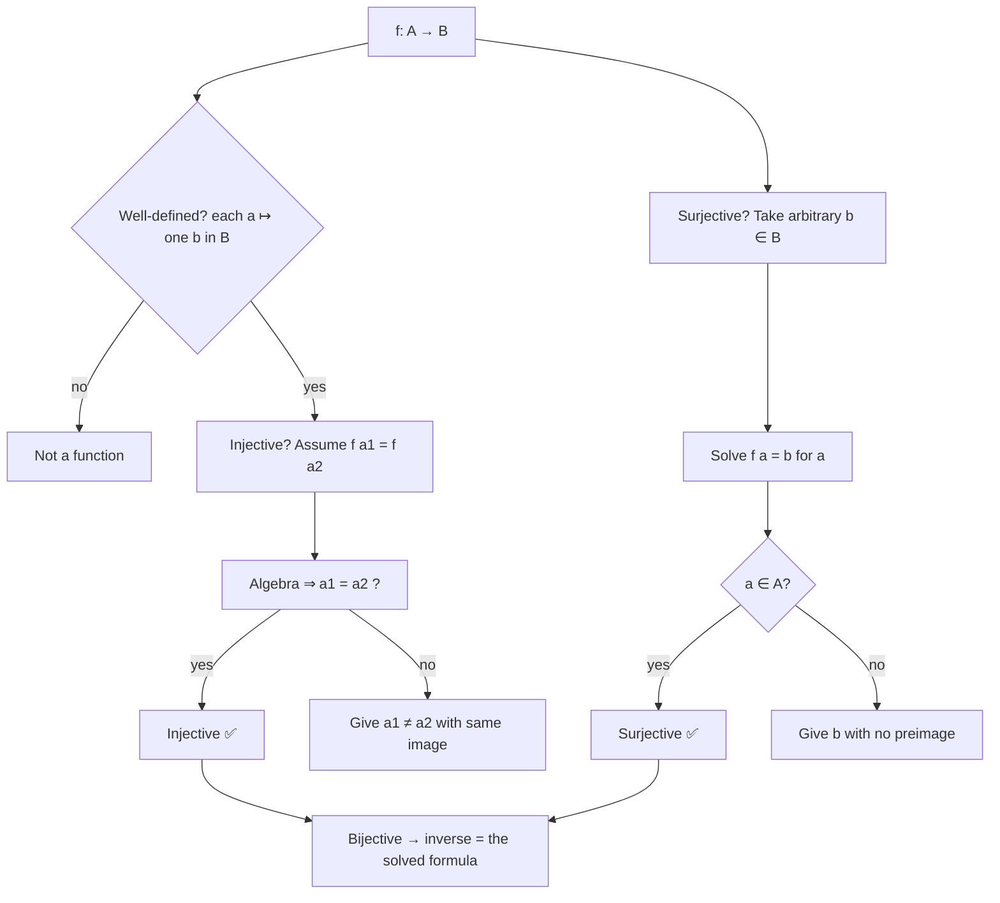

# 06 — Functions

← [[05 - Relations]] | [[00 - Discrete Mathematics MOC|MOC]] | Next → [[07 - Mathematical Induction and Recursion]]

## 1. Core Concepts

> [!definition] Function
> A **function** f: A → B is a relation that assigns to **each** element of A **exactly one** element of B.
> - A = **domain**, B = **codomain**
> - f(a) = **image** of a; a = a **preimage** of f(a)
> - **Range** (image of f) = {f(a) | a ∈ A} ⊆ B

### Types of Functions

| Type                     | Definition                                  | Picture                        | Size condition (finite) |
| ------------------------ | ------------------------------------------- | ------------------------------ | ----------------------- |
| **Injective** (one-to-one)  | f(a₁) = f(a₂) ⇒ a₁ = a₂                 | no two arrows hit the same b   | \|A\| ≤ \|B\|           |
| **Surjective** (onto)    | ∀b ∃a: f(a) = b                             | every b is hit                 | \|A\| ≥ \|B\|           |
| **Bijective**            | injective and surjective                    | perfect pairing                | \|A\| = \|B\|           |



### Operations
- **Composition**: (g ∘ f)(x) = g(f(x)) for f: A → B, g: B → C.
- **Inverse** f⁻¹: B → A exists **iff f is bijective**; f⁻¹(f(a)) = a.
- **Identity** id_A(a) = a.

Composition facts: injective ∘ injective = injective; surjective ∘ surjective = surjective; bijective ∘ bijective = bijective.

### Important Functions in CS

| Function           | Definition                         | Example                       |
| ------------------ | ---------------------------------- | ----------------------------- |
| Floor ⌊x⌋          | greatest integer ≤ x               | ⌊3.7⌋ = 3, ⌊−3.2⌋ = −4        |
| Ceiling ⌈x⌉        | least integer ≥ x                  | ⌈3.2⌉ = 4                     |
| Mod                | a mod n ∈ {0,…,n−1}                | 17 mod 5 = 2                  |
| Characteristic χ_A | 1 if x ∈ A else 0                  | bit vectors                   |
| Hash function      | key → bucket index                 | not injective (collisions!)   |
| Factorial n!       | 1·2·…·n                            | 5! = 120                      |
| log₂ n             | inverse of 2ⁿ                      | binary search steps           |

### Counting Functions (|A| = m, |B| = n)

| What                              | Count                                            |
| --------------------------------- | ------------------------------------------------ |
| All functions A → B               | nᵐ                                               |
| Injective functions               | n!/(n−m)! (if m ≤ n, else 0)                     |
| Bijections (m = n)                | n!                                               |
| Surjective functions              | Σₖ (−1)ᵏ C(n,k) (n−k)ᵐ  (inclusion–exclusion)    |

### Pigeonhole Principle (function view)
If |A| > |B|, no function A → B is injective — some two elements share an image. See [[08 - Counting and Combinatorics]].

### Cardinality via Bijections
Two sets have the **same cardinality** iff a bijection exists between them. ℕ ↔ ℤ via 0,1,−1,2,−2,… shows ℤ is countable.

## 2. Worked Examples

> [!example] Example 1 — Classify
> | f | Domain → Codomain | Inj | Surj | Bij |
> |---|---|---|---|---|
> | f(x) = 2x + 1 | ℝ → ℝ | ✅ | ✅ | ✅ |
> | f(x) = x² | ℝ → ℝ | ❌ (f(−1) = f(1)) | ❌ (−1 not hit) | ❌ |
> | f(x) = x² | ℝ≥0 → ℝ≥0 | ✅ | ✅ | ✅ |
> | f(n) = 2n | ℤ → ℤ | ✅ | ❌ (odd numbers missed) | ❌ |
> | f(x) = ⌊x⌋ | ℝ → ℤ | ❌ | ✅ | ❌ |

> [!example] Example 2 — Inverse
> f(x) = 2x + 1 ⇒ y = 2x + 1 ⇒ x = (y − 1)/2 ⇒ f⁻¹(y) = (y − 1)/2.

> [!example] Example 3 — Composition is not commutative
> f(x) = x + 1, g(x) = x². (g ∘ f)(x) = (x + 1)², (f ∘ g)(x) = x² + 1. At x = 1: 4 ≠ 2.

> [!example] Example 4 — Count functions from {1,2,3} to {a,b}
> All: 2³ = 8. Injective: 0 (3 > 2). Surjective: 8 − 2 = 6 (subtract the 2 constant functions).

## 3. Mind Map



## 4. Workflow — Proving a Function is a Bijection



## 5. Real-Life Examples

| Situation                                | Function type                                    |
| ---------------------------------------- | ------------------------------------------------ |
| Student ID → student                     | Bijection (IDs must be unique and all used)      |
| Person → birthday                        | Function, not injective (shared birthdays)       |
| Hash table key → bucket                  | Not injective → collisions must be handled       |
| Encryption / decryption                  | Must be bijective so decryption is possible      |
| Lossless compression (ZIP)               | Injective (decodable); lossy (JPEG) is not       |
| URL shortener                            | Short code ↔ long URL must be injective          |
| Seat assignment in a full theatre        | Bijection people ↔ seats                         |
| Database primary key → row               | Injective                                        |

## 6. Programming Use Case (Python)

```python
from itertools import product
from math import comb, factorial

def is_function(pairs, A, B):
    """pairs: set of (a, b). Each a in A must appear exactly once with b in B."""
    outs = {}
    for a, b in pairs:
        if a not in A or b not in B:
            return False
        if a in outs and outs[a] != b:
            return False
        outs[a] = b
    return set(outs) == set(A)

def is_injective(f: dict) -> bool:
    return len(set(f.values())) == len(f)

def is_surjective(f: dict, codomain) -> bool:
    return set(f.values()) == set(codomain)

def is_bijective(f: dict, codomain) -> bool:
    return is_injective(f) and is_surjective(f, codomain)

def inverse(f: dict) -> dict:
    if not is_injective(f):
        raise ValueError("not invertible: function is not injective")
    return {v: k for k, v in f.items()}

def compose(g: dict, f: dict) -> dict:
    """(g ∘ f)(x) = g(f(x))"""
    return {x: g[f[x]] for x in f}

def all_functions(A, B):
    A, B = list(A), list(B)
    return [dict(zip(A, outs)) for outs in product(B, repeat=len(A))]

def count_surjections(m, n):
    return sum((-1) ** k * comb(n, k) * (n - k) ** m for k in range(n + 1))

def count_injections(m, n):
    return factorial(n) // factorial(n - m) if m <= n else 0
```

### Real use: a toy hash table showing collisions (non-injective function)

```python
def bucket(key: str, n_buckets: int) -> int:
    return sum(ord(c) for c in key) % n_buckets

def find_collisions(keys, n_buckets):
    seen = {}
    collisions = []
    for k in keys:
        b = bucket(k, n_buckets)
        if b in seen:
            collisions.append((seen[b], k, b))
        else:
            seen[b] = k
    return collisions

# Caesar cipher: a bijection on the alphabet ⇒ decryptable
ALPHA = "abcdefghijklmnopqrstuvwxyz"
def caesar_map(shift):
    return {c: ALPHA[(i + shift) % 26] for i, c in enumerate(ALPHA)}
```

## 7. Test Cases

```python
def test_is_function():
    A, B = {1, 2, 3}, {"a", "b"}
    assert is_function({(1, "a"), (2, "a"), (3, "b")}, A, B)
    assert not is_function({(1, "a"), (1, "b"), (2, "a"), (3, "a")}, A, B)  # 1 has two outputs
    assert not is_function({(1, "a"), (2, "b")}, A, B)                      # 3 has no output

def test_types():
    f = {1: "a", 2: "b", 3: "c"}
    assert is_bijective(f, {"a", "b", "c"})
    g = {1: "a", 2: "a", 3: "b"}
    assert not is_injective(g) and is_surjective(g, {"a", "b"})
    h = {1: "a", 2: "b"}
    assert is_injective(h) and not is_surjective(h, {"a", "b", "c"})

def test_inverse_and_compose():
    f = {1: "a", 2: "b"}
    assert compose(inverse(f), f) == {1: 1, 2: 2}       # f⁻¹ ∘ f = id
    try:
        inverse({1: "a", 2: "a"})
        assert False
    except ValueError:
        pass

def test_composition_not_commutative():
    D = range(-3, 4)
    f = {x: x + 1 for x in D}
    g = {x: x * x for x in range(-3, 17)}
    f2 = {x: x + 1 for x in range(0, 17)}
    assert compose(g, f)[1] == 4
    assert compose(f2, {x: x * x for x in D})[1] == 2

def test_counting_functions_brute_force():
    A, B = [1, 2, 3], ["a", "b"]
    fs = all_functions(A, B)
    assert len(fs) == 2 ** 3
    assert sum(is_surjective(f, B) for f in fs) == count_surjections(3, 2) == 6
    assert sum(is_injective(f) for f in fs) == count_injections(3, 2) == 0
    A4, B4 = [1, 2], ["a", "b", "c"]
    assert sum(is_injective(f) for f in all_functions(A4, B4)) == count_injections(2, 3) == 6

def test_hash_collisions():
    assert find_collisions(["ab", "ba"], 10) == [("ab", "ba", bucket("ab", 10))]  # anagrams collide

def test_caesar_is_bijection():
    enc = caesar_map(3)
    assert is_bijective(enc, set(ALPHA))
    dec = inverse(enc)
    msg = "discrete"
    assert "".join(dec[enc[c]] for c in msg) == msg
```

## 8. Practice Problems

1. Is f: ℤ → ℤ, f(n) = n + 5 a bijection? Find f⁻¹.
2. Give a bijection between ℕ and the even naturals.
3. How many bijections exist from a 5-element set to itself?
4. Prove: if g ∘ f is injective, then f is injective.

> [!success]- Answers
> 1. Yes; f⁻¹(n) = n − 5.
> 2. f(n) = 2n.
> 3. 5! = 120.
> 4. If f(a₁) = f(a₂) then g(f(a₁)) = g(f(a₂)) ⇒ a₁ = a₂.

## 9. Summary

> [!summary]
> - A function maps **every** input to **exactly one** output.
> - Injective = no collisions, surjective = covers codomain, bijective = both ⇒ invertible.
> - Counting: nᵐ functions, n!/(n−m)! injections, n! bijections.
> - Bijections define "same size" — basis for counting and cardinality of infinite sets.
