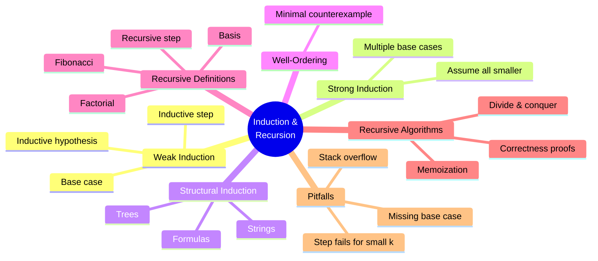
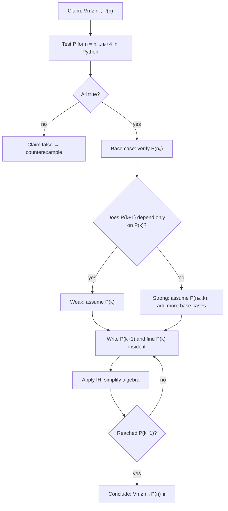
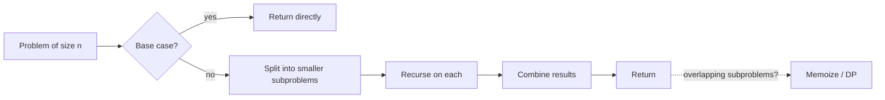

# 07 — Mathematical Induction and Recursion

← [[06 - Functions]] | [[00 - Discrete Mathematics MOC|MOC]] | Next → [[08 - Counting and Combinatorics]]

## 1. Core Concepts

> [!definition] Principle of Mathematical Induction
> To prove P(n) for all integers n ≥ n₀:
> 1. **Base case**: prove P(n₀).
> 2. **Inductive step**: prove that for any k ≥ n₀, **P(k) ⇒ P(k + 1)**. P(k) is the **inductive hypothesis (IH)**.
>
> Then P(n) is true for all n ≥ n₀.

> [!tip] Domino analogy
> Knock over the first domino (base case), and make sure every domino knocks over the next one (inductive step) ⇒ all dominoes fall.

### Types of Induction

| Type           | Inductive step assumes             | Typical use                                   |
| -------------- | ---------------------------------- | --------------------------------------------- |
| Weak (ordinary)| P(k)                               | Sums, inequalities, divisibility              |
| Strong         | P(n₀), P(n₀+1), …, P(k)            | Prime factorisation, Fibonacci, games         |
| Structural     | property holds for sub-structures  | Trees, lists, formulas, grammars              |
| Well-ordering  | every non-empty subset of ℕ has a least element | Equivalent to induction; minimal counterexample proofs |

### Recursion — the Mirror Image of Induction

> [!definition] Recursive definition
> 1. **Basis**: define the object for the smallest case(s).
> 2. **Recursive step**: define larger cases in terms of smaller ones.

| Object       | Basis                 | Recursive step                         |
| ------------ | --------------------- | -------------------------------------- |
| Factorial    | 0! = 1                | n! = n · (n − 1)!                      |
| Fibonacci    | F₀ = 0, F₁ = 1        | Fₙ = Fₙ₋₁ + Fₙ₋₂                       |
| Power        | a⁰ = 1                | aⁿ = a · aⁿ⁻¹                          |
| Strings Σ*   | ε (empty string) ∈ Σ* | w ∈ Σ*, x ∈ Σ ⇒ wx ∈ Σ*                |
| Binary tree  | empty tree            | node with left and right subtrees      |
| Balanced parens | ε                  | (S) and SS are balanced if S is        |

**Recursive algorithm correctness = induction**: prove the base case returns correctly and that, if recursive calls on smaller inputs are correct, the current call is correct.

### Classic Formulas Proven by Induction

| Formula                                    |
| ------------------------------------------ |
| 1 + 2 + … + n = n(n + 1)/2                 |
| 1² + 2² + … + n² = n(n + 1)(2n + 1)/6      |
| 1³ + … + n³ = (n(n + 1)/2)²                |
| 1 + 2 + 4 + … + 2ⁿ = 2ⁿ⁺¹ − 1              |
| 1 + 3 + 5 + … + (2n − 1) = n²              |
| 2ⁿ > n² for n ≥ 5                          |
| n! > 2ⁿ for n ≥ 4                          |
| 3 \| (n³ − n)                              |

## 2. Worked Examples

> [!example] Example 1 — Sum of first n integers
> **Claim**: Σᵢ₌₁ⁿ i = n(n+1)/2.
> **Base** n = 1: 1 = 1·2/2 ✅
> **Step**: assume Σᵢ₌₁ᵏ i = k(k+1)/2. Then
> Σᵢ₌₁ᵏ⁺¹ i = k(k+1)/2 + (k+1) = (k+1)(k+2)/2 ✅ ∎

> [!example] Example 2 — Divisibility: 6 | (n³ − n) for n ≥ 0
> Base n = 0: 0 ✅. Step: (k+1)³ − (k+1) = (k³ − k) + 3k(k+1). By IH 6 | (k³ − k), and k(k+1) is even ⇒ 6 | 3k(k+1). ∎

> [!example] Example 3 — Inequality: 2ⁿ > n² for n ≥ 5
> Base n = 5: 32 > 25 ✅. Step: 2ᵏ⁺¹ = 2·2ᵏ > 2k² ≥ (k+1)² when k² ≥ 2k + 1, true for k ≥ 3. ∎

> [!example] Example 4 — Strong induction: every n ≥ 2 is a product of primes
> If n is prime, done. Otherwise n = ab, 2 ≤ a, b < n. By strong IH, a and b are products of primes ⇒ so is n. ∎

> [!example] Example 5 — Strong induction: postage with 4¢ and 5¢ stamps for n ≥ 12
> Bases: 12 = 4+4+4, 13 = 4+4+5, 14 = 4+5+5, 15 = 5+5+5. Step (k ≥ 15): k+1 = (k−3) + 4, and k−3 ≥ 12 is formable by IH. ∎

> [!warning] Bogus proof — "all horses are the same colour"
> The step from k = 1 to k = 2 fails: the two overlapping groups of size k share **no** horse. Always check that the inductive step works for the **smallest** k.

## 3. Mind Map



## 4. Workflow — Writing an Induction Proof



### Workflow — Designing a Recursive Function



## 5. Real-Life Examples

| Example                                  | Connection                                                         |
| ---------------------------------------- | ------------------------------------------------------------------ |
| Domino chain / ladder climbing           | Base + step = reach every rung                                     |
| Russian nesting dolls                    | Recursion: open doll, repeat on the smaller doll                   |
| File-system size (`du`)                  | Size(folder) = Σ size(children) — structural recursion             |
| Loop invariants in code                  | Induction on the number of iterations                              |
| Compound interest: Aₙ = (1 + r)Aₙ₋₁      | Recursive definition; closed form Aₙ = A₀(1 + r)ⁿ by induction     |
| Fractals (Koch snowflake, trees in games)| Recursive generation                                               |
| JSON / HTML parsing                      | Recursive descent over nested structures                           |
| Tower of Hanoi                           | Moves(n) = 2·Moves(n−1) + 1 = 2ⁿ − 1                               |

## 6. Programming Use Case (Python)

```python
from functools import lru_cache

def factorial(n: int) -> int:
    if n < 0:
        raise ValueError("n must be ≥ 0")
    return 1 if n == 0 else n * factorial(n - 1)

def fib_naive(n: int) -> int:          # O(φ^n) — exponential
    return n if n < 2 else fib_naive(n - 1) + fib_naive(n - 2)

@lru_cache(maxsize=None)
def fib_memo(n: int) -> int:           # O(n) with memoization
    return n if n < 2 else fib_memo(n - 1) + fib_memo(n - 2)

def fib_iter(n: int) -> int:           # O(n), O(1) space
    a, b = 0, 1
    for _ in range(n):
        a, b = b, a + b
    return a

def fast_power(a: int, n: int) -> int:
    """Exponentiation by squaring, O(log n). Correctness by strong induction on n."""
    if n == 0:
        return 1
    half = fast_power(a, n // 2)
    return half * half * (a if n % 2 else 1)

def hanoi(n, src="A", aux="B", dst="C", moves=None):
    if moves is None:
        moves = []
    if n > 0:
        hanoi(n - 1, src, dst, aux, moves)
        moves.append((src, dst))
        hanoi(n - 1, aux, src, dst, moves)
    return moves

def balanced(s: str) -> bool:
    """Recursive grammar S → ε | (S)S, checked with a counter."""
    depth = 0
    for ch in s:
        depth += 1 if ch == "(" else -1
        if depth < 0:
            return False
    return depth == 0

def stamps(n: int):
    """Strong-induction construction: n ≥ 12 using 4s and 5s. Returns (fours, fives)."""
    base = {12: (3, 0), 13: (2, 1), 14: (1, 2), 15: (0, 3)}
    if n in base:
        return base[n]
    if n < 12:
        raise ValueError("not guaranteed below 12")
    f, v = stamps(n - 4)
    return f + 1, v

def check_formula(lhs, rhs, n_from=1, n_to=200):
    """Empirical check of an identity before writing the induction proof."""
    return all(lhs(n) == rhs(n) for n in range(n_from, n_to + 1))
```

### Real use: recursive directory size (structural recursion)

```python
def tree_size(node) -> int:
    """node is either an int (file size) or a dict name -> node (folder)."""
    if isinstance(node, int):
        return node
    return sum(tree_size(child) for child in node.values())

project = {
    "README.md": 2,
    "src": {"main.py": 10, "utils": {"io.py": 4, "math.py": 6}},
    "tests": {"test_main.py": 3},
}
```

## 7. Test Cases

```python
def test_factorial():
    assert [factorial(n) for n in range(6)] == [1, 1, 2, 6, 24, 120]

def test_fibonacci_versions_agree():
    assert all(fib_naive(n) == fib_memo(n) == fib_iter(n) for n in range(20))
    assert fib_iter(50) == 12586269025

def test_fast_power():
    assert all(fast_power(a, n) == a ** n for a in range(-3, 4) for n in range(15))

def test_hanoi_move_count():
    assert all(len(hanoi(n)) == 2 ** n - 1 for n in range(10))
    assert hanoi(2) == [("A", "B"), ("A", "C"), ("B", "C")]

def test_classic_formulas():
    assert check_formula(lambda n: sum(range(1, n + 1)), lambda n: n * (n + 1) // 2)
    assert check_formula(lambda n: sum(i * i for i in range(1, n + 1)), lambda n: n * (n + 1) * (2 * n + 1) // 6)
    assert check_formula(lambda n: sum(i ** 3 for i in range(1, n + 1)), lambda n: (n * (n + 1) // 2) ** 2)
    assert check_formula(lambda n: sum(2 ** i for i in range(n + 1)), lambda n: 2 ** (n + 1) - 1, 0)
    assert check_formula(lambda n: sum(2 * i - 1 for i in range(1, n + 1)), lambda n: n * n)

def test_inequalities_and_divisibility():
    assert all(2 ** n > n * n for n in range(5, 300))
    assert not (2 ** 4 > 4 * 4)        # base case matters: fails at n = 4
    assert all((n ** 3 - n) % 6 == 0 for n in range(0, 500))

def test_stamps():
    for n in range(12, 200):
        f, v = stamps(n)
        assert 4 * f + 5 * v == n and f >= 0 and v >= 0

def test_balanced():
    assert balanced("") and balanced("(())()") and not balanced(")(") and not balanced("(()")

def test_tree_size():
    assert tree_size(project) == 25
```

## 8. Practice Problems

1. Prove by induction: 1 + 3 + 5 + … + (2n − 1) = n².
2. Prove: n! > 2ⁿ for n ≥ 4.
3. Prove that a binary tree of height h has at most 2ʰ⁺¹ − 1 nodes (structural induction).
4. What is wrong with: "P(k) ⇒ P(k+1) holds, so P(n) is true for all n" (no base case)?
5. Write a recursive Python function for gcd and argue its correctness by strong induction.

> [!success]- Hints
> 1. (k² ) + (2k + 1) = (k + 1)².
> 2. (k+1)! = (k+1)·k! > (k+1)·2ᵏ > 2·2ᵏ.
> 3. Nodes ≤ 1 + 2(2ʰ − 1) = 2ʰ⁺¹ − 1.
> 4. P(n): "n = n + 1" satisfies the step but is never true.
> 5. gcd(a, b) = gcd(b, a mod b), with a mod b < b ⇒ see [[10 - Number Theory and Cryptography]].

## 9. Summary

> [!summary]
> - Induction = base case + (P(k) ⇒ P(k+1)). Strong induction assumes **all** smaller cases.
> - Recursion defines; induction proves. Every correct recursive function has a matching induction proof.
> - Always test small cases first and check that the inductive step really works at the smallest k.
> - Recursion leads to [[11 - Recurrence Relations]] for analysing running times.
