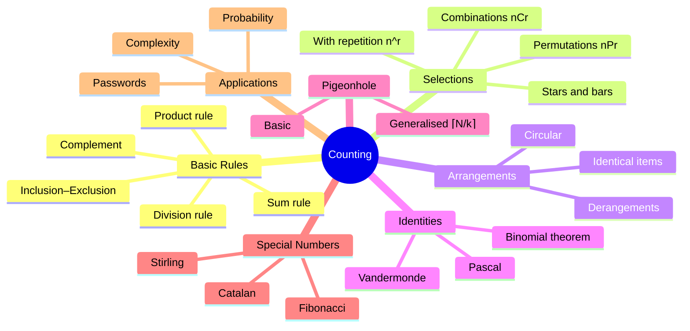
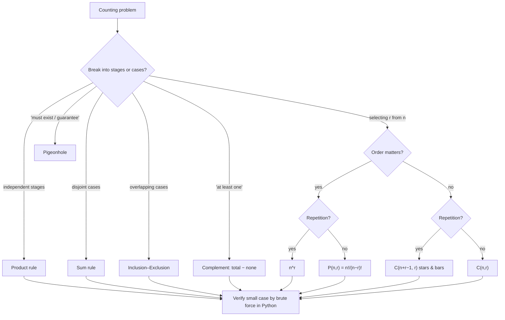

# 08 — Counting and Combinatorics

← [[07 - Mathematical Induction and Recursion]] | [[00 - Discrete Mathematics MOC|MOC]] | Next → [[09 - Discrete Probability]]

## 1. Core Concepts

### Basic Rules

| Rule               | Statement                                                                        | Example                                    |
| ------------------ | -------------------------------------------------------------------------------- | ------------------------------------------ |
| **Sum rule**       | Task done in one of n₁ **or** n₂ disjoint ways ⇒ n₁ + n₂ ways                    | 5 pizzas or 3 burgers ⇒ 8 meals            |
| **Product rule**   | Task = step 1 (n₁ ways) **and** step 2 (n₂ ways) ⇒ n₁ · n₂ ways                  | 3 shirts × 4 pants ⇒ 12 outfits            |
| **Subtraction (inclusion–exclusion)** | \|A ∪ B\| = \|A\| + \|B\| − \|A ∩ B\|                       | bit strings starting with 1 or ending with 00 |
| **Division rule**  | n ways, each outcome counted d times ⇒ n/d                                       | seating around a round table: n!/n         |
| **Complement**     | count(wanted) = count(all) − count(unwanted)                                     | passwords with ≥ 1 digit                   |

### The Four Fundamental Selections (choose r from n)

|                          | **Order matters**              | **Order doesn't matter**             |
| ------------------------ | ------------------------------ | ------------------------------------ |
| **No repetition**        | Permutation P(n,r) = n!/(n−r)! | Combination C(n,r) = n!/(r!(n−r)!)   |
| **Repetition allowed**   | nʳ                             | C(n + r − 1, r)  (stars and bars)    |

> [!tip] Decision questions
> 1. Does **order** matter? (PIN codes: yes; lottery tickets: no)
> 2. Can items **repeat**? (dice rolls: yes; picking committee members: no)

### More Tools

| Tool                               | Formula / statement                                                  |
| ---------------------------------- | -------------------------------------------------------------------- |
| Permutations with identical items  | n! / (n₁! n₂! … nₖ!)  — e.g. arrangements of "MISSISSIPPI"           |
| Circular permutations              | (n − 1)!                                                             |
| Binomial theorem                   | (x + y)ⁿ = Σₖ C(n,k) xⁿ⁻ᵏ yᵏ                                         |
| Pascal's identity                  | C(n,k) = C(n−1,k−1) + C(n−1,k)                                       |
| Sum of a row                       | Σₖ C(n,k) = 2ⁿ                                                       |
| Vandermonde                        | C(m+n, r) = Σₖ C(m,k) C(n,r−k)                                       |
| Derangements (no fixed points)     | Dₙ = n! Σₖ (−1)ᵏ/k! ≈ n!/e                                           |
| Catalan numbers                    | Cₙ = C(2n,n)/(n+1): balanced parens, BST shapes, triangulations      |

### Pigeonhole Principle

> [!definition] Pigeonhole principle
> If n + 1 objects go into n boxes, some box contains ≥ 2 objects.
> **Generalised**: N objects in k boxes ⇒ some box has ≥ ⌈N/k⌉ objects.

### Pascal's Triangle

```
            1
          1   1
        1   2   1
      1   3   3   1
    1   4   6   4   1
  1   5  10  10   5   1
```

## 2. Worked Examples

> [!example] Example 1 — License plates: 3 letters then 3 digits
> 26³ · 10³ = **17,576,000** (product rule, repetition allowed).

> [!example] Example 2 — Podium (gold, silver, bronze) from 10 runners
> P(10, 3) = 10 · 9 · 8 = **720** (order matters).

> [!example] Example 3 — Committee of 3 from 10 people
> C(10, 3) = **120** (order doesn't matter). Note P(10,3)/3! = 720/6 = 120 (division rule).

> [!example] Example 4 — Committee of 3 men and 2 women from 7 men and 5 women
> C(7,3) · C(5,2) = 35 · 10 = **350**.

> [!example] Example 5 — Arrangements of "MISSISSIPPI"
> 11 letters: M×1, I×4, S×4, P×2 ⇒ 11!/(1!·4!·4!·2!) = **34,650**.

> [!example] Example 6 — Stars and bars
> Ways to buy 6 donuts from 4 flavours: C(6 + 4 − 1, 6) = C(9, 6) = **84**.
> Number of non-negative integer solutions of x₁ + x₂ + x₃ = 10: C(12, 2) = **66**.

> [!example] Example 7 — Pigeonhole
> Among 367 people, two share a birthday (366 possible days). Among any 5 integers, two have the same remainder mod 4.

> [!example] Example 8 — Complement counting
> 8-character lowercase+digit passwords with at least one digit: 36⁸ − 26⁸ = 2,821,109,907,456 − 208,827,064,576 = **2,612,282,842,880**.

## 3. Mind Map



## 4. Workflow — Which Formula?



## 5. Real-Life Examples

| Situation                                         | Count                                  |
| ------------------------------------------------- | -------------------------------------- |
| 4-digit PIN                                       | 10⁴ = 10,000                           |
| Lottery: choose 6 of 49                           | C(49, 6) = 13,983,816                  |
| Poker: number of 5-card hands                     | C(52, 5) = 2,598,960                   |
| Shuffled deck orderings                           | 52! ≈ 8.07 × 10⁶⁷ (every shuffle is likely unique in history) |
| IPv4 addresses                                    | 2³² ≈ 4.3 billion → why IPv6 (2¹²⁸)    |
| Pizza with any subset of 10 toppings              | 2¹⁰ = 1024                             |
| Round-robin tournament of 20 teams                | C(20, 2) = 190 matches                 |
| Brute-forcing a 128-bit key                       | 2¹²⁸ ≈ 3.4 × 10³⁸ tries                |
| Secret Santa with nobody drawing themselves       | Derangements D₁₀ = 1,334,961           |
| Load balancing: 1001 requests on 1000 servers     | Pigeonhole ⇒ some server gets ≥ 2      |
| Hash collisions are unavoidable                   | Pigeonhole: infinitely many inputs, finitely many hashes |

## 6. Programming Use Case (Python)

```python
from math import comb, perm, factorial, ceil
from itertools import permutations, combinations, product, combinations_with_replacement
from collections import Counter

def P(n, r):
    return perm(n, r)

def C(n, r):
    return comb(n, r)

def multiset_permutations(word: str) -> int:
    counts = Counter(word)
    result = factorial(len(word))
    for c in counts.values():
        result //= factorial(c)
    return result

def stars_and_bars(n_types: int, r_items: int) -> int:
    return comb(n_types + r_items - 1, r_items)

def derangements(n: int) -> int:
    # Recurrence D(n) = (n−1)(D(n−1) + D(n−2)), D(0)=1, D(1)=0
    a, b = 1, 0
    if n == 0:
        return 1
    for k in range(2, n + 1):
        a, b = b, (k - 1) * (a + b)
    return b

def catalan(n: int) -> int:
    return comb(2 * n, n) // (n + 1)

def pascal_triangle(rows: int):
    tri = [[1]]
    for _ in range(rows - 1):
        prev = tri[-1]
        tri.append([1] + [prev[i] + prev[i + 1] for i in range(len(prev) - 1)] + [1])
    return tri

def pigeonhole_min(objects: int, boxes: int) -> int:
    """Minimum guaranteed occupancy of the fullest box."""
    return ceil(objects / boxes)

def password_space(length: int, alphabet: int) -> int:
    return alphabet ** length

def brute_force_years(space: int, guesses_per_second: float) -> float:
    return space / guesses_per_second / (3600 * 24 * 365)
```

### Real use: password strength & generating combinations

```python
def passwords_with_at_least_one_digit(length: int) -> int:
    return 36 ** length - 26 ** length          # complement rule

def team_lineups(players, size):
    """All possible teams (order irrelevant)."""
    return list(combinations(players, size))

def strength_report(length, alphabet, rate=1e10):
    space = password_space(length, alphabet)
    return {"combinations": space, "years_to_brute_force": brute_force_years(space, rate)}
```

## 7. Test Cases

```python
def test_basic_formulas_match_brute_force():
    items = "abcde"
    assert len(list(permutations(items, 3))) == P(5, 3) == 60
    assert len(list(combinations(items, 3))) == C(5, 3) == 10
    assert len(list(product(items, repeat=3))) == 5 ** 3
    assert len(list(combinations_with_replacement(items, 3))) == stars_and_bars(5, 3) == 35

def test_worked_examples():
    assert 26 ** 3 * 10 ** 3 == 17_576_000
    assert P(10, 3) == 720 and C(10, 3) == 120
    assert C(7, 3) * C(5, 2) == 350
    assert multiset_permutations("MISSISSIPPI") == 34650
    assert stars_and_bars(4, 6) == 84
    assert stars_and_bars(3, 10) == 66

def test_multiset_brute_force():
    assert multiset_permutations("AABB") == len(set(permutations("AABB"))) == 6

def test_derangements():
    assert [derangements(n) for n in range(7)] == [1, 0, 1, 2, 9, 44, 265]
    brute = sum(all(p[i] != i for i in range(5)) for p in permutations(range(5)))
    assert brute == derangements(5)

def test_catalan_counts_balanced_parens():
    def count_balanced(n):
        return sum(1 for s in product("()", repeat=2 * n)
                   if all(s[:i].count("(") >= s[:i].count(")") for i in range(2 * n + 1))
                   and s.count("(") == n)
    assert [catalan(n) for n in range(6)] == [1, 1, 2, 5, 14, 42]
    assert all(count_balanced(n) == catalan(n) for n in range(1, 6))

def test_pascal_and_binomial():
    tri = pascal_triangle(8)
    assert tri[5] == [1, 5, 10, 10, 5, 1]
    assert all(sum(tri[n]) == 2 ** n for n in range(8))
    x, y, n = 3, 2, 6
    assert (x + y) ** n == sum(C(n, k) * x ** (n - k) * y ** k for k in range(n + 1))

def test_pigeonhole():
    assert pigeonhole_min(367, 366) == 2
    assert pigeonhole_min(100, 12) == 9
    nums = [7, 12, 33, 41, 58]
    remainders = [x % 4 for x in nums]
    assert len(set(remainders)) < len(remainders)   # 5 integers, 4 remainders

def test_passwords():
    assert passwords_with_at_least_one_digit(8) == 2_612_282_842_880
    assert strength_report(12, 94)["years_to_brute_force"] > 1000
    assert len(team_lineups(["a", "b", "c", "d"], 2)) == 6

def test_famous_numbers():
    assert C(49, 6) == 13_983_816
    assert C(52, 5) == 2_598_960
    assert derangements(10) == 1_334_961
```

## 8. Practice Problems

1. How many bit strings of length 10 contain exactly four 1s?
2. How many ways can 8 people sit around a round table?
3. How many 5-card poker hands contain exactly one pair?
4. How many integers 1..100 must you pick to guarantee two that sum to 101?
5. How many shortest lattice paths from (0,0) to (5,3)?

> [!success]- Answers
> 1. C(10, 4) = 210.
> 2. 7! = 5040.
> 3. 13 · C(4,2) · C(12,3) · 4³ = 1,098,240.
> 4. 51 (50 pairs {1,100}, {2,99}, …).
> 5. C(8, 3) = 56.

## 9. Summary

> [!summary]
> - Sum rule (or), product rule (and), inclusion–exclusion (overlap), complement ("at least").
> - Ask **order?** and **repetition?** → P(n,r), C(n,r), nʳ, or C(n+r−1, r).
> - Pigeonhole guarantees existence; it explains unavoidable hash collisions.
> - Always sanity-check formulas with `itertools` brute force on small inputs.
> - Counting is the backbone of [[09 - Discrete Probability]].
