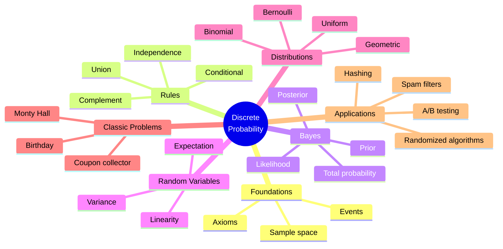
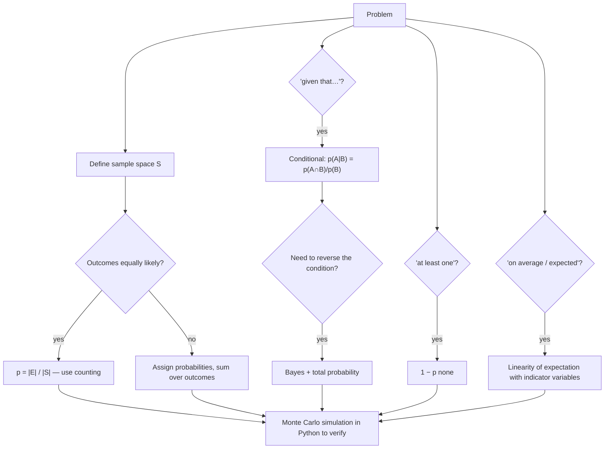

# 09 — Discrete Probability

← [[08 - Counting and Combinatorics]] | [[00 - Discrete Mathematics MOC|MOC]] | Next → [[10 - Number Theory and Cryptography]]

## 1. Core Concepts

| Term                | Meaning                                                        | Example (one die)          |
| ------------------- | -------------------------------------------------------------- | -------------------------- |
| Experiment          | Process with uncertain outcome                                 | Roll a die                 |
| Sample space S      | Set of all outcomes                                            | {1, 2, 3, 4, 5, 6}         |
| Event E             | Subset of S                                                    | "even" = {2, 4, 6}         |
| Probability (equally likely) | p(E) = \|E\| / \|S\|                                  | 3/6 = 1/2                  |

### Axioms (Kolmogorov)
1. 0 ≤ p(E) ≤ 1
2. p(S) = 1
3. For disjoint events: p(E₁ ∪ E₂) = p(E₁) + p(E₂)

### Rules

| Rule                     | Formula                                              |
| ------------------------ | ---------------------------------------------------- |
| Complement               | p(Ē) = 1 − p(E)                                      |
| Union                    | p(A ∪ B) = p(A) + p(B) − p(A ∩ B)                    |
| Conditional probability  | p(A \| B) = p(A ∩ B) / p(B)                          |
| Multiplication           | p(A ∩ B) = p(A \| B) · p(B)                          |
| Independence             | A, B independent ⟺ p(A ∩ B) = p(A) · p(B)            |
| Total probability        | p(A) = Σᵢ p(A \| Bᵢ) p(Bᵢ)  (Bᵢ partition S)         |
| **Bayes' theorem**       | p(B \| A) = p(A \| B) · p(B) / p(A)                  |

### Random Variables

> [!definition] Random variable
> A **random variable** X is a function S → ℝ (see [[06 - Functions]]). Example: X = sum of two dice.

| Quantity          | Formula                                 | Meaning                     |
| ----------------- | --------------------------------------- | --------------------------- |
| Expectation E[X]  | Σ x · p(X = x)                          | Long-run average            |
| Linearity         | E[aX + bY] = aE[X] + bE[Y] (always!)    | No independence required    |
| Variance V[X]     | E[X²] − (E[X])²                         | Spread                      |
| Std deviation     | √V[X]                                   |                             |

### Common Distributions

| Distribution  | Models                                     | p(X = k)                         | E[X]  | V[X]       |
| ------------- | ------------------------------------------ | -------------------------------- | ----- | ---------- |
| Bernoulli(p)  | single success/fail                        | p if k = 1, 1 − p if k = 0       | p     | p(1 − p)   |
| Binomial(n,p) | # successes in n independent trials        | C(n,k) pᵏ (1−p)ⁿ⁻ᵏ               | np    | np(1 − p)  |
| Geometric(p)  | # trials until first success               | (1−p)ᵏ⁻¹ p                       | 1/p   | (1−p)/p²   |
| Uniform{1..n} | fair die                                   | 1/n                              | (n+1)/2 | (n²−1)/12 |

## 2. Worked Examples

> [!example] Example 1 — Two dice, sum = 7
> |S| = 36. Favourable: (1,6),(2,5),(3,4),(4,3),(5,2),(6,1) ⇒ 6/36 = **1/6**.

> [!example] Example 2 — At least one six in 4 rolls
> 1 − (5/6)⁴ ≈ **0.5177** (complement).

> [!example] Example 3 — Birthday problem
> p(all 23 people have different birthdays) = (365·364·…·343)/365²³ ≈ 0.4927 ⇒ p(shared) ≈ **0.507**.

> [!example] Example 4 — Bayes: medical test
> Disease prevalence 1%. Test sensitivity 99% (p(+ | D) = 0.99), false-positive rate 5% (p(+ | ¬D) = 0.05).
> p(+) = 0.99·0.01 + 0.05·0.99 = 0.0594
> p(D | +) = 0.0099 / 0.0594 ≈ **0.167** — only ~17%, despite the "99% accurate" test!

> [!example] Example 5 — Expectation of a die
> E[X] = (1+2+3+4+5+6)/6 = **3.5**. Sum of two dice: E = 3.5 + 3.5 = **7** (linearity).

> [!example] Example 6 — Monty Hall
> Pick 1 of 3 doors; host opens a goat door. Switching wins with probability **2/3**, staying wins with 1/3.

## 3. Mind Map



## 4. Workflow — Solving a Probability Problem



## 5. Real-Life Examples

| Application                     | Probability concept                                           |
| ------------------------------- | ------------------------------------------------------------- |
| Email spam filters              | Naive Bayes: p(spam \| words)                                 |
| Medical diagnosis               | Bayes — base rates matter (false positives)                   |
| Hash table performance          | Expected chain length = n/m (load factor)                     |
| Birthday attack on hashes       | Collisions after ~√(2ᴺ) attempts for an N-bit hash            |
| Randomized Quicksort            | Expected O(n log n) comparisons                               |
| A/B testing websites            | Binomial distribution of conversions                          |
| Insurance & casinos             | Expected value — the house always has positive expectation    |
| Network packet loss / retries   | Geometric distribution: expected tries = 1/p                  |
| Weather forecast "70% rain"     | Frequency / calibrated probability                            |

## 6. Programming Use Case (Python)

```python
import random
from fractions import Fraction
from itertools import product
from math import comb, prod

def prob(event, space):
    """Exact probability for equally likely outcomes."""
    space = list(space)
    return Fraction(sum(1 for s in space if event(s)), len(space))

def conditional(a, b, space):
    space = list(space)
    nb = sum(1 for s in space if b(s))
    nab = sum(1 for s in space if a(s) and b(s))
    return Fraction(nab, nb)

def bayes(prior, likelihood, false_positive_rate):
    """p(H | evidence)."""
    evidence = likelihood * prior + false_positive_rate * (1 - prior)
    return likelihood * prior / evidence

def expectation(dist: dict):
    return sum(x * p for x, p in dist.items())

def variance(dist: dict):
    mu = expectation(dist)
    return sum((x - mu) ** 2 * p for x, p in dist.items())

def binomial_pmf(k, n, p):
    return comb(n, k) * p ** k * (1 - p) ** (n - k)

def birthday_shared(n, days=365):
    return 1 - prod((days - i) / days for i in range(n))

TWO_DICE = list(product(range(1, 7), repeat=2))
```

### Monte Carlo simulation (verify answers empirically)

```python
def monty_hall(trials=100_000, switch=True, seed=42):
    rng = random.Random(seed)
    wins = 0
    for _ in range(trials):
        car = rng.randrange(3)
        pick = rng.randrange(3)
        opened = next(d for d in range(3) if d != pick and d != car)
        if switch:
            pick = next(d for d in range(3) if d != pick and d != opened)
        wins += pick == car
    return wins / trials

def simulate_birthday(n, trials=20_000, seed=1):
    rng = random.Random(seed)
    hits = sum(len(set(rng.randrange(365) for _ in range(n))) < n for _ in range(trials))
    return hits / trials
```

### Real use: a tiny Naive Bayes spam filter

```python
from collections import Counter
from math import log

class NaiveBayesSpam:
    def fit(self, docs, labels):
        self.words = {True: Counter(), False: Counter()}
        self.docs = Counter(labels)
        for d, spam in zip(docs, labels):
            self.words[spam].update(d.lower().split())
        self.vocab = set(self.words[True]) | set(self.words[False])
        return self

    def _log_score(self, doc, spam):
        total = sum(self.words[spam].values())
        score = log(self.docs[spam] / sum(self.docs.values()))   # prior
        for w in doc.lower().split():                            # likelihoods, Laplace smoothing
            score += log((self.words[spam][w] + 1) / (total + len(self.vocab)))
        return score

    def is_spam(self, doc):
        return self._log_score(doc, True) > self._log_score(doc, False)
```

## 7. Test Cases

```python
def test_dice():
    assert prob(lambda s: sum(s) == 7, TWO_DICE) == Fraction(1, 6)
    assert prob(lambda s: s[0] == s[1], TWO_DICE) == Fraction(1, 6)
    assert conditional(lambda s: sum(s) == 8, lambda s: s[0] == 3, TWO_DICE) == Fraction(1, 6)

def test_independence():
    A = lambda s: s[0] % 2 == 0      # first die even
    B = lambda s: s[1] > 4           # second die 5 or 6
    assert prob(lambda s: A(s) and B(s), TWO_DICE) == prob(A, TWO_DICE) * prob(B, TWO_DICE)

def test_complement_at_least_one_six():
    assert abs((1 - (5 / 6) ** 4) - 0.5177) < 1e-4

def test_birthday():
    assert birthday_shared(23) > 0.5 > birthday_shared(22)
    assert abs(simulate_birthday(23) - birthday_shared(23)) < 0.02

def test_bayes_medical():
    assert abs(bayes(0.01, 0.99, 0.05) - 0.1667) < 1e-3

def test_expectation_variance():
    die = {k: Fraction(1, 6) for k in range(1, 7)}
    assert expectation(die) == Fraction(7, 2)
    assert variance(die) == Fraction(35, 12)
    two = {}
    for a, b in TWO_DICE:
        two[a + b] = two.get(a + b, 0) + Fraction(1, 36)
    assert expectation(two) == 7          # linearity

def test_binomial():
    assert abs(sum(binomial_pmf(k, 10, 0.3) for k in range(11)) - 1) < 1e-12
    assert abs(sum(k * binomial_pmf(k, 10, 0.3) for k in range(11)) - 3.0) < 1e-12

def test_monty_hall():
    assert abs(monty_hall(switch=True) - 2 / 3) < 0.01
    assert abs(monty_hall(switch=False) - 1 / 3) < 0.01

def test_naive_bayes():
    docs = ["win money now", "cheap money offer", "meeting at noon", "project meeting notes"]
    labels = [True, True, False, False]
    nb = NaiveBayesSpam().fit(docs, labels)
    assert nb.is_spam("win cheap money")
    assert not nb.is_spam("notes from the meeting")
```

## 8. Practice Problems

1. A fair coin is tossed 10 times. P(exactly 5 heads)?
2. Draw 2 cards without replacement. P(both aces)?
3. Expected number of fixed points of a random permutation of n items? *(Hint: indicator variables.)*
4. A factory: machine A makes 60% of items (2% defective), B makes 40% (5% defective). An item is defective — P(it came from B)?

> [!success]- Answers
> 1. C(10,5)/2¹⁰ = 252/1024 ≈ 0.246.
> 2. (4/52)(3/51) = 1/221.
> 3. 1 (each of the n items is fixed with probability 1/n).
> 4. 0.02/(0.012 + 0.02) = 0.625.

## 9. Summary

> [!summary]
> - Equally likely outcomes ⇒ probability = counting ([[08 - Counting and Combinatorics]]).
> - Conditional probability and **Bayes** reverse the direction of evidence; base rates matter.
> - **Linearity of expectation** works even without independence — a powerful trick.
> - Use exact `Fraction`s for small spaces and Monte Carlo simulation to check intuition.
