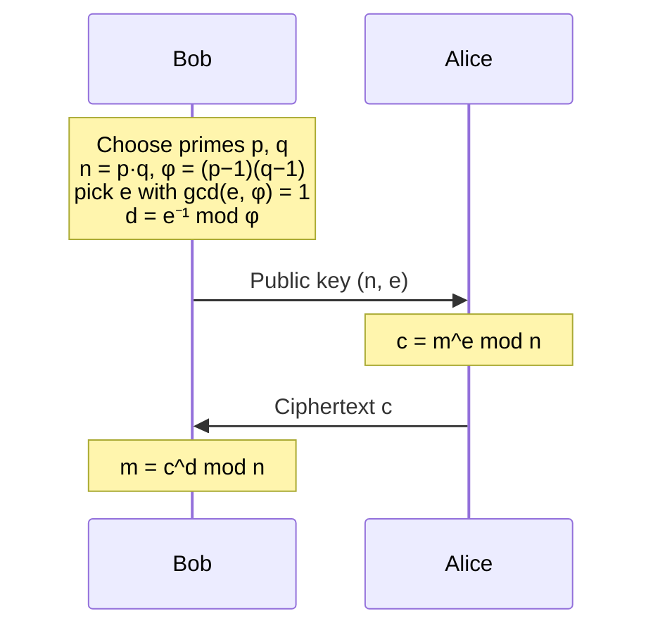
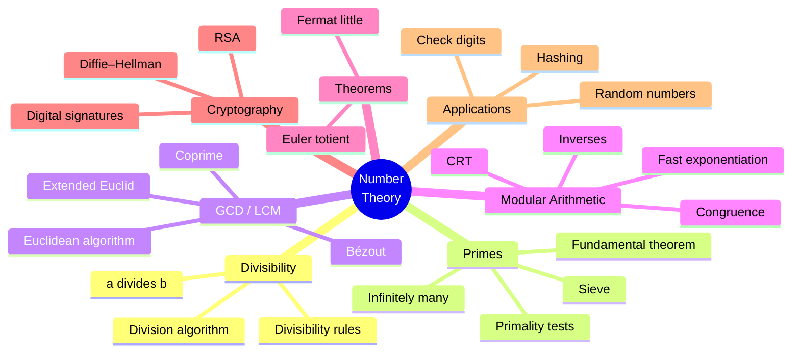
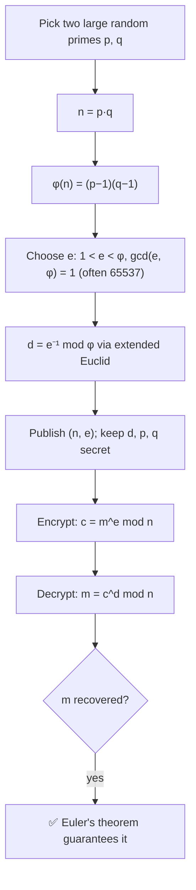
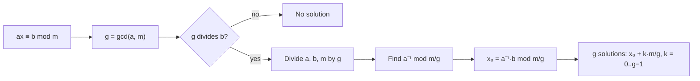

# 10 — Number Theory and Cryptography

← [[09 - Discrete Probability]] | [[00 - Discrete Mathematics MOC|MOC]] | Next → [[11 - Recurrence Relations]]

## 1. Core Concepts

### Divisibility
- **a | b** (a divides b) ⟺ ∃k ∈ ℤ: b = ak.
- Properties: a | b ∧ a | c ⇒ a | (b + c); a | b ⇒ a | bc; a | b ∧ b | c ⇒ a | c.
- **Division algorithm**: for a ∈ ℤ, d > 0 there are unique q, r with a = dq + r, 0 ≤ r < d. (`q, r = divmod(a, d)`)

### Primes
- p > 1 is **prime** if its only positive divisors are 1 and p; otherwise **composite**.
- **Fundamental Theorem of Arithmetic**: every n > 1 has a unique prime factorisation (60 = 2² · 3 · 5).
- If n is composite, it has a prime factor ≤ √n ⇒ trial division up to √n.
- Infinitely many primes (Euclid, see [[03 - Proof Techniques]]).
- **Sieve of Eratosthenes** lists all primes ≤ n in O(n log log n).

### GCD and LCM
- gcd(a, b): largest d dividing both. lcm(a, b): smallest positive multiple of both.
- gcd(a, b) · lcm(a, b) = |a · b|.
- **Euclidean algorithm**: gcd(a, b) = gcd(b, a mod b), gcd(a, 0) = a. Runs in O(log min(a, b)).
- **Bézout's identity**: ∃ s, t ∈ ℤ with gcd(a, b) = sa + tb (found by the **extended Euclidean algorithm**).
- a and b are **coprime** if gcd(a, b) = 1.

### Modular Arithmetic
- a ≡ b (mod m) ⟺ m | (a − b). An [[05 - Relations|equivalence relation]] with classes [0], …, [m−1].
- If a ≡ b and c ≡ d (mod m): a + c ≡ b + d and ac ≡ bd (mod m).
- **Modular inverse**: ā with aā ≡ 1 (mod m) exists ⟺ gcd(a, m) = 1. (`pow(a, -1, m)` in Python 3.8+)
- **Fast modular exponentiation**: compute aⁿ mod m in O(log n) by repeated squaring (`pow(a, n, m)`).

### Key Theorems

| Theorem                     | Statement                                                                 |
| --------------------------- | ------------------------------------------------------------------------- |
| Fermat's little theorem     | p prime, p ∤ a ⇒ aᵖ⁻¹ ≡ 1 (mod p)                                         |
| Euler's theorem             | gcd(a, n) = 1 ⇒ a^φ(n) ≡ 1 (mod n)                                        |
| Euler's totient φ(n)        | # of 1 ≤ k ≤ n coprime to n; φ(p) = p − 1, φ(pq) = (p−1)(q−1)             |
| Chinese Remainder Theorem   | x ≡ aᵢ (mod mᵢ) with pairwise-coprime mᵢ has a unique solution mod ∏mᵢ   |

### RSA Public-Key Cryptography



**Why it works**: ed ≡ 1 (mod φ(n)) ⇒ m^(ed) = m^(1 + kφ(n)) ≡ m (mod n) by Euler's theorem.
**Why it is secure**: recovering d requires φ(n), which requires factoring n — believed hard for 2048-bit n.

## 2. Worked Examples

> [!example] Example 1 — Euclidean algorithm: gcd(252, 198)
> 252 = 1·198 + 54
> 198 = 3·54 + 36
> 54 = 1·36 + 18
> 36 = 2·18 + 0 ⇒ **gcd = 18**, lcm = 252·198/18 = 2772.

> [!example] Example 2 — Extended Euclid / Bézout
> Back-substitute: 18 = 54 − 36 = 54 − (198 − 3·54) = 4·54 − 198 = 4(252 − 198) − 198 = **4·252 − 5·198**.

> [!example] Example 3 — Modular inverse of 3 mod 7
> 3 · 5 = 15 ≡ 1 (mod 7) ⇒ 3⁻¹ ≡ **5**.

> [!example] Example 4 — Fast exponentiation: 3²⁰⁰ mod 13
> Fermat: 3¹² ≡ 1 (mod 13). 200 = 16·12 + 8 ⇒ 3²⁰⁰ ≡ 3⁸ = 6561 ≡ **9** (mod 13).

> [!example] Example 5 — Chinese Remainder Theorem
> x ≡ 2 (mod 3), x ≡ 3 (mod 5), x ≡ 2 (mod 7) ⇒ **x = 23** (mod 105). (Sunzi's classic problem.)

> [!example] Example 6 — Toy RSA
> p = 61, q = 53 ⇒ n = 3233, φ = 3120. e = 17, d = 17⁻¹ mod 3120 = 2753.
> Encrypt m = 65: c = 65¹⁷ mod 3233 = **2790**. Decrypt: 2790²⁷⁵³ mod 3233 = **65** ✅

## 3. Mind Map



## 4. Workflow — RSA from Scratch



### Workflow — Solving a Linear Congruence ax ≡ b (mod m)



## 5. Real-Life Examples

| Application                          | Number theory used                                          |
| ------------------------------------ | ----------------------------------------------------------- |
| HTTPS / TLS, SSH keys                | RSA, Diffie–Hellman, elliptic curves                        |
| Digital signatures, Bitcoin          | Modular exponentiation, elliptic curves over finite fields  |
| ISBN-10 / ISBN-13, credit cards (Luhn)| Check digits mod 11 / mod 10 catch typing errors           |
| Clock and calendar arithmetic        | mod 12, mod 24, mod 7 (day of week)                         |
| Hash tables                          | h(k) = k mod p with p prime spreads keys evenly             |
| Pseudo-random generators             | Linear congruential: xₙ₊₁ = (a xₙ + c) mod m                |
| Simplifying fractions, gear ratios   | gcd and lcm                                                 |
| Scheduling repeating events          | lcm: buses every 12 and 18 min meet every 36 min            |

## 6. Programming Use Case (Python)

```python
from math import isqrt

def gcd(a: int, b: int) -> int:
    while b:
        a, b = b, a % b
    return abs(a)

def lcm(a: int, b: int) -> int:
    return abs(a * b) // gcd(a, b) if a and b else 0

def extended_gcd(a: int, b: int):
    """Return (g, s, t) with g = gcd(a, b) = s·a + t·b."""
    if b == 0:
        return a, 1, 0
    g, s, t = extended_gcd(b, a % b)
    return g, t, s - (a // b) * t

def mod_inverse(a: int, m: int) -> int:
    g, s, _ = extended_gcd(a % m, m)
    if g != 1:
        raise ValueError(f"{a} has no inverse mod {m}")
    return s % m

def mod_pow(base: int, exp: int, mod: int) -> int:
    """Square-and-multiply, O(log exp). Same as built-in pow(base, exp, mod)."""
    result, base = 1, base % mod
    while exp > 0:
        if exp & 1:
            result = result * base % mod
        base = base * base % mod
        exp >>= 1
    return result

def sieve(n: int):
    is_p = [True] * (n + 1)
    is_p[0:2] = [False, False]
    for i in range(2, isqrt(n) + 1):
        if is_p[i]:
            is_p[i * i:: i] = [False] * len(range(i * i, n + 1, i))
    return [i for i, p in enumerate(is_p) if p]

def factorize(n: int) -> dict:
    factors, d = {}, 2
    while d * d <= n:
        while n % d == 0:
            factors[d] = factors.get(d, 0) + 1
            n //= d
        d += 1
    if n > 1:
        factors[n] = factors.get(n, 0) + 1
    return factors

def phi(n: int) -> int:
    result = n
    for p in factorize(n):
        result -= result // p
    return result

def crt(remainders, moduli):
    """Chinese Remainder Theorem for pairwise-coprime moduli."""
    M = 1
    for m in moduli:
        M *= m
    x = 0
    for a, m in zip(remainders, moduli):
        Mi = M // m
        x += a * Mi * mod_inverse(Mi, m)
    return x % M

def is_probable_prime(n: int, bases=(2, 3, 5, 7, 11, 13, 17, 19, 23, 29, 31, 37)) -> bool:
    """Miller–Rabin; deterministic for n < 3.3 × 10^24 with these bases."""
    if n < 2:
        return False
    for p in bases:
        if n % p == 0:
            return n == p
    d, s = n - 1, 0
    while d % 2 == 0:
        d //= 2
        s += 1
    for a in bases:
        x = pow(a, d, n)
        if x in (1, n - 1):
            continue
        for _ in range(s - 1):
            x = x * x % n
            if x == n - 1:
                break
        else:
            return False
    return True
```

### Real use: toy RSA and Luhn credit-card check

```python
def rsa_keygen(p: int, q: int, e: int = 65537):
    n, ph = p * q, (p - 1) * (q - 1)
    if gcd(e, ph) != 1:
        raise ValueError("e must be coprime to φ(n)")
    return (n, e), (n, mod_inverse(e, ph))

def rsa_encrypt(m: int, public):
    n, e = public
    return mod_pow(m, e, n)

def rsa_decrypt(c: int, private):
    n, d = private
    return mod_pow(c, d, n)

def luhn_valid(number: str) -> bool:
    digits = [int(c) for c in number if c.isdigit()][::-1]
    total = 0
    for i, d in enumerate(digits):
        if i % 2 == 1:
            d = d * 2 - 9 if d * 2 > 9 else d * 2
        total += d
    return total % 10 == 0

def isbn10_valid(isbn: str) -> bool:
    chars = [c for c in isbn if c.isdigit() or c in "Xx"]
    if len(chars) != 10:
        return False
    vals = [10 if c in "Xx" else int(c) for c in chars]
    return sum((10 - i) * v for i, v in enumerate(vals)) % 11 == 0
```

## 7. Test Cases

```python
import math

def test_gcd_lcm():
    assert gcd(252, 198) == 18 == math.gcd(252, 198)
    assert lcm(252, 198) == 2772
    assert gcd(17, 5) == 1
    assert all(gcd(a, b) * lcm(a, b) == a * b for a in range(1, 40) for b in range(1, 40))

def test_bezout():
    g, s, t = extended_gcd(252, 198)
    assert g == 18 and s * 252 + t * 198 == 18
    assert (s, t) == (4, -5)

def test_mod_inverse():
    assert mod_inverse(3, 7) == 5
    assert mod_inverse(17, 3120) == 2753 == pow(17, -1, 3120)
    try:
        mod_inverse(6, 9)
        assert False
    except ValueError:
        pass

def test_mod_pow_and_fermat():
    assert mod_pow(3, 200, 13) == 9 == pow(3, 200, 13)
    for p in sieve(100):
        for a in range(1, p):
            assert mod_pow(a, p - 1, p) == 1

def test_sieve_and_factor():
    assert sieve(30) == [2, 3, 5, 7, 11, 13, 17, 19, 23, 29]
    assert factorize(60) == {2: 2, 3: 1, 5: 1}
    assert factorize(97) == {97: 1}

def test_phi_and_euler():
    assert phi(1) == 1 and phi(9) == 6 and phi(3233) == 3120
    assert all(pow(a, phi(20), 20) == 1 for a in range(1, 20) if gcd(a, 20) == 1)

def test_crt():
    assert crt([2, 3, 2], [3, 5, 7]) == 23

def test_miller_rabin():
    assert [n for n in range(50) if is_probable_prime(n)] == sieve(49)
    assert is_probable_prime(2 ** 61 - 1)           # Mersenne prime
    assert not is_probable_prime(561)               # Carmichael number fools Fermat, not M–R

def test_rsa_toy():
    pub, priv = rsa_keygen(61, 53, 17)
    assert pub == (3233, 17) and priv == (3233, 2753)
    assert rsa_encrypt(65, pub) == 2790
    assert rsa_decrypt(2790, priv) == 65
    assert all(rsa_decrypt(rsa_encrypt(m, pub), priv) == m for m in range(0, 3233, 97))

def test_check_digits():
    assert luhn_valid("4539 1488 0343 6467")
    assert not luhn_valid("4539 1488 0343 6468")
    assert isbn10_valid("0-306-40615-2")
    assert not isbn10_valid("0-306-40615-3")
```

## 8. Practice Problems

1. Find gcd(1071, 462) and Bézout coefficients.
2. Solve 7x ≡ 3 (mod 26).
3. Compute 7²²² mod 11 by hand using Fermat.
4. Why must p and q in RSA be kept secret?
5. Find the smallest x > 0 with x ≡ 1 (mod 4), x ≡ 2 (mod 5), x ≡ 3 (mod 9).

> [!success]- Answers
> 1. 21 = −3·1071 + 7·462.
> 2. 7⁻¹ ≡ 15 (mod 26) ⇒ x ≡ 45 ≡ 19.
> 3. 7¹⁰ ≡ 1 ⇒ 7²²² ≡ 7² = 49 ≡ 5.
> 4. They give φ(n), hence d.
> 5. 57.

## 9. Summary

> [!summary]
> - Euclid's algorithm computes gcd in O(log n); extended Euclid gives inverses.
> - Modular arithmetic = arithmetic on equivalence classes; `pow(a, n, m)` is fast.
> - Fermat/Euler theorems power **RSA**, whose security rests on factoring being hard.
> - Everyday uses: check digits, hashing, scheduling, random numbers, secure web traffic.
