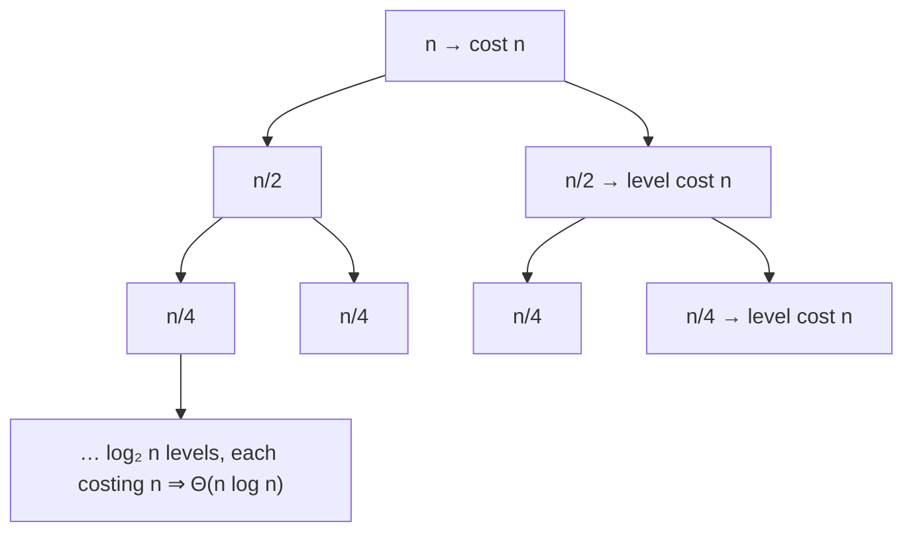
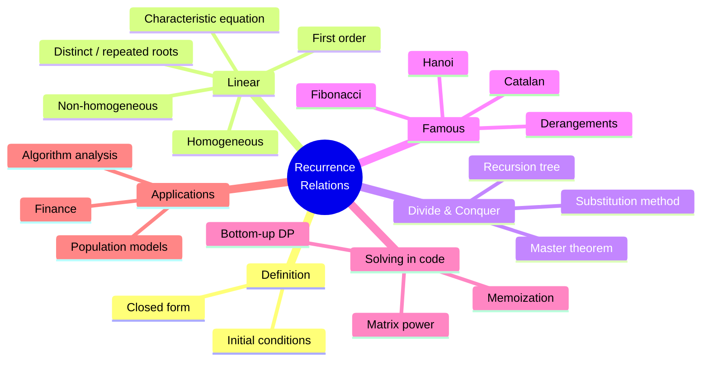
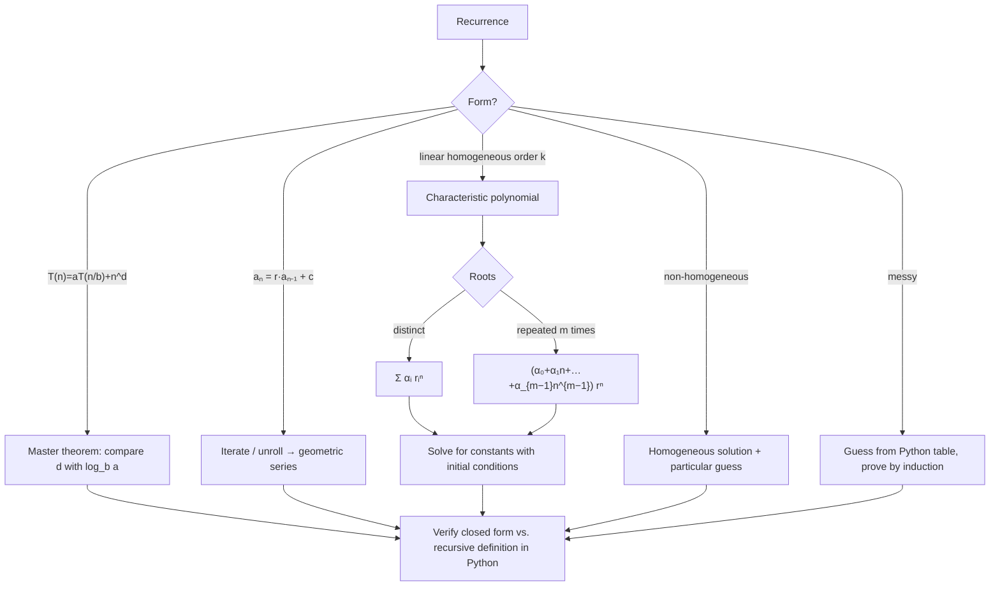

# 11 — Recurrence Relations

← [[10 - Number Theory and Cryptography]] | [[00 - Discrete Mathematics MOC|MOC]] | Next → [[12 - Graph Theory]]

## 1. Core Concepts

> [!definition] Recurrence relation
> An equation defining aₙ in terms of earlier terms a₀, …, aₙ₋₁, together with **initial conditions**. **Solving** it means finding a **closed form** aₙ = f(n).

### Kinds of Recurrences

| Kind                                | Example                         | Solution method                       |
| ----------------------------------- | ------------------------------- | ------------------------------------- |
| First-order linear                  | aₙ = r·aₙ₋₁ + c                 | Iteration / formula                   |
| Linear homogeneous, constant coeff. | aₙ = c₁aₙ₋₁ + c₂aₙ₋₂            | Characteristic equation               |
| Linear non-homogeneous              | aₙ = 2aₙ₋₁ + n                  | Homogeneous + particular solution     |
| Divide and conquer                  | T(n) = aT(n/b) + f(n)           | Master theorem, recursion tree        |

### Method 1 — Iteration (unrolling)
aₙ = aₙ₋₁ + d ⇒ aₙ = a₀ + nd (arithmetic)
aₙ = r aₙ₋₁ ⇒ aₙ = a₀ rⁿ (geometric)
aₙ = r aₙ₋₁ + c (r ≠ 1) ⇒ aₙ = rⁿ a₀ + c(rⁿ − 1)/(r − 1)

### Method 2 — Characteristic Equation (2nd order)
For aₙ = c₁aₙ₋₁ + c₂aₙ₋₂, solve **r² − c₁r − c₂ = 0**:

| Roots                  | General solution                     |
| ---------------------- | ------------------------------------ |
| Distinct r₁ ≠ r₂       | aₙ = α r₁ⁿ + β r₂ⁿ                   |
| Repeated r₀            | aₙ = (α + β n) r₀ⁿ                   |

Find α, β from the initial conditions.

### Method 3 — Master Theorem
For T(n) = a·T(n/b) + Θ(nᵈ), with a ≥ 1, b > 1, d ≥ 0:

| Case           | Condition       | T(n)               |
| -------------- | --------------- | ------------------ |
| 1 (leaves win) | d < log_b a     | Θ(n^(log_b a))     |
| 2 (balanced)   | d = log_b a     | Θ(nᵈ log n)        |
| 3 (root wins)  | d > log_b a     | Θ(nᵈ)              |

### Common Algorithm Recurrences

| Algorithm               | Recurrence                | Solution        |
| ----------------------- | ------------------------- | --------------- |
| Binary search           | T(n) = T(n/2) + 1         | Θ(log n)        |
| Merge sort              | T(n) = 2T(n/2) + n        | Θ(n log n)      |
| Linear search (recursive)| T(n) = T(n−1) + 1        | Θ(n)            |
| Selection sort          | T(n) = T(n−1) + n         | Θ(n²)           |
| Karatsuba multiplication| T(n) = 3T(n/2) + n        | Θ(n^1.585)      |
| Strassen matrix mult.   | T(n) = 7T(n/2) + n²       | Θ(n^2.807)      |
| Tower of Hanoi          | T(n) = 2T(n−1) + 1        | 2ⁿ − 1          |
| Naive Fibonacci         | T(n) = T(n−1) + T(n−2) + 1| Θ(φⁿ)           |

### Recursion Tree for Merge Sort



## 2. Worked Examples

> [!example] Example 1 — Compound interest
> Aₙ = 1.05·Aₙ₋₁, A₀ = 1000 ⇒ Aₙ = 1000·1.05ⁿ. After 10 years: ≈ **1628.89**.

> [!example] Example 2 — Fibonacci closed form (Binet)
> Fₙ = Fₙ₋₁ + Fₙ₋₂ ⇒ r² − r − 1 = 0 ⇒ r = (1 ± √5)/2 = φ, ψ.
> F₀ = 0, F₁ = 1 ⇒ α = 1/√5, β = −1/√5 ⇒ **Fₙ = (φⁿ − ψⁿ)/√5**.

> [!example] Example 3 — Distinct roots
> aₙ = 5aₙ₋₁ − 6aₙ₋₂, a₀ = 1, a₁ = 4. r² − 5r + 6 = 0 ⇒ r = 2, 3.
> aₙ = α2ⁿ + β3ⁿ: α + β = 1, 2α + 3β = 4 ⇒ β = 2, α = −1 ⇒ **aₙ = 2·3ⁿ − 2ⁿ**.

> [!example] Example 4 — Repeated root
> aₙ = 4aₙ₋₁ − 4aₙ₋₂, a₀ = 1, a₁ = 6. r = 2 (double).
> aₙ = (α + βn)2ⁿ: α = 1, 2(1 + β) = 6 ⇒ β = 2 ⇒ **aₙ = (1 + 2n)2ⁿ**.

> [!example] Example 5 — Master theorem
> - Merge sort: a = 2, b = 2, d = 1, log₂2 = 1 = d ⇒ Case 2 ⇒ Θ(n log n).
> - T(n) = 8T(n/2) + n²: log₂8 = 3 > 2 ⇒ Case 1 ⇒ Θ(n³).
> - T(n) = 2T(n/2) + n²: log₂2 = 1 < 2 ⇒ Case 3 ⇒ Θ(n²).

> [!example] Example 6 — Bit strings with no two consecutive 0s
> Let aₙ = count of length n. Last bit 1: aₙ₋₁ ways. Last bits "10": aₙ₋₂ ways.
> aₙ = aₙ₋₁ + aₙ₋₂, a₁ = 2, a₂ = 3 ⇒ aₙ = Fₙ₊₂.

## 3. Mind Map



## 4. Workflow — Solving a Recurrence



## 5. Real-Life Examples

| Situation                                  | Recurrence                                     |
| ------------------------------------------ | ---------------------------------------------- |
| Bank savings with monthly deposit          | Bₙ = (1 + r)Bₙ₋₁ + D                           |
| Loan amortisation                          | Bₙ = (1 + r)Bₙ₋₁ − payment                     |
| Rabbit population (Fibonacci's original)   | Fₙ = Fₙ₋₁ + Fₙ₋₂                               |
| Drug concentration with repeated doses     | Cₙ = k·Cₙ₋₁ + dose                             |
| Virus spread (simple model)                | Iₙ = R·Iₙ₋₁                                    |
| Running time of merge sort / quicksort     | Divide-and-conquer recurrences                 |
| Number of ways to climb stairs (1 or 2 steps)| Fibonacci                                    |
| Dynamic programming (edit distance, knapsack)| Multi-variable recurrences                   |

## 6. Programming Use Case (Python)

```python
from functools import lru_cache
from math import log, sqrt, isclose

def solve_first_order(r, c, a0, n):
    """Closed form of aₙ = r·aₙ₋₁ + c."""
    if r == 1:
        return a0 + c * n
    return r ** n * a0 + c * (r ** n - 1) / (r - 1)

def iterate(recurrence, initial, n):
    """Generic bottom-up evaluator: recurrence(prev_terms_list) -> next term."""
    terms = list(initial)
    while len(terms) <= n:
        terms.append(recurrence(terms))
    return terms[n]

def solve_second_order(c1, c2, a0, a1):
    """Return closed-form function for aₙ = c1·aₙ₋₁ + c2·aₙ₋₂ (real roots)."""
    disc = c1 * c1 + 4 * c2
    if disc < 0:
        raise ValueError("complex roots not handled here")
    if disc == 0:
        r = c1 / 2
        alpha = a0
        beta = a1 / r - alpha
        return lambda n: (alpha + beta * n) * r ** n
    r1, r2 = (c1 + sqrt(disc)) / 2, (c1 - sqrt(disc)) / 2
    beta = (a1 - a0 * r1) / (r2 - r1)
    alpha = a0 - beta
    return lambda n: alpha * r1 ** n + beta * r2 ** n

def binet(n):
    phi, psi = (1 + sqrt(5)) / 2, (1 - sqrt(5)) / 2
    return round((phi ** n - psi ** n) / sqrt(5))

def fib_matrix(n):
    """O(log n) Fibonacci via [[1,1],[1,0]]^n."""
    def mul(A, B):
        return [[A[0][0]*B[0][0] + A[0][1]*B[1][0], A[0][0]*B[0][1] + A[0][1]*B[1][1]],
                [A[1][0]*B[0][0] + A[1][1]*B[1][0], A[1][0]*B[0][1] + A[1][1]*B[1][1]]]
    result, M = [[1, 0], [0, 1]], [[1, 1], [1, 0]]
    while n:
        if n & 1:
            result = mul(result, M)
        M = mul(M, M)
        n >>= 1
    return result[0][1]

def master_theorem(a, b, d):
    crit = log(a, b)
    if isclose(d, crit):
        return f"Θ(n^{d} log n)"
    if d < crit:
        return f"Θ(n^{crit:.3f})"
    return f"Θ(n^{d})"
```

### Real use: count operations of merge sort and compare with n log n

```python
def merge_sort(xs, counter):
    if len(xs) <= 1:
        return xs
    mid = len(xs) // 2
    left, right = merge_sort(xs[:mid], counter), merge_sort(xs[mid:], counter)
    out, i, j = [], 0, 0
    while i < len(left) and j < len(right):
        counter[0] += 1                      # one comparison
        if left[i] <= right[j]:
            out.append(left[i]); i += 1
        else:
            out.append(right[j]); j += 1
    return out + left[i:] + right[j:]

def savings_balance(months, monthly_rate, deposit, start=0.0):
    """Bₙ = (1 + r)Bₙ₋₁ + D — closed form via solve_first_order."""
    return solve_first_order(1 + monthly_rate, deposit, start, months)

@lru_cache(maxsize=None)
def climb_stairs(n):
    """Ways to climb n stairs taking 1 or 2 steps."""
    return 1 if n <= 1 else climb_stairs(n - 1) + climb_stairs(n - 2)
```

## 7. Test Cases

```python
import random

def test_first_order():
    assert round(solve_first_order(1.05, 0, 1000, 10), 2) == 1628.89
    assert solve_first_order(1, 3, 2, 5) == 17
    assert all(isclose(solve_first_order(2, 1, 0, n), iterate(lambda t: 2 * t[-1] + 1, [0], n)) for n in range(15))

def test_hanoi_closed_form():
    assert all(iterate(lambda t: 2 * t[-1] + 1, [0], n) == 2 ** n - 1 for n in range(20))

def test_distinct_roots():
    f = solve_second_order(5, -6, 1, 4)
    for n in range(15):
        assert round(f(n)) == 2 * 3 ** n - 2 ** n == iterate(lambda t: 5 * t[-1] - 6 * t[-2], [1, 4], n)

def test_repeated_root():
    f = solve_second_order(4, -4, 1, 6)
    for n in range(15):
        assert round(f(n)) == (1 + 2 * n) * 2 ** n == iterate(lambda t: 4 * t[-1] - 4 * t[-2], [1, 6], n)

def test_fibonacci_methods_agree():
    fibs = [iterate(lambda t: t[-1] + t[-2], [0, 1], n) for n in range(60)]
    assert fibs[:10] == [0, 1, 1, 2, 3, 5, 8, 13, 21, 34]
    assert all(binet(n) == fibs[n] for n in range(60))
    assert all(fib_matrix(n) == fibs[n] for n in range(60))

def test_no_consecutive_zeros():
    from itertools import product
    for n in range(1, 12):
        count = sum("00" not in "".join(s) for s in product("01", repeat=n))
        assert count == fib_matrix(n + 2)

def test_master_theorem():
    assert master_theorem(2, 2, 1) == "Θ(n^1 log n)"     # merge sort
    assert master_theorem(1, 2, 0) == "Θ(n^0 log n)"     # binary search = Θ(log n)
    assert master_theorem(8, 2, 2) == "Θ(n^3.000)"
    assert master_theorem(2, 2, 2) == "Θ(n^2)"
    assert master_theorem(3, 2, 1) == "Θ(n^1.585)"       # Karatsuba

def test_merge_sort_comparisons_bounded_by_n_log_n():
    rng = random.Random(0)
    for n in (16, 128, 1024):
        xs = [rng.random() for _ in range(n)]
        c = [0]
        assert merge_sort(xs, c) == sorted(xs)
        assert c[0] <= n * log(n, 2)

def test_real_life():
    assert climb_stairs(10) == 89
    assert round(savings_balance(12, 0.01, 100), 2) == 1268.25
```

## 8. Practice Problems

1. Solve aₙ = 3aₙ₋₁, a₀ = 2.
2. Solve aₙ = aₙ₋₁ + 6aₙ₋₂, a₀ = 3, a₁ = 6.
3. Apply the master theorem to T(n) = 4T(n/2) + n.
4. Find a recurrence for the number of ways to tile a 2 × n board with 1 × 2 dominoes.
5. A loan of 10,000 at 1% monthly with payments of 500: write the recurrence and find when it is paid off (Python).

> [!success]- Answers
> 1. aₙ = 2·3ⁿ.
> 2. r = 3, −2 ⇒ aₙ = (12/5)·3ⁿ + (3/5)(−2)ⁿ.
> 3. log₂4 = 2 > 1 ⇒ Θ(n²).
> 4. tₙ = tₙ₋₁ + tₙ₋₂, t₁ = 1, t₂ = 2 (Fibonacci).
> 5. Bₙ = 1.01Bₙ₋₁ − 500; paid off in month 23.

## 9. Summary

> [!summary]
> - Recurrences describe sequences and the running time of recursive algorithms.
> - Linear: characteristic roots → closed form; constants from initial conditions.
> - Divide & conquer: **master theorem** compares d with log_b a.
> - Always cross-check closed forms with an iterative Python evaluator, then prove by [[07 - Mathematical Induction and Recursion|induction]].
