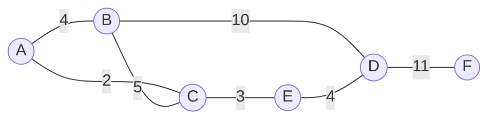
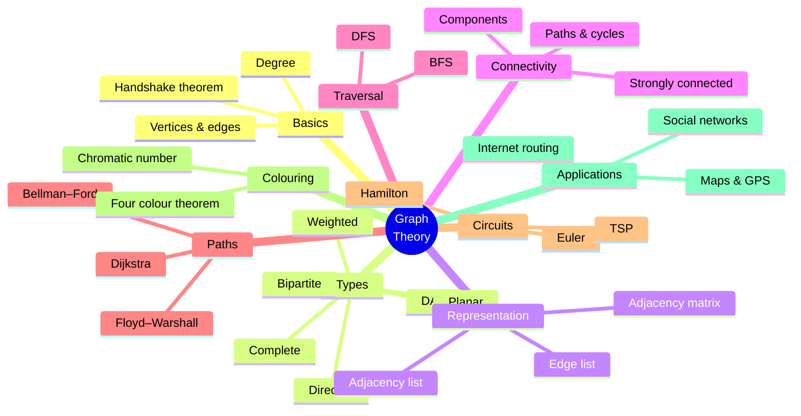
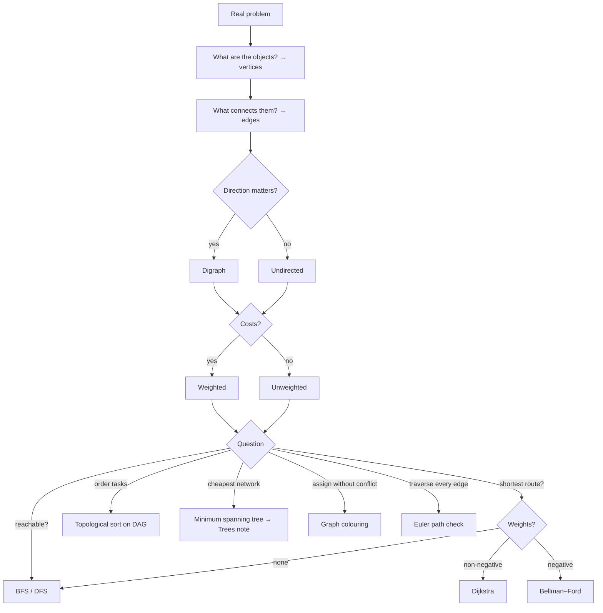

# 12 — Graph Theory

← [[11 - Recurrence Relations]] | [[00 - Discrete Mathematics MOC|MOC]] | Next → [[13 - Trees]]

## 1. Core Concepts

> [!definition] Graph
> A **graph** G = (V, E) consists of a set of **vertices** V and a set of **edges** E, each edge connecting two vertices.

### Types of Graphs

| Type               | Description                                    | Example                    |
| ------------------ | ---------------------------------------------- | -------------------------- |
| Undirected         | Edges {u, v} have no direction                 | Facebook friendships       |
| Directed (digraph) | Edges (u, v) have direction                    | Twitter follows, web links |
| Weighted           | Edges carry a number (cost, distance)          | Road maps                  |
| Simple             | No loops, no multiple edges                    |                            |
| Multigraph         | Multiple edges allowed                         | Flights between cities     |
| Complete Kₙ        | Every pair connected; n(n−1)/2 edges           |                            |
| Bipartite          | V = A ∪ B, edges only between A and B          | Jobs ↔ applicants          |
| Cycle Cₙ, Path Pₙ, Wheel Wₙ, Hypercube Qₙ | Special families        |                            |
| DAG                | Directed acyclic graph                         | Task dependencies          |

### Terminology
- **Degree** deg(v): number of edges at v (loops count twice). Digraphs: in-degree, out-degree.
- **Handshake theorem**: Σ deg(v) = 2|E| ⇒ the number of odd-degree vertices is even.
- **Walk / path / trail / cycle**: walk = any sequence; trail = no repeated edges; path = no repeated vertices; cycle = closed path.
- **Connected**: a path exists between every pair. **Connected components** = maximal connected subgraphs.
- **Strongly connected** (digraph): directed path both ways for every pair.
- **Subgraph**, **isomorphism** (same structure, relabelled vertices).

### Representations

| Representation    | Space     | Edge check | Best for       |
| ----------------- | --------- | ---------- | -------------- |
| Adjacency matrix  | O(V²)     | O(1)       | Dense graphs   |
| Adjacency list    | O(V + E)  | O(deg v)   | Sparse graphs  |
| Edge list         | O(E)      | O(E)       | Kruskal's MST  |

### Example Graph



### Classic Problems

| Problem                        | Question                                       | Answer / algorithm                                       |
| ------------------------------ | ---------------------------------------------- | -------------------------------------------------------- |
| **Euler circuit**              | Use every **edge** exactly once, return home   | Exists ⟺ connected and every degree is even (Euler 1736, Königsberg) |
| **Euler path**                 | Every edge once, not necessarily closed        | Exactly 0 or 2 odd-degree vertices                       |
| **Hamilton circuit**           | Visit every **vertex** exactly once            | NP-complete; Dirac: deg(v) ≥ n/2 suffices                |
| **Shortest path**              | Minimum-weight path                            | BFS (unweighted), Dijkstra (w ≥ 0), Bellman–Ford (negatives) |
| **Graph colouring**            | Colour vertices, adjacent ≠ same               | χ(G); planar graphs need ≤ 4 colours (Four Colour Theorem) |
| **Bipartite test**             | 2-colourable?                                  | BFS; ⟺ no odd cycle                                      |
| **Planarity**                  | Draw without crossings?                        | Euler: V − E + F = 2; K₅ and K₃,₃ are not planar         |
| **Travelling salesman**        | Cheapest Hamilton circuit                      | NP-hard                                                  |
| **Max flow / matching**        | Network capacity, pairing                      | Ford–Fulkerson, Hopcroft–Karp                            |

### Traversals

| BFS (Breadth-First)                   | DFS (Depth-First)                         |
| ------------------------------------- | ----------------------------------------- |
| Queue (FIFO)                          | Stack / recursion (LIFO)                  |
| Explores level by level               | Goes deep first, backtracks               |
| Shortest path in unweighted graphs    | Cycle detection, topological sort, SCCs   |
| O(V + E)                              | O(V + E)                                  |

## 2. Worked Examples

> [!example] Example 1 — Handshake theorem
> A graph has degrees 3, 3, 2, 2, 2. Edges = (3+3+2+2+2)/2 = **6**. Can a graph have degrees 3, 3, 3? No — the sum 9 is odd.

> [!example] Example 2 — Königsberg bridges
> Four land masses with degrees 5, 3, 3, 3 — four odd vertices ⇒ **no Euler path**, so the famous walk is impossible.

> [!example] Example 3 — Dijkstra on the example graph from A
> | Step | Visit | A | B | C | D | E | F |
> |---|---|---|---|---|---|---|---|
> | 0 | — | 0 | ∞ | ∞ | ∞ | ∞ | ∞ |
> | 1 | A | 0 | 4 | 2 | ∞ | ∞ | ∞ |
> | 2 | C | 0 | 4 | 2 | ∞ | 5 | ∞ |
> | 3 | B | 0 | 4 | 2 | 14 | 5 | ∞ |
> | 4 | E | 0 | 4 | 2 | **9** | 5 | ∞ |
> | 5 | D | 0 | 4 | 2 | 9 | 5 | **20** |
> Shortest A→F = 20 via A–C–E–D–F.

> [!example] Example 4 — Euler's formula for planar graphs
> A cube: V = 8, E = 12 ⇒ F = 2 − 8 + 12 = **6** faces ✅.

> [!example] Example 5 — Colouring an exam timetable
> Courses = vertices, edge if a student takes both. The chromatic number = minimum number of exam slots.

## 3. Mind Map



## 4. Workflow — Modelling a Problem as a Graph



## 5. Real-Life Examples

| Application                    | Vertices          | Edges                  | Algorithm                     |
| ------------------------------ | ----------------- | ---------------------- | ----------------------------- |
| Google Maps / GPS              | Intersections     | Roads (weighted)       | Dijkstra, A*                  |
| Internet routing (OSPF)        | Routers           | Links                  | Dijkstra                      |
| Social networks                | People            | Friendships            | BFS (degrees of separation), communities |
| Web search (PageRank)          | Pages             | Hyperlinks (directed)  | Random walks / eigenvectors   |
| Package managers               | Packages          | Dependencies           | Topological sort              |
| Garbage collection             | Objects           | References             | DFS/BFS reachability (mark & sweep) |
| Exam / register scheduling     | Courses / variables | Conflicts            | Graph colouring               |
| Garbage truck / snow-plough routes | Intersections | Streets                | Euler circuits (Chinese postman) |
| Recommendation engines         | Users & items     | Interactions (bipartite)| Graph neural nets, random walks |
| Epidemiology                   | People            | Contacts               | Spread simulation             |

## 6. Programming Use Case (Python)

```python
import heapq
from collections import defaultdict, deque

class Graph:
    def __init__(self, directed=False):
        self.directed = directed
        self.adj = defaultdict(dict)        # u -> {v: weight}

    def add_edge(self, u, v, w=1):
        self.adj[u][v] = w
        if not self.directed:
            self.adj[v][u] = w
        else:
            self.adj[v]                      # ensure v exists

    @property
    def vertices(self):
        return set(self.adj)

    def degree(self, v):
        return len(self.adj[v])

    def edge_count(self):
        total = sum(len(n) for n in self.adj.values())
        return total if self.directed else total // 2

def bfs(g, start):
    """Return dict of hop distances from start."""
    dist = {start: 0}
    q = deque([start])
    while q:
        u = q.popleft()
        for v in sorted(g.adj[u]):
            if v not in dist:
                dist[v] = dist[u] + 1
                q.append(v)
    return dist

def dfs(g, start, visited=None, order=None):
    if visited is None:
        visited, order = set(), []
    visited.add(start)
    order.append(start)
    for v in sorted(g.adj[start]):
        if v not in visited:
            dfs(g, v, visited, order)
    return order

def connected_components(g):
    seen, comps = set(), []
    for v in sorted(g.vertices):
        if v not in seen:
            comp = set(bfs(g, v))
            seen |= comp
            comps.append(comp)
    return comps

def dijkstra(g, source):
    dist = {v: float("inf") for v in g.vertices}
    prev = {v: None for v in g.vertices}
    dist[source] = 0
    pq = [(0, source)]
    while pq:
        d, u = heapq.heappop(pq)
        if d > dist[u]:
            continue
        for v, w in g.adj[u].items():
            if d + w < dist[v]:
                dist[v], prev[v] = d + w, u
                heapq.heappush(pq, (dist[v], v))
    return dist, prev

def shortest_path(g, s, t):
    dist, prev = dijkstra(g, s)
    path, node = [], t
    while node is not None:
        path.append(node)
        node = prev[node]
    return dist[t], path[::-1]

def is_bipartite(g):
    color = {}
    for s in g.vertices:
        if s in color:
            continue
        color[s] = 0
        q = deque([s])
        while q:
            u = q.popleft()
            for v in g.adj[u]:
                if v not in color:
                    color[v] = 1 - color[u]
                    q.append(v)
                elif color[v] == color[u]:
                    return False
    return True

def euler_status(g):
    """'circuit', 'path', or 'none' for an undirected graph (isolated vertices ignored)."""
    if sum(1 for comp in connected_components(g) if len(comp) > 1) > 1:
        return "none"
    odd = sum(1 for v in g.vertices if g.degree(v) % 2)
    return "circuit" if odd == 0 else "path" if odd == 2 else "none"

def greedy_coloring(g):
    """Welsh–Powell: colour high-degree vertices first. Uses ≤ Δ+1 colours."""
    colors = {}
    for v in sorted(g.vertices, key=lambda x: (-g.degree(x), x)):
        used = {colors[u] for u in g.adj[v] if u in colors}
        colors[v] = next(c for c in range(len(g.vertices)) if c not in used)
    return colors

def has_cycle_directed(g):
    WHITE, GREY, BLACK = 0, 1, 2
    state = {v: WHITE for v in g.vertices}
    def visit(u):
        state[u] = GREY
        for v in g.adj[u]:
            if state[v] == GREY or (state[v] == WHITE and visit(v)):
                return True
        state[u] = BLACK
        return False
    return any(state[v] == WHITE and visit(v) for v in list(g.vertices))
```

### Real use: degrees of separation & exam scheduling

```python
def degrees_of_separation(friendships, a, b):
    g = Graph()
    for u, v in friendships:
        g.add_edge(u, v)
    return bfs(g, a).get(b)     # None if not connected

def exam_slots(conflicts):
    g = Graph()
    for c1, c2 in conflicts:
        g.add_edge(c1, c2)
    coloring = greedy_coloring(g)
    slots = defaultdict(list)
    for course, slot in coloring.items():
        slots[slot].append(course)
    return {s: sorted(cs) for s, cs in slots.items()}
```

## 7. Test Cases

```python
def build_example():
    g = Graph()
    for u, v, w in [("A","B",4), ("A","C",2), ("B","C",5), ("B","D",10), ("C","E",3), ("E","D",4), ("D","F",11)]:
        g.add_edge(u, v, w)
    return g

def test_handshake():
    g = build_example()
    assert sum(g.degree(v) for v in g.vertices) == 2 * g.edge_count()
    assert sum(1 for v in g.vertices if g.degree(v) % 2) % 2 == 0

def test_bfs_dfs():
    g = build_example()
    assert bfs(g, "A") == {"A": 0, "B": 1, "C": 1, "D": 2, "E": 2, "F": 3}
    assert dfs(g, "A") == ["A", "B", "C", "E", "D", "F"]

def test_dijkstra():
    g = build_example()
    dist, path = shortest_path(g, "A", "F")
    assert dist == 20 and path == ["A", "C", "E", "D", "F"]
    assert dijkstra(g, "A")[0]["D"] == 9

def test_components():
    g = Graph()
    g.add_edge(1, 2); g.add_edge(2, 3); g.add_edge(4, 5)
    assert sorted(map(sorted, connected_components(g))) == [[1, 2, 3], [4, 5]]

def test_bipartite():
    square = Graph()
    for u, v in [(1, 2), (2, 3), (3, 4), (4, 1)]:
        square.add_edge(u, v)
    triangle = Graph()
    for u, v in [(1, 2), (2, 3), (3, 1)]:
        triangle.add_edge(u, v)
    assert is_bipartite(square) and not is_bipartite(triangle)   # odd cycle ⇒ not bipartite

def test_euler_konigsberg():
    k = Graph()   # Königsberg multigraph; parallel bridges split by helper nodes I2, I3 (degree 2)
    bridges = [("N","I"), ("N","I2"), ("I2","I"), ("S","I"), ("S","I3"), ("I3","I"), ("N","E"), ("S","E"), ("I","E")]
    for u, v in bridges:
        k.add_edge(u, v)
    odd = sum(1 for v in ["N", "S", "I", "E"] if k.degree(v) % 2)
    assert odd == 4 and euler_status(k) == "none"
    sq = Graph()
    for u, v in [(1, 2), (2, 3), (3, 4), (4, 1)]:
        sq.add_edge(u, v)
    assert euler_status(sq) == "circuit"
    sq.add_edge(1, 3)
    assert euler_status(sq) == "path"

def test_coloring_valid():
    g = build_example()
    col = greedy_coloring(g)
    assert all(col[u] != col[v] for u in g.adj for v in g.adj[u])
    assert len(set(col.values())) <= max(g.degree(v) for v in g.vertices) + 1

def test_directed_cycle():
    dag = Graph(directed=True)
    dag.add_edge("a", "b"); dag.add_edge("b", "c")
    assert not has_cycle_directed(dag)
    dag.add_edge("c", "a")
    assert has_cycle_directed(dag)

def test_complete_graph_edges():
    for n in range(1, 8):
        g = Graph()
        for i in range(n):
            g.adj[i]
            for j in range(i + 1, n):
                g.add_edge(i, j)
        assert g.edge_count() == n * (n - 1) // 2

def test_real_life():
    f = [("ann", "bob"), ("bob", "cat"), ("cat", "dan"), ("eve", "fay")]
    assert degrees_of_separation(f, "ann", "dan") == 3
    assert degrees_of_separation(f, "ann", "eve") is None
    slots = exam_slots([("math", "physics"), ("math", "cs"), ("physics", "cs"), ("art", "math")])
    assert len(slots) == 3          # triangle math–physics–cs forces 3 slots
```

## 8. Practice Problems

1. How many edges does K₁₀ have? Is K₄ planar?
2. Show that every tree with ≥ 2 vertices is bipartite.
3. For which n does Kₙ have an Euler circuit?
4. A planar connected graph has 10 vertices each of degree 3. How many faces?
5. Model a metro map and find the route with fewest stops — which algorithm?

> [!success]- Answers
> 1. 45; yes (K₄ is planar).
> 2. No cycles ⇒ no odd cycles ⇒ bipartite.
> 3. Odd n (every degree n − 1 is even).
> 4. E = 15 ⇒ F = 2 − 10 + 15 = 7.
> 5. BFS (unweighted, counts stops).

## 9. Summary

> [!summary]
> - Graphs model anything with **objects + connections**.
> - Handshake theorem: Σ deg = 2|E|.
> - BFS = shortest hops; DFS = structure (cycles, topological order); Dijkstra = weighted shortest paths.
> - Euler (edges) has an easy degree test; Hamilton (vertices) is NP-complete.
> - Trees are a special case → [[13 - Trees]].
