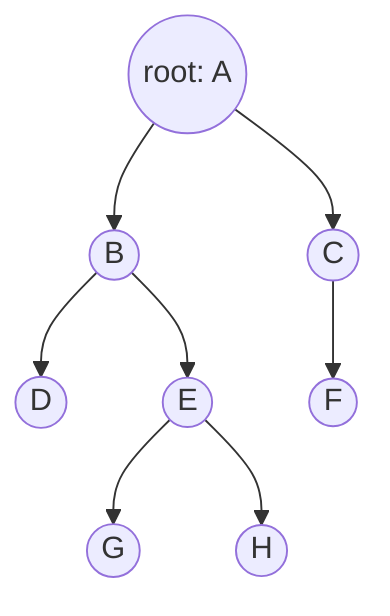
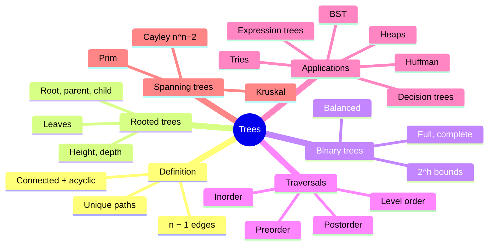
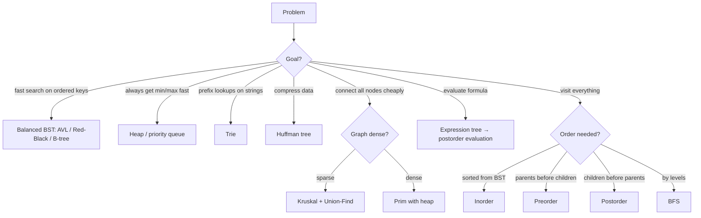

# 13 — Trees

← [[12 - Graph Theory]] | [[00 - Discrete Mathematics MOC|MOC]] | Next → [[14 - Boolean Algebra]]

## 1. Core Concepts

> [!definition] Tree
> A **tree** is a connected undirected graph with **no cycles**. A **forest** is a graph with no cycles (a union of trees).

### Equivalent Characterisations (for a graph with n vertices)
1. G is connected and acyclic.
2. There is a **unique path** between any two vertices.
3. G is connected and has **n − 1 edges**.
4. G is acyclic and has **n − 1 edges**.
5. Removing any edge disconnects G; adding any edge creates exactly one cycle.

### Rooted Tree Vocabulary



| Term          | Meaning                                    | In the diagram        |
| ------------- | ------------------------------------------ | --------------------- |
| Root          | Distinguished top vertex                   | A                     |
| Parent / child| Edge from parent down to child             | B is parent of D, E   |
| Siblings      | Same parent                                | D, E                  |
| Leaf          | No children                                | D, F, G, H            |
| Internal node | Has ≥ 1 child                              | A, B, C, E            |
| Depth / level | Edges from root                            | depth(G) = 3          |
| Height        | Max depth                                  | 3                     |
| Subtree       | A node with all its descendants            | subtree at B          |
| Ancestor / descendant |                                    | A is ancestor of H    |

### m-ary and Binary Trees
- **m-ary**: each node has ≤ m children. **Full**: each internal node has exactly m children.
- Full m-ary tree with i internal nodes has n = mi + 1 nodes and l = (m − 1)i + 1 leaves.
- A binary tree of height h has ≤ 2ʰ⁺¹ − 1 nodes and ≤ 2ʰ leaves ⇒ h ≥ ⌈log₂ l⌉.
- **Balanced** trees keep h = O(log n).

### Tree Traversals

| Traversal  | Order                       | For the diagram above          | Use                         |
| ---------- | --------------------------- | ------------------------------ | --------------------------- |
| Preorder   | node, left, right           | A B D E G H C F                | Copy tree, prefix notation  |
| Inorder    | left, node, right (binary)  | (BST → sorted output)          | Sorted order from BST       |
| Postorder  | left, right, node           | D G H E B F C A                | Delete tree, compute sizes  |
| Level-order| BFS by depth                | A B C D E F G H                | Shortest depth, printing    |

### Important Tree Applications

| Tree                         | Key property                                       |
| ---------------------------- | -------------------------------------------------- |
| **Binary search tree (BST)** | left < node < right ⇒ O(h) search/insert           |
| **Expression tree**          | Leaves = operands, internal = operators            |
| **Decision tree**            | Sorting by comparisons needs ≥ log₂(n!) = Ω(n log n)|
| **Huffman tree**             | Optimal prefix-free code for compression           |
| **Heap**                     | Complete binary tree; parent ≤ children            |
| **Trie**                     | Prefix tree for strings (autocomplete)             |
| **Spanning tree**            | Subgraph that is a tree containing all vertices    |

### Minimum Spanning Tree (MST)
Cheapest set of edges connecting all vertices of a weighted connected graph.

| Algorithm   | Idea                                                              | Complexity      |
| ----------- | ----------------------------------------------------------------- | --------------- |
| **Kruskal** | Sort edges; add the cheapest that doesn't form a cycle (Union-Find)| O(E log E)     |
| **Prim**    | Grow one tree; repeatedly add the cheapest edge leaving it         | O(E log V)     |

**Cayley's formula**: Kₙ has nⁿ⁻² spanning trees.

## 2. Worked Examples

> [!example] Example 1 — Count edges
> A tree with 100 vertices has **99** edges. A forest with 100 vertices and 7 trees has 100 − 7 = **93** edges.

> [!example] Example 2 — Full ternary tree
> A full 3-ary tree with 10 internal nodes has n = 3·10 + 1 = **31** vertices and l = 2·10 + 1 = **21** leaves.

> [!example] Example 3 — Build a BST from 50, 30, 70, 20, 40, 60, 80
> ```mermaid
> graph TD
>     50 --> 30
>     50 --> 70
>     30 --> 20
>     30 --> 40
>     70 --> 60
>     70 --> 80
> ```
> Inorder: 20 30 40 50 60 70 80 (sorted ✅). Height = 2.

> [!example] Example 4 — Expression tree for (3 + 4) × (5 − 2)
> Preorder (prefix): × + 3 4 − 5 2. Postorder (RPN): 3 4 + 5 2 − ×. Value = **21**.

> [!example] Example 5 — Kruskal
> Edges: A–C 2, C–E 3, A–B 4, E–D 4, B–C 5, B–D 10, D–F 11.
> Take A–C(2), C–E(3), A–B(4), E–D(4); skip B–C (cycle), skip B–D (cycle); take D–F(11).
> MST weight = 2 + 3 + 4 + 4 + 11 = **24**.

> [!example] Example 6 — Huffman coding
> Frequencies: a:45, b:13, c:12, d:16, e:9, f:5.
> Merge f+e=14, c+b=25, 14+d=30, 25+30=55, a+55=100.
> Codes (one valid assignment): a=0, c=100, b=101, f=1100, e=1101, d=111. Average length = 2.24 bits vs 3 bits fixed.

## 3. Mind Map



## 4. Workflow — Choosing a Tree Algorithm



## 5. Real-Life Examples

| Real system                         | Tree used                                       |
| ----------------------------------- | ----------------------------------------------- |
| File systems (folders/files)        | Rooted tree; `du` uses postorder                |
| HTML / XML DOM                      | Rooted ordered tree                             |
| Database indexes (MySQL, PostgreSQL)| B+ trees — balanced, high fan-out               |
| ZIP, JPEG, MP3 compression          | Huffman coding                                  |
| Autocomplete / spell check          | Tries                                           |
| Company org chart, family tree      | Rooted trees                                    |
| Compilers                           | Abstract syntax trees (expression trees)        |
| Network design (cables, pipelines)  | Minimum spanning trees                          |
| Machine learning                    | Decision trees, random forests                  |
| Tournament brackets                 | Full binary tree: n teams ⇒ n − 1 matches       |
| Git history (without merges)        | Tree of commits                                 |

## 6. Programming Use Case (Python)

```python
import heapq
from collections import deque, Counter

class Node:
    def __init__(self, key, left=None, right=None):
        self.key, self.left, self.right = key, left, right

class BST:
    def __init__(self):
        self.root = None

    def insert(self, key):
        def _ins(node, key):
            if node is None:
                return Node(key)
            if key < node.key:
                node.left = _ins(node.left, key)
            elif key > node.key:
                node.right = _ins(node.right, key)
            return node
        self.root = _ins(self.root, key)

    def contains(self, key):
        node = self.root
        while node:
            if key == node.key:
                return True
            node = node.left if key < node.key else node.right
        return False

def inorder(n):
    return inorder(n.left) + [n.key] + inorder(n.right) if n else []

def preorder(n):
    return [n.key] + preorder(n.left) + preorder(n.right) if n else []

def postorder(n):
    return postorder(n.left) + postorder(n.right) + [n.key] if n else []

def level_order(root):
    out, q = [], deque([root] if root else [])
    while q:
        n = q.popleft()
        out.append(n.key)
        q.extend(c for c in (n.left, n.right) if c)
    return out

def height(n):
    return -1 if n is None else 1 + max(height(n.left), height(n.right))

def count_nodes(n):
    return 0 if n is None else 1 + count_nodes(n.left) + count_nodes(n.right)

def evaluate(n):
    """Evaluate an expression tree (postorder)."""
    if n.left is None and n.right is None:
        return n.key
    a, b = evaluate(n.left), evaluate(n.right)
    return {"+": a + b, "-": a - b, "*": a * b, "/": a / b}[n.key]

def is_tree(n_vertices, edges):
    """Connected with n−1 edges ⇔ tree."""
    if len(edges) != n_vertices - 1:
        return False
    parent = list(range(n_vertices))
    def find(x):
        while parent[x] != x:
            parent[x] = parent[parent[x]]
            x = parent[x]
        return x
    for u, v in edges:
        ru, rv = find(u), find(v)
        if ru == rv:
            return False        # cycle
        parent[ru] = rv
    return True

def kruskal(vertices, edges):
    """edges: (w, u, v). Returns (total_weight, chosen_edges)."""
    parent = {v: v for v in vertices}
    def find(x):
        while parent[x] != x:
            parent[x] = parent[parent[x]]
            x = parent[x]
        return x
    total, mst = 0, []
    for w, u, v in sorted(edges):
        ru, rv = find(u), find(v)
        if ru != rv:
            parent[ru] = rv
            total += w
            mst.append((u, v, w))
    return total, mst

def prim(adj, start):
    """adj: u -> {v: w}. Returns total MST weight."""
    visited, total = {start}, 0
    pq = [(w, v) for v, w in adj[start].items()]
    heapq.heapify(pq)
    while pq and len(visited) < len(adj):
        w, v = heapq.heappop(pq)
        if v in visited:
            continue
        visited.add(v)
        total += w
        for x, wx in adj[v].items():
            if x not in visited:
                heapq.heappush(pq, (wx, x))
    return total
```

### Real use: Huffman compression and a trie for autocomplete

```python
def huffman_codes(text_or_freq):
    freq = Counter(text_or_freq) if isinstance(text_or_freq, str) else dict(text_or_freq)
    heap = [(f, i, {ch: ""}) for i, (ch, f) in enumerate(sorted(freq.items()))]
    heapq.heapify(heap)
    if len(heap) == 1:
        return {ch: "0" for ch in freq}
    counter = len(heap)
    while len(heap) > 1:
        f1, _, c1 = heapq.heappop(heap)
        f2, _, c2 = heapq.heappop(heap)
        merged = {ch: "0" + code for ch, code in c1.items()}
        merged.update({ch: "1" + code for ch, code in c2.items()})
        heapq.heappush(heap, (f1 + f2, counter, merged))
        counter += 1
    return heap[0][2]

def is_prefix_free(codes):
    cs = list(codes.values())
    return not any(a != b and b.startswith(a) for a in cs for b in cs)

class Trie:
    def __init__(self):
        self.children, self.end = {}, False

    def insert(self, word):
        node = self
        for ch in word:
            node = node.children.setdefault(ch, Trie())
        node.end = True

    def complete(self, prefix):
        node = self
        for ch in prefix:
            if ch not in node.children:
                return []
            node = node.children[ch]
        out = []
        def walk(n, acc):           # preorder traversal
            if n.end:
                out.append(acc)
            for ch in sorted(n.children):
                walk(n.children[ch], acc + ch)
        walk(node, prefix)
        return out
```

## 7. Test Cases

```python
def sample_tree():
    #        A
    #      B   C
    #     D E   F
    #      G H
    return Node("A", Node("B", Node("D"), Node("E", Node("G"), Node("H"))), Node("C", None, Node("F")))

def test_traversals():
    t = sample_tree()
    assert preorder(t) == list("ABDEGHCF")
    assert postorder(t) == list("DGHEBFCA")
    assert level_order(t) == list("ABCDEFGH")
    assert height(t) == 3 and count_nodes(t) == 8

def test_bst():
    bst = BST()
    for k in [50, 30, 70, 20, 40, 60, 80]:
        bst.insert(k)
    assert inorder(bst.root) == [20, 30, 40, 50, 60, 70, 80]
    assert height(bst.root) == 2
    assert bst.contains(60) and not bst.contains(65)

def test_bst_degenerate_height():
    bst = BST()
    for k in range(10):          # sorted inserts ⇒ a path, height n−1
        bst.insert(k)
    assert height(bst.root) == 9

def test_binary_tree_bounds():
    t = sample_tree()
    assert count_nodes(t) <= 2 ** (height(t) + 1) - 1

def test_expression_tree():
    expr = Node("*", Node("+", Node(3), Node(4)), Node("-", Node(5), Node(2)))
    assert evaluate(expr) == 21
    assert postorder(expr) == [3, 4, "+", 5, 2, "-", "*"]

def test_is_tree():
    assert is_tree(4, [(0, 1), (1, 2), (1, 3)])
    assert not is_tree(4, [(0, 1), (1, 2), (2, 0)])          # cycle + disconnected
    assert not is_tree(4, [(0, 1), (1, 2)])                  # too few edges

def test_mst_kruskal_and_prim_agree():
    edges = [(4, "A", "B"), (2, "A", "C"), (5, "B", "C"), (10, "B", "D"), (3, "C", "E"), (4, "E", "D"), (11, "D", "F")]
    V = {"A", "B", "C", "D", "E", "F"}
    total, mst = kruskal(V, edges)
    assert total == 24 and len(mst) == len(V) - 1
    adj = {v: {} for v in V}
    for w, u, v in edges:
        adj[u][v] = w; adj[v][u] = w
    assert prim(adj, "A") == 24

def test_cayley_small():
    from itertools import combinations
    for n in range(2, 6):
        all_edges = list(combinations(range(n), 2))
        count = sum(is_tree(n, list(es)) for es in combinations(all_edges, n - 1))
        assert count == n ** (n - 2)

def test_huffman():
    freq = {"a": 45, "b": 13, "c": 12, "d": 16, "e": 9, "f": 5}
    codes = huffman_codes(freq)
    assert is_prefix_free(codes)
    avg = sum(freq[c] * len(codes[c]) for c in freq) / sum(freq.values())
    assert abs(avg - 2.24) < 1e-9
    text = "abracadabra"
    c2 = huffman_codes(text)
    encoded = "".join(c2[ch] for ch in text)
    assert len(encoded) < 8 * len(text)

def test_trie():
    t = Trie()
    for w in ["car", "card", "care", "cat", "dog"]:
        t.insert(w)
    assert t.complete("car") == ["car", "card", "care"]
    assert t.complete("do") == ["dog"]
    assert t.complete("x") == []
```

## 8. Practice Problems

1. How many edges does a forest with 50 vertices and 4 components have?
2. A full binary tree has 63 leaves. How many internal nodes?
3. Insert 15, 10, 20, 8, 12, 25 into an empty BST and give the preorder traversal.
4. Why does any comparison sort need Ω(n log n) comparisons in the worst case?
5. Find the number of spanning trees of K₅.

> [!success]- Answers
> 1. 46.
> 2. 62 (l = i + 1).
> 3. 15 10 8 12 20 25.
> 4. The decision tree has ≥ n! leaves ⇒ height ≥ log₂(n!) = Θ(n log n).
> 5. 5³ = 125.

## 9. Summary

> [!summary]
> - Tree ⟺ connected + acyclic ⟺ n − 1 edges and connected.
> - Traversals: pre/in/post-order (DFS) and level-order (BFS).
> - BSTs, heaps, tries, Huffman trees, B-trees power real software.
> - MST: Kruskal (edges + Union-Find) or Prim (grow from a vertex).
> - Decision trees give lower bounds; balanced trees give O(log n) operations.
