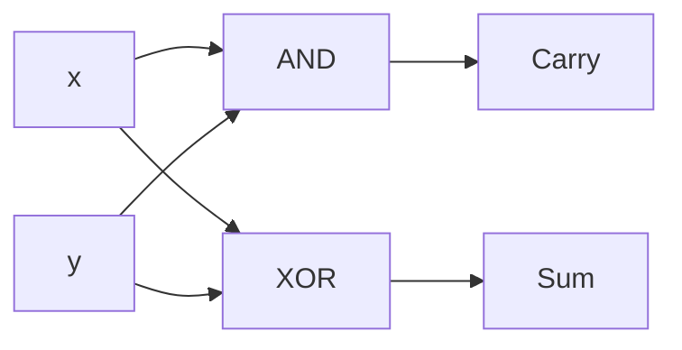
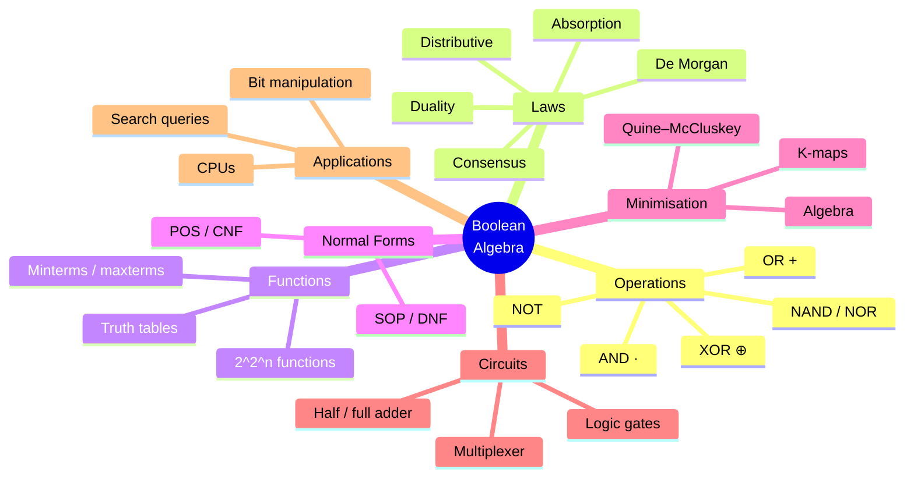
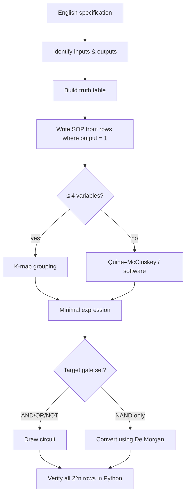

# 14 — Boolean Algebra

← [[13 - Trees]] | [[00 - Discrete Mathematics MOC|MOC]] | Next → [[15 - Finite Automata and Regular Languages]]

## 1. Core Concepts

> [!definition] Boolean algebra
> The algebra of the set B = {0, 1} with operations **+** (OR), **·** (AND) and **‾** (NOT, complement). It is the same structure as [[01 - Propositional Logic|propositional logic]] (T/F) and [[04 - Sets|set algebra]] (∪, ∩, complement).

| Logic | Sets | Boolean | Python (bits) | Gate |
| ----- | ---- | ------- | ------------- | ---- |
| ∨     | ∪    | x + y   | `x \| y`      | OR   |
| ∧     | ∩    | x · y   | `x & y`       | AND  |
| ¬     | Aᶜ   | x̄       | `1 - x` / `~x & 1` | NOT |
| ⊕     | Δ    | x ⊕ y   | `x ^ y`       | XOR  |

### Laws of Boolean Algebra

| Law            | AND form                 | OR form                    |
| -------------- | ------------------------ | -------------------------- |
| Identity       | x · 1 = x                | x + 0 = x                  |
| Domination     | x · 0 = 0                | x + 1 = 1                  |
| Idempotent     | x · x = x                | x + x = x                  |
| Complement     | x · x̄ = 0                | x + x̄ = 1                  |
| Involution     | (x̄)‾ = x                 |                            |
| Commutative    | xy = yx                  | x + y = y + x              |
| Distributive   | x(y + z) = xy + xz       | x + yz = (x + y)(x + z) ⚠️ |
| De Morgan      | (xy)‾ = x̄ + ȳ            | (x + y)‾ = x̄ȳ              |
| Absorption     | x(x + y) = x             | x + xy = x                 |
| Consensus      | xy + x̄z + yz = xy + x̄z   |                            |

> [!tip] Duality
> Swap + ↔ · and 0 ↔ 1 in any identity and you get another valid identity.

### Boolean Functions and Normal Forms
- A Boolean function of n variables: Bⁿ → B. There are **2^(2ⁿ)** such functions.
- **Minterm**: AND of all variables (each plain or complemented) — true in exactly one row.
- **Maxterm**: OR of all variables — false in exactly one row.
- **Sum of Products (SOP / DNF)**: OR of the minterms where f = 1.
- **Product of Sums (POS / CNF)**: AND of the maxterms where f = 0.
- **Functional completeness**: {AND, OR, NOT} is complete; so is {NAND} alone, and {NOR} alone.

### Logic Gates


*Half adder: Sum = x ⊕ y, Carry = x · y.*

**Full adder** (adds x, y and carry-in c): Sum = x ⊕ y ⊕ c, Carry-out = xy + c(x ⊕ y). Chain n full adders ⇒ an n-bit **ripple-carry adder**.

### Karnaugh Maps (K-maps)
A grid where adjacent cells differ in one variable (Gray code order 00, 01, 11, 10). Group 1s in rectangles of size 1, 2, 4, 8 (wrapping around edges) — each group becomes one simplified product term.

## 2. Worked Examples

> [!example] Example 1 — Simplify algebraically
> F = xy + xȳ + x̄y
> = x(y + ȳ) + x̄y = x + x̄y = (x + x̄)(x + y) = **x + y**

> [!example] Example 2 — SOP from a truth table (majority function)
> | x | y | z | M |
> |---|---|---|---|
> | 0 | 0 | 0 | 0 |
> | 0 | 0 | 1 | 0 |
> | 0 | 1 | 0 | 0 |
> | 0 | 1 | 1 | 1 |
> | 1 | 0 | 0 | 0 |
> | 1 | 0 | 1 | 1 |
> | 1 | 1 | 0 | 1 |
> | 1 | 1 | 1 | 1 |
> SOP: M = x̄yz + xȳz + xyz̄ + xyz ⇒ simplified **M = xy + xz + yz**.

> [!example] Example 3 — K-map for F(x, y, z) = Σm(0, 2, 4, 5, 6)
> ```
>          yz=00  01  11  10
>   x=0  |  1    0   0   1  |
>   x=1  |  1    1   0   1  |
> ```
> Groups: four corners column-pair {00,10} for both rows ⇒ **z̄**; cells (x=1, yz=00,01) ⇒ **xȳ**.
> F = **z̄ + xȳ**.

> [!example] Example 4 — NOT, AND and OR from NAND only
> x̄ = x NAND x; xy = (x NAND y) NAND (x NAND y); x + y = (x NAND x) NAND (y NAND y).

> [!example] Example 5 — Binary addition with full adders
> 0110 (6) + 0111 (7): bit 0: 0+1 = 1 c0; bit 1: 1+1 = 0 c1; bit 2: 1+1+1 = 1 c1; bit 3: 0+0+1 = 1 ⇒ **1101 (13)**.

## 3. Mind Map



## 4. Workflow — From Specification to Circuit



## 5. Real-Life Examples

| Application                          | Boolean algebra role                                         |
| ------------------------------------ | ------------------------------------------------------------ |
| CPU arithmetic (ALU)                 | Adders, comparators built from gates                         |
| Memory chips, multiplexers           | Address decoding with AND/NOT                                |
| Staircase light (two switches)       | Light = a ⊕ b                                                |
| Car seat-belt warning                | Alarm = ignition · driver_present · belt̄                     |
| Elevator / traffic-light controllers | Boolean functions of sensor inputs                           |
| Feature flags, permission bitmasks   | `perms & WRITE`, `flags \| DEBUG`                            |
| Database query optimisers            | Rewrite WHERE clauses with De Morgan / absorption            |
| Graphics: masking, XOR cursor        | Bitwise ops                                                  |
| Error detection (parity bit)         | Parity = XOR of all bits                                     |

## 6. Programming Use Case (Python)

```python
from itertools import product

def truth_table(f, n):
    return [(bits, f(*bits)) for bits in product((0, 1), repeat=n)]

def sop(f, names):
    """Canonical sum-of-products string from f."""
    terms = []
    for bits, out in truth_table(f, len(names)):
        if out:
            terms.append("".join(v if b else v + "'" for v, b in zip(names, bits)))
    return " + ".join(terms) if terms else "0"

def pos(f, names):
    """Canonical product-of-sums string from f."""
    terms = []
    for bits, out in truth_table(f, len(names)):
        if not out:
            terms.append("(" + " + ".join(v + "'" if b else v for v, b in zip(names, bits)) + ")")
    return "".join(terms) if terms else "1"

def equivalent(f, g, n):
    return all(f(*b) == g(*b) for b in product((0, 1), repeat=n))

def NAND(a, b):
    return 1 - (a & b)

def NOT_n(a):
    return NAND(a, a)

def AND_n(a, b):
    return NAND(NAND(a, b), NAND(a, b))

def OR_n(a, b):
    return NAND(NAND(a, a), NAND(b, b))

def half_adder(a, b):
    return a ^ b, a & b                       # (sum, carry)

def full_adder(a, b, c):
    s1, c1 = half_adder(a, b)
    s, c2 = half_adder(s1, c)
    return s, c1 | c2

def ripple_add(x: int, y: int, bits=8):
    """Add two integers using only full adders, bit by bit."""
    carry, result = 0, 0
    for i in range(bits):
        s, carry = full_adder((x >> i) & 1, (y >> i) & 1, carry)
        result |= s << i
    return result, carry                      # carry = overflow bit

def parity_bit(data: int) -> int:
    p = 0
    while data:
        p ^= data & 1
        data >>= 1
    return p
```

### Real use: permission bitmasks

```python
READ, WRITE, EXECUTE, ADMIN = 1, 2, 4, 8

def grant(perms, flag):
    return perms | flag

def revoke(perms, flag):
    return perms & ~flag

def has(perms, flag):
    return perms & flag == flag

def staircase_light(switch_a, switch_b):
    return switch_a ^ switch_b

def seatbelt_alarm(ignition, driver, belt):
    return ignition & driver & (1 - belt)
```

## 7. Test Cases

```python
def test_simplification():
    assert equivalent(lambda x, y: (x & y) | (x & (1 - y)) | ((1 - x) & y), lambda x, y: x | y, 2)

def test_majority():
    maj = lambda x, y, z: int(x + y + z >= 2)
    assert equivalent(maj, lambda x, y, z: (x & y) | (x & z) | (y & z), 3)
    assert sop(maj, "xyz") == "x'yz + xy'z + xyz' + xyz"

def test_kmap_result():
    minterms = {0, 2, 4, 5, 6}
    f = lambda x, y, z: int((x << 2 | y << 1 | z) in minterms)
    assert equivalent(f, lambda x, y, z: (1 - z) | (x & (1 - y)), 3)

def test_de_morgan_and_laws():
    assert equivalent(lambda x, y: 1 - (x & y), lambda x, y: (1 - x) | (1 - y), 2)
    assert equivalent(lambda x, y: 1 - (x | y), lambda x, y: (1 - x) & (1 - y), 2)
    assert equivalent(lambda x, y, z: x | (y & z), lambda x, y, z: (x | y) & (x | z), 3)   # OR distributes
    assert equivalent(lambda x, y: x | (x & y), lambda x, y: x, 2)                        # absorption
    assert equivalent(lambda x, y, z: (x & y) | ((1 - x) & z) | (y & z),
                      lambda x, y, z: (x & y) | ((1 - x) & z), 3)                         # consensus

def test_pos():
    assert pos(lambda x, y: x | y, "xy") == "(x + y)"
    assert pos(lambda x, y: x & y, "xy") == "(x + y)(x + y')(x' + y)"

def test_nand_complete():
    assert equivalent(NOT_n, lambda a: 1 - a, 1)
    assert equivalent(AND_n, lambda a, b: a & b, 2)
    assert equivalent(OR_n, lambda a, b: a | b, 2)

def test_adders():
    assert half_adder(1, 1) == (0, 1)
    assert all(full_adder(a, b, c) == ((a + b + c) % 2, (a + b + c) // 2) for a, b, c in product((0, 1), repeat=3))
    assert ripple_add(6, 7, 4) == (13, 0)
    assert all(ripple_add(x, y)[0] == (x + y) % 256 for x in range(0, 256, 7) for y in range(0, 256, 11))
    assert ripple_add(200, 100) == (44, 1)    # overflow

def test_number_of_boolean_functions():
    n = 2
    tables = set(product((0, 1), repeat=2 ** n))
    assert len(tables) == 2 ** (2 ** n) == 16

def test_parity():
    assert parity_bit(0b1011) == 1 and parity_bit(0b1001) == 0

def test_bitmasks():
    p = grant(grant(0, READ), WRITE)
    assert has(p, READ) and has(p, WRITE) and not has(p, ADMIN)
    p = revoke(p, WRITE)
    assert not has(p, WRITE) and has(p, READ)

def test_real_life_circuits():
    assert [staircase_light(a, b) for a, b in product((0, 1), repeat=2)] == [0, 1, 1, 0]
    assert seatbelt_alarm(1, 1, 0) == 1 and seatbelt_alarm(1, 1, 1) == 0 and seatbelt_alarm(0, 1, 0) == 0
```

## 8. Practice Problems

1. Simplify x̄ȳz + x̄yz + xȳz.
2. Express XOR using only AND, OR, NOT.
3. Find a minimal SOP for F(w,x,y,z) = Σm(0, 1, 2, 3, 8, 9, 10, 11).
4. Design a circuit that outputs 1 when a 3-bit number is ≥ 5.
5. How many Boolean functions of 3 variables exist?

> [!success]- Answers
> 1. z(x̄ + ȳ).
> 2. x ⊕ y = xȳ + x̄y.
> 3. x̄.
> 4. F = x(y + z) where x is the MSB.
> 5. 2⁸ = 256.

## 9. Summary

> [!summary]
> - Boolean algebra = logic = set algebra with different symbols.
> - Every function has a canonical SOP/POS; minimise with algebra or K-maps.
> - NAND (or NOR) alone is functionally complete — the basis of chip design.
> - Adders, ALUs, bitmasks, parity and query optimisation all use these laws.
