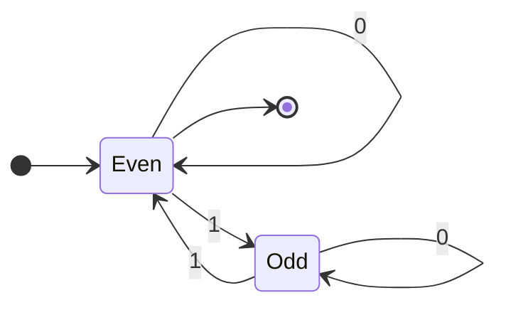
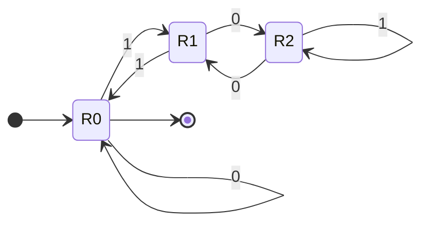
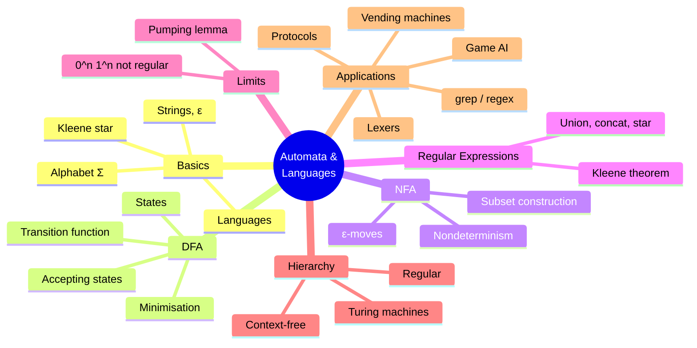
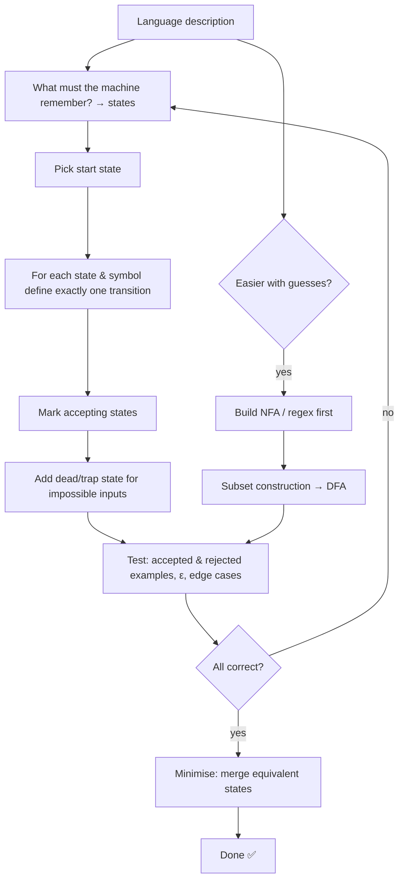

# 15 — Finite Automata and Regular Languages

← [[14 - Boolean Algebra]] | [[00 - Discrete Mathematics MOC|MOC]]

## 1. Core Concepts

### Strings and Languages
- **Alphabet** Σ: finite set of symbols, e.g. {0, 1}.
- **String** (word): finite sequence of symbols; ε = empty string; |w| = length.
- **Σ\***: all strings over Σ (defined [[07 - Mathematical Induction and Recursion|recursively]]).
- **Language** L ⊆ Σ\*: any set of strings (see [[04 - Sets]]).
- Operations: union L₁ ∪ L₂, concatenation L₁L₂, **Kleene star** L\* = {ε} ∪ L ∪ LL ∪ …

> [!definition] Deterministic Finite Automaton (DFA)
> A 5-tuple M = (Q, Σ, δ, q₀, F):
> - Q — finite set of states
> - Σ — input alphabet
> - δ: Q × Σ → Q — transition [[06 - Functions|function]]
> - q₀ ∈ Q — start state
> - F ⊆ Q — accepting (final) states
>
> M **accepts** w if reading w from q₀ ends in a state in F. L(M) = set of accepted strings.

> [!definition] Nondeterministic Finite Automaton (NFA)
> Like a DFA, but δ: Q × (Σ ∪ {ε}) → 𝒫(Q) — zero, one or many next states. Accepts if **some** path ends in F.

### Key Theorems

| Theorem                         | Statement                                                                           |
| ------------------------------- | ----------------------------------------------------------------------------------- |
| NFA = DFA (Rabin–Scott)         | Every NFA has an equivalent DFA (**subset construction**, up to 2ⁿ states)           |
| Kleene's theorem                | Regular expressions, NFAs and DFAs describe exactly the same languages (**regular**) |
| Closure                         | Regular languages are closed under ∪, ∩, complement, concatenation, star            |
| Pumping lemma                   | Used to prove a language is **not** regular, e.g. {0ⁿ1ⁿ}                             |
| Myhill–Nerode                   | Every regular language has a unique minimal DFA                                     |

### Regular Expressions

| Regex       | Language                                 |
| ----------- | ---------------------------------------- |
| `a`         | {a}                                      |
| `ab`        | concatenation {ab}                       |
| `a\|b`      | union {a, b}                             |
| `a*`        | {ε, a, aa, aaa, …}                       |
| `(0\|1)*1`  | binary strings ending in 1               |
| `0*10*`     | exactly one 1                            |
| `(01)*`     | ε, 01, 0101, …                           |

### Chomsky Hierarchy

| Type | Grammar            | Machine                 | Example language   |
| ---- | ------------------ | ----------------------- | ------------------ |
| 3    | Regular            | Finite automaton        | `a*b*`             |
| 2    | Context-free       | Pushdown automaton      | {aⁿbⁿ}, balanced () |
| 1    | Context-sensitive  | Linear-bounded automaton| {aⁿbⁿcⁿ}           |
| 0    | Unrestricted       | Turing machine          | Any computable     |

### Example DFA — binary strings with an even number of 1s


*Even is both the start and the accepting state.*

### Example DFA — binary numbers divisible by 3


*State = value mod 3; reading bit b moves r to (2r + b) mod 3 — [[10 - Number Theory and Cryptography|modular arithmetic]] in a machine.*

## 2. Worked Examples

> [!example] Example 1 — Trace the "divisible by 3" DFA on 110 (= 6)
> R0 --1--> R1 --1--> R0 --0--> R0 ⇒ ends in R0 ⇒ **accepted** ✅

> [!example] Example 2 — DFA for strings containing "ab"
> States: q0 (no progress), q1 (just saw a), q2 (seen "ab", accepting, absorbing).
> δ(q0,a)=q1, δ(q0,b)=q0, δ(q1,a)=q1, δ(q1,b)=q2, δ(q2,·)=q2.

> [!example] Example 3 — Subset construction
> NFA for "ends in 01": q0 –0,1→ q0, q0 –0→ q1, q1 –1→ q2 (accept).
> DFA states: {q0}, {q0,q1}, {q0,q2}.
> {q0} –0→ {q0,q1}, –1→ {q0}; {q0,q1} –0→ {q0,q1}, –1→ {q0,q2}; {q0,q2} –0→ {q0,q1}, –1→ {q0}. Accept {q0,q2}.

> [!example] Example 4 — {0ⁿ1ⁿ | n ≥ 0} is not regular (pumping lemma sketch)
> Suppose a DFA with p states accepts it. Take w = 0ᵖ1ᵖ. Reading the first p zeros visits p + 1 states ⇒ some state repeats ([[08 - Counting and Combinatorics|pigeonhole]]). Looping that segment once more gives 0ᵖ⁺ᵏ1ᵖ, which the DFA also accepts — contradiction. ∎

> [!example] Example 5 — Regex for email-like strings (simplified)
> `[a-z0-9._]+@[a-z0-9]+\.[a-z]{2,}` — a regular language.

## 3. Mind Map



## 4. Workflow — Designing a DFA



## 5. Real-Life Examples

| System                              | Automaton                                                     |
| ----------------------------------- | ------------------------------------------------------------- |
| Vending machine                     | States = credit inserted; inputs = coins; accept = dispense   |
| Traffic lights                      | Cycle of states with timer/sensor transitions                 |
| Turnstile                           | Locked ⇄ Unlocked on coin / push                              |
| Compiler lexer                      | DFA recognises identifiers, numbers, keywords                 |
| `grep`, form validation, log parsing| Regular expressions compiled to automata                      |
| TCP connection                      | Protocol state machine (LISTEN, SYN-SENT, ESTABLISHED, …)     |
| Video game enemy AI                 | Patrol → Chase → Attack → Flee states                         |
| UI flows (checkout, login)          | Screens as states; React/XState state machines                |
| Spam / intrusion detection          | Aho–Corasick automaton for multi-pattern matching             |
| DNA sequence search                 | Pattern-matching automata                                     |

## 6. Programming Use Case (Python)

```python
import re
from itertools import product

class DFA:
    def __init__(self, states, alphabet, delta, start, accepting):
        self.states, self.alphabet = states, alphabet
        self.delta, self.start, self.accepting = delta, start, accepting

    def run(self, word):
        """Return the list of visited states (trace)."""
        q, trace = self.start, [self.start]
        for ch in word:
            if ch not in self.alphabet:
                raise ValueError(f"symbol {ch!r} not in alphabet")
            q = self.delta[(q, ch)]
            trace.append(q)
        return trace

    def accepts(self, word):
        return self.run(word)[-1] in self.accepting

class NFA:
    def __init__(self, states, alphabet, delta, start, accepting):
        self.states, self.alphabet = states, alphabet
        self.delta = delta              # (q, symbol or '') -> set of states
        self.start, self.accepting = start, accepting

    def eps_closure(self, S):
        stack, closure = list(S), set(S)
        while stack:
            q = stack.pop()
            for r in self.delta.get((q, ""), set()):
                if r not in closure:
                    closure.add(r)
                    stack.append(r)
        return frozenset(closure)

    def step(self, S, ch):
        return self.eps_closure({r for q in S for r in self.delta.get((q, ch), set())})

    def accepts(self, word):
        S = self.eps_closure({self.start})
        for ch in word:
            S = self.step(S, ch)
        return bool(S & self.accepting)

    def to_dfa(self):
        """Subset construction."""
        start = self.eps_closure({self.start})
        states, todo, delta = {start}, [start], {}
        while todo:
            S = todo.pop()
            for ch in self.alphabet:
                T = self.step(S, ch)
                delta[(S, ch)] = T
                if T not in states:
                    states.add(T)
                    todo.append(T)
        accepting = {S for S in states if S & self.accepting}
        return DFA(states, self.alphabet, delta, start, accepting)

# Example machines
even_ones = DFA({"E", "O"}, {"0", "1"},
                {("E", "0"): "E", ("E", "1"): "O", ("O", "0"): "O", ("O", "1"): "E"}, "E", {"E"})

div3 = DFA({0, 1, 2}, {"0", "1"},
           {(r, b): (2 * r + int(b)) % 3 for r in range(3) for b in "01"}, 0, {0})

contains_ab = DFA({"q0", "q1", "q2"}, {"a", "b"},
                  {("q0", "a"): "q1", ("q0", "b"): "q0",
                   ("q1", "a"): "q1", ("q1", "b"): "q2",
                   ("q2", "a"): "q2", ("q2", "b"): "q2"}, "q0", {"q2"})

ends_01 = NFA({"q0", "q1", "q2"}, {"0", "1"},
              {("q0", "0"): {"q0", "q1"}, ("q0", "1"): {"q0"}, ("q1", "1"): {"q2"}}, "q0", {"q2"})

def minimize_state_count(dfa):
    """Count states of the minimal DFA via partition refinement (Moore's algorithm)."""
    reachable, todo = {dfa.start}, [dfa.start]
    while todo:
        q = todo.pop()
        for ch in dfa.alphabet:
            r = dfa.delta[(q, ch)]
            if r not in reachable:
                reachable.add(r)
                todo.append(r)
    partition = {q: (q in dfa.accepting) for q in reachable}
    while True:
        sig = {q: (partition[q],) + tuple(partition[dfa.delta[(q, ch)]] for ch in sorted(dfa.alphabet))
               for q in reachable}
        ids = {s: i for i, s in enumerate(sorted(set(sig.values()), key=repr))}
        new = {q: ids[sig[q]] for q in reachable}
        if len(set(new.values())) == len(set(partition.values())):
            return len(set(new.values()))
        partition = new
```

### Real use: a tokenizer (lexer) and a vending-machine FSM

```python
TOKEN_SPEC = [
    ("NUMBER", r"\d+(\.\d+)?"),
    ("IDENT",  r"[A-Za-z_]\w*"),
    ("OP",     r"[+\-*/=()]"),
    ("SKIP",   r"\s+"),
]
TOKEN_RE = re.compile("|".join(f"(?P<{n}>{p})" for n, p in TOKEN_SPEC))

def tokenize(code):
    pos, tokens = 0, []
    while pos < len(code):
        m = TOKEN_RE.match(code, pos)
        if not m:
            raise SyntaxError(f"unexpected character {code[pos]!r} at {pos}")
        if m.lastgroup != "SKIP":
            tokens.append((m.lastgroup, m.group()))
        pos = m.end()
    return tokens

def vending_machine(coins, price=15):
    """States = credit so far (0, 5, 10, 15+). Returns (dispensed, change)."""
    credit = 0
    for c in coins:
        if c not in (5, 10):
            raise ValueError("only 5 and 10 coins accepted")
        credit += c
        if credit >= price:
            return True, credit - price
    return False, credit

EMAIL = re.compile(r"^[a-z0-9._]+@[a-z0-9]+\.[a-z]{2,}$")
```

## 7. Test Cases

```python
def all_strings(alphabet, max_len):
    for n in range(max_len + 1):
        for t in product(sorted(alphabet), repeat=n):
            yield "".join(t)

def test_even_ones():
    assert even_ones.accepts("") and even_ones.accepts("1010") and not even_ones.accepts("111")
    assert all(even_ones.accepts(w) == (w.count("1") % 2 == 0) for w in all_strings("01", 8))

def test_div3():
    assert div3.run("110") == [0, 1, 0, 0]
    assert all(div3.accepts(w) == (int(w or "0", 2) % 3 == 0) for w in all_strings("01", 10))

def test_contains_ab():
    assert all(contains_ab.accepts(w) == ("ab" in w) for w in all_strings("ab", 8))

def test_nfa_and_subset_construction():
    dfa = ends_01.to_dfa()
    for w in all_strings("01", 9):
        assert ends_01.accepts(w) == w.endswith("01") == dfa.accepts(w)
    assert len(dfa.states) == 3

def test_regex_matches_automaton():
    pattern = re.compile(r"(0|1)*01")
    assert all(bool(pattern.fullmatch(w)) == ends_01.accepts(w) for w in all_strings("01", 8))

def test_minimization():
    assert minimize_state_count(div3) == 3
    redundant = DFA({"A", "B", "C"}, {"0", "1"},
                    {("A", "0"): "B", ("A", "1"): "C", ("B", "0"): "B", ("B", "1"): "C",
                     ("C", "0"): "B", ("C", "1"): "C"}, "A", {"C"})
    assert minimize_state_count(redundant) == 2   # A and B are equivalent

def test_pumping_intuition():
    # No DFA with p states can track 0^n 1^n beyond n = p: demonstrate state repetition
    states_seen = div3.run("0" * 5)
    assert len(states_seen) > len(div3.states)    # pigeonhole: some state repeats

def test_invalid_symbol():
    try:
        even_ones.accepts("012")
        assert False
    except ValueError:
        pass

def test_tokenizer():
    assert tokenize("x = 3.14 * (y + 42)") == [
        ("IDENT", "x"), ("OP", "="), ("NUMBER", "3.14"), ("OP", "*"), ("OP", "("),
        ("IDENT", "y"), ("OP", "+"), ("NUMBER", "42"), ("OP", ")")]

def test_vending_machine():
    assert vending_machine([5, 10]) == (True, 0)
    assert vending_machine([10, 10]) == (True, 5)
    assert vending_machine([5, 5]) == (False, 10)

def test_email_regex():
    assert EMAIL.match("student.one@uni.edu")
    assert not EMAIL.match("bad@address")
```

## 8. Practice Problems

1. Design a DFA over {a, b} accepting strings that start and end with the same letter.
2. Write a regex for binary strings with no two consecutive 1s.
3. Convert the NFA for "contains 11" to a DFA.
4. Prove that {ww | w ∈ {0,1}\*} is not regular.
5. Model a turnstile (Locked/Unlocked, inputs coin/push) as a DFA in Python.

> [!success]- Answers
> 1. States: start, A-started (last a / last b), B-started (last a / last b): 5 states.
> 2. `(0|10)*(1|ε)`, i.e. `(0|10)*1?`.
> 3. 3 states: "no 1 yet", "just saw 1", "seen 11" (absorbing, accepting).
> 4. Pump 0ᵖ1 0ᵖ1.
> 5. δ(L, coin)=U, δ(L, push)=L, δ(U, push)=L, δ(U, coin)=U.

## 9. Summary

> [!summary]
> - A DFA reads input one symbol at a time with finite memory (its state).
> - NFA ≡ DFA ≡ regex — the **regular languages** (Kleene's theorem).
> - The pumping lemma (pigeonhole!) shows the limits: no counting without bound.
> - State machines are everywhere: lexers, protocols, UIs, games, vending machines.
> - Ties together sets, functions, graphs, induction and modular arithmetic — back to the [[00 - Discrete Mathematics MOC|MOC]].
